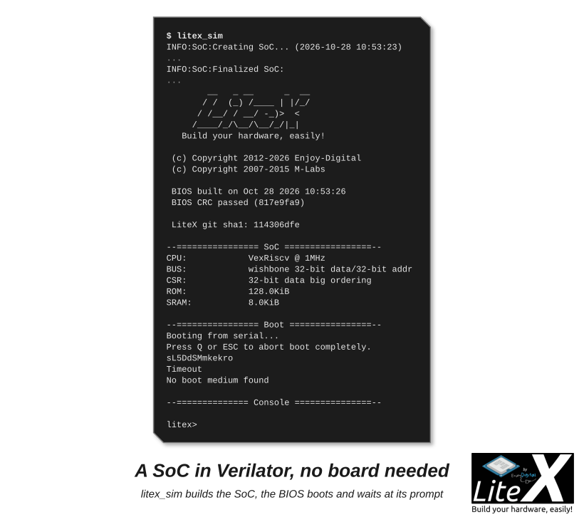

<p align="center"></p>

```
             Copyright 2012-2026 / Enjoy-Digital & LiteX developers
```
[](https://github.com/enjoy-digital/litex/actions)
 [](https://deepwiki.com/enjoy-digital/litex)

<!-- readme:begin -->
# Welcome to LiteX!

The LiteX framework provides a convenient and efficient infrastructure to create FPGA Cores/SoCs, to explore various digital design architectures and create [full FPGA based systems](https://github.com/enjoy-digital/litex/wiki/Projects).

**LiteX SoC builder framework quick tour/overview: [Slides](https://docs.google.com/presentation/d/1mQOWqgmyQxpjLAzFwCulqgkp0TuxmaIDYp5iUfPqqIk/edit?usp=sharing)**

**Want to get started and/or looking for documentation? Make sure to visit the [Wiki](https://github.com/enjoy-digital/litex/wiki)!**

**Want development notes from building FPGA SoCs with LiteX? Visit the [LiteX Notes blog](https://enjoy-digital.github.io/)!**

**A question or want to get in touch? Join us on [Discord](https://discord.gg/PkJwjDbxeG) or on our IRC channel: [#litex at irc.libera.chat]**.

LiteX provides all the common components required to easily create an FPGA Core/SoC:
 - :heavy_check_mark: Buses and Streams (Wishbone, AXI, Avalon-ST) and their interconnect.
 - :heavy_check_mark: Simple cores: RAM, ROM, Timer, UART, JTAG, GPIO, SPI, I2C, PWM, video, USB, HyperRAM, etc...
 - :heavy_check_mark: Complex cores through the ecosystem of cores: [LiteDRAM](https://github.com/enjoy-digital/litedram), [LitePCIe](https://github.com/enjoy-digital/litepcie), [LiteEth](https://github.com/enjoy-digital/liteeth), [LiteSATA](https://github.com/enjoy-digital/litesata), [LiteNVMe](https://github.com/enjoy-digital/litenvme), etc...
 - :heavy_check_mark: Various CPUs & ISAs: RISC-V (VexRiscv, VexiiRiscv, NaxRiscv, Rocket, SERV, ...), OpenRISC, LM32, POWER, MIPS, the hard CPUs of Zynq, Agilex and Cyclone V, X86 (through a PCIe), etc...
 - :heavy_check_mark: Mixed languages support with VHDL/Verilog/SystemVerilog/Amaranth/Spinal-HDL/etc... integration capabilities.
 - :heavy_check_mark: Powerful debug infrastructure through the various [bridges](https://github.com/enjoy-digital/litex/wiki/Host-Bridges) and [LiteScope](https://github.com/enjoy-digital/litescope).
 - :heavy_check_mark: Direct/Fast simulation through [Verilator](https://www.veripool.org/verilator/).
 - :heavy_check_mark: Build backends for open-source and vendor toolchains (Xilinx, Intel, Lattice, Gowin, Efinix, CologneChip, Anlogic, Microsemi, QuickLogic).
 - :heavy_check_mark: And a lot more... :)

# Typical LiteX design flow:
```
                                      +---------------+
                                      |FPGA toolchains|
                                      +----^-----+----+
                                           |     |
                                        +--+-----v--+
                       +-------+        |           |
                       | Migen +-------->           |
                       +-------+        |           |        Your design
                                        |   LiteX   +---> ready to be used!
                                        |           |
              +----------------------+  |           |
              |LiteX Cores Ecosystem +-->           |
              +----------------------+  +-^-------^-+
               (Eth, SATA, DRAM, USB,     |       |
                PCIe, Video, etc...)      +       +
                                         board   target
                                         file    file
```
Your design is two Python files: the *platform* describes the board (pins, clocks, connectors, toolchain, programmer; [LiteX-Boards](https://github.com/litex-hub/litex-boards) has 200+ of them) and the *target* describes your SoC (CPU, memories, peripherals, cores from the ecosystem). The LiteX Builder generates the Verilog and constraints, runs the toolchain (or Verilator), builds the BIOS and generates the software support (`csr.h`, `soc.h`, `mem.h`, `memory.x`, `csr.csv/json/svd`, device trees); the host tools (`litex_term`, `litex_server`/`litex_cli` through a UART, JTAG, Ethernet or PCIe bridge, LiteScope, GDB) control and debug the running SoC.

# Try it in ten minutes

```sh
python3 -m venv ~/litex-venv && source ~/litex-venv/bin/activate
wget https://raw.githubusercontent.com/enjoy-digital/litex/master/litex_setup.py
chmod +x litex_setup.py
./litex_setup.py --init --install --config=standard   # Migen, LiteX, the cores, the boards, the CPUs
./litex_setup.py --gcc=riscv                           # the RISC-V compiler for the BIOS and software
pip3 install meson ninja
litex_sim --cpu-type=vexriscv                          # a SoC in Verilator, no board needed
```



A SoC with a VexRiscv CPU, built and run by Verilator, with the LiteX BIOS waiting at its prompt
in your terminal. Then follow the path, one short page at a time:

1. [Install LiteX](https://github.com/enjoy-digital/litex/wiki/Installation): the toolchains, your board, updates, troubleshooting.
2. [Create a minimal SoC](https://github.com/enjoy-digital/litex/wiki/Create-A-minimal-SoC): the same SoC on your board, from a 40-line Python file.
3. [Write firmware for it](https://github.com/enjoy-digital/litex/wiki/Write-Firmware-For-Your-SoC): the bare-metal demo, built and loaded over the serial port.
4. [Control it from the host](https://github.com/enjoy-digital/litex/wiki/Host-Bridges): read and write the SoC from Python scripts.
5. [Look inside with LiteScope](https://github.com/enjoy-digital/litex/wiki/Use-LiteScope-To-Debug-A-SoC): a logic analyzer inside the design.
6. [Debug the CPU with GDB](https://github.com/enjoy-digital/litex/wiki/Debug-With-GDB): breakpoints in the firmware over JTAG.

By combining LiteX with the ecosystem of cores, creating complex SoCs becomes a lot easier than with traditional approaches while providing better portability and flexibility: Here is for example a Multi-core Linux Capable SoC based on VexRiscv-SMP CPU, LiteDRAM, LiteSATA built and integrated with LiteX, running on a cheap repurposed [Acorn CLE215+ Mining Board](https://github.com/enjoy-digital/litex/wiki/Use-LiteX-on-the-Acorn-CLE-215):

For more info, have a look at [Linux-on-LiteX-Vexriscv](https://github.com/litex-hub/linux-on-litex-vexriscv) project and try running Linux on your FPGA board!

LiteX's digital logic is currently described with [Migen](https://github.com/m-labs/migen) which does not prevent users to create mixed language projects:
- It's very common and easy to integrate VHDL/Verilog/SystemVerilog/Amaranth/Spinal-HDL code in LiteX!
- It's also very common to do the opposite and generate the LiteX design as a verilog file and integrate it in a traditional flow.

LiteX was initially developed by [Enjoy-Digital](http://enjoy-digital.fr/) to create projects for clients (and we are still using it for that :)) and trying to take the different clients' requirements/needs consideration made, we think, the framework very flexible:
 - Some users only want to use it to easily interconnect their existing VHDL/Verilog/SV cores.
 - Some users are only interested to reuse the PCIe/Ethernet/SATA/etc cores as regular core and just integrate them in their traditional flow.
 - Some users with a hardware background start with the above approaches and then switch later to the full Python flow since find it more efficient.
 - Some users with a software background and fluent with Python start playing with FPGAs while they would probably never touch FPGA otherwise :)
 - Etc...

We are well aware that everyone has a different background, so it's up to you to pick the right approach with LiteX that will be convenient for you! [The LiteX approach](https://github.com/enjoy-digital/litex/wiki/LiteX-Approach) describes the way we build with it.

We share this project under a permissive BSD 2-Clause License, inspired by our fantastic community and supportive clients. If LiteX benefits your research, hobby, or commercial projects, we kindly ask for your positive collaboration and respect for the effort involved. The framework is also far from perfect and we'll be happy to have your [feedback or/and contributions](https://github.com/enjoy-digital/litex/wiki/Feedback-Contribution-Support). Have fun! :wink:

# Where to go next

| | |
| --- | --- |
| **Build your SoC** | [Add a new board](https://github.com/enjoy-digital/litex/wiki/Add-A-New-Board), [Add a new core](https://github.com/enjoy-digital/litex/wiki/Add-A-New-Core), [Add a new CPU](https://github.com/enjoy-digital/litex/wiki/Add-A-New-CPU), [Reuse an existing core](https://github.com/enjoy-digital/litex/wiki/Reuse-An-Existing-Core), [Create a complex SoC](https://github.com/enjoy-digital/litex/wiki/Create-A-Complex-SoC), [Create a PCIe SoC](https://github.com/enjoy-digital/litex/wiki/Create-A-PCIe-SoC), [Export to Verilog](https://github.com/enjoy-digital/litex/wiki/Export-To-Verilog), [Simulate your SoC](https://github.com/enjoy-digital/litex/wiki/SoC-Simulator), [Load and flash](https://github.com/enjoy-digital/litex/wiki/Load-And-Flash), [LiteX on the Acorn CLE 215+](https://github.com/enjoy-digital/litex/wiki/Use-LiteX-on-the-Acorn-CLE-215) |
| **Run software on it** | [OSes ecosystem](https://github.com/enjoy-digital/litex/wiki/OSes-Ecosystem), [BIOS](https://github.com/enjoy-digital/litex/wiki/BIOS), [MicroPython](https://github.com/enjoy-digital/litex/wiki/Run-MicroPython-On-Your-SoC), [Zephyr](https://github.com/enjoy-digital/litex/wiki/Run-Zephyr-On-Your-SoC), [Linux](https://github.com/enjoy-digital/litex/wiki/Run-Linux-On-Your-SoC) |
| **How LiteX works** | [The LiteX approach](https://github.com/enjoy-digital/litex/wiki/LiteX-Approach), [SoC builder](https://github.com/enjoy-digital/litex/wiki/SoC-builder), [Choosing a CPU](https://github.com/enjoy-digital/litex/wiki/Choosing-A-CPU), [Wishbone](https://github.com/enjoy-digital/litex/wiki/Wishbone-Bus) / [AXI](https://github.com/enjoy-digital/litex/wiki/AXI-Bus) / [CSR](https://github.com/enjoy-digital/litex/wiki/CSR-Bus) buses, [Streams](https://github.com/enjoy-digital/litex/wiki/Streams), [Verilog to LiteX](https://github.com/enjoy-digital/litex/wiki/LiteX-for-Hardware-Engineers) |
| **Reference** | [CPUs](https://github.com/enjoy-digital/litex/wiki/CPUs), [Hard core CPUs](https://github.com/enjoy-digital/litex/wiki/Hard-core-CPUs), [SoC builder reference](https://github.com/enjoy-digital/litex/wiki/SoC-Builder-Reference), [Cores](https://github.com/enjoy-digital/litex/wiki/Cores), [Cores ecosystem](https://github.com/enjoy-digital/litex/wiki/Cores-Ecosystem), [Build backends](https://github.com/enjoy-digital/litex/wiki/Build-Backends), [Tools](https://github.com/enjoy-digital/litex/wiki/Tools), [SoC documentation](https://github.com/enjoy-digital/litex/wiki/SoC-Documentation) |
| **Projects and community** | [Projects](https://github.com/enjoy-digital/litex/wiki/Projects), [Tutorials and resources](https://github.com/enjoy-digital/litex/wiki/Tutorials-Resources), [Feedback, contribution, support](https://github.com/enjoy-digital/litex/wiki/Feedback-Contribution-Support), [Contributing to the wiki](https://github.com/enjoy-digital/litex/wiki/Contributing-to-the-Wiki) |
| **For AI agents** | [LiteX for AI agents](https://github.com/enjoy-digital/litex/wiki/LiteX-for-AI-Agents) |
<!-- readme:end -->

## 2026.08 highlights

- More ways to build SoCs: Intel Cyclone V/Agilex HPS integration, Gowin AE350 improvements, native AXI/AXI-Lite HyperRAM, and broader framebuffer memory support.
- New hardware building blocks: FPGA temperature monitors, AP Memory PSRAM and Gowin HyperRAM, SPI/parallel LCD, OV5640 camera capture, and I2S audio.
- Better connectivity: packet streams with byte-valid final words, new LiteEth 1000BASE-X/SGMII PHY options, and LitePCIe protocol and DMA improvements.
- More boards and targets, including ModRetro M64/Chromatic, Sipeed Tang Mega 60K, and new Cyclone V/Agilex HPS paths.
- A dedicated release helper and PyPI publishing workflow for the LiteX ecosystem.

See [CHANGES.md](CHANGES.md) for the full list of fixes, additions, and ecosystem updates. LiteJESD204B has been renamed to [LiteJESD204](https://github.com/enjoy-digital/litejesd204); the old Python package remains as a temporary compatibility shim.

# Sponsors/Partners

A huge shoutout to our awesome industrial clients who have given us the green light to incorporate some of the developments we initially created for them directly into LiteX! These innovative developments often provide the building blocks for the features that the wider community can then use and improve upon. Your support has been instrumental for the project, and we are incredibly grateful for your partnership. Thanks!


# Community

<p align="center"></p>

Over the years a friendly community has grown around LiteX and the ecosystem of cores. Feedbacks and contributions have already greatly improved the project, EnjoyDigital still leads the development but it is now a community project and collaborative projects created around/with LiteX can be found at https://github.com/litex-hub.

# Contact

E-mail: florent@enjoy-digital.fr
