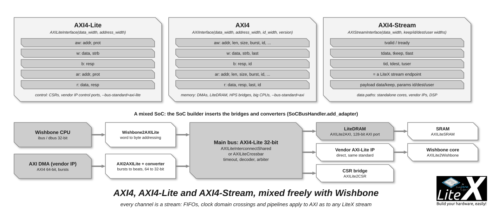

[AXI](https://developer.arm.com/documentation/ihi0022/latest/) is what the vendor IPs, the
hard CPUs (Zynq, Agilex and Cyclone V HPS) and the big soft CPUs (NaxRiscv, VexiiRiscv, Rocket,
CVA6, OpenC906) speak, and LiteX speaks it too: AXI4, AXI4-Lite and AXI4-Stream in
`litex/soc/interconnect/axi/`, with the same interconnects, converters, bridges, SRAM, CDC and
timeout as Wishbone. You meet it when you add one of those, when you pick
`--bus-standard=axi-lite` or `axi` for the main bus, or when you export a core for a Vivado or
Quartus block design; the [SoC builder](SoC-builder.md) inserts the bridges so that masters and
slaves of different standards share one SoC.



*AXI4 for memory traffic, AXI4-Lite for control, AXI4-Stream for data paths; bridges to and
from Wishbone wherever the two meet.*

```sh
python3 -m litex_boards.targets.digilent_arty --cpu-type=naxriscv --build --no-compile-gateware   # an AXI-Lite CPU on a Wishbone bus: the bridge is added for you
```

## The three flavours

Pick from the first column: Lite for control, full for memory, Stream for data.

| Flavour | Channels | Use |
| --- | --- | --- |
| **AXI4-Lite** | `aw`, `w`, `b`, `ar`, `r`; no bursts, no IDs | Control: CSRs, simple peripherals, the control port of a vendor IP. |
| **AXI4** | The five channels with bursts (`len`, `size`, `burst`), IDs, responses | Memory: DMAs, the LiteDRAM AXI port, the HPS bridges, the big CPUs. |
| **AXI4-Stream** | One channel: `tvalid`, `tready`, `tlast`, `tdata`, `tkeep`, `tid`, `tdest`, `tuser` | Data paths: a LiteX [stream](Streams.md) endpoint, it connects to any stream directly. |

```python
from litex.soc.interconnect.axi import *

axi_lite = AXILiteInterface(data_width=32, address_width=32)
axi      = AXIInterface(data_width=128, address_width=32, id_width=4, version="axi4")   # or "axi3"
axis     = AXIStreamInterface(data_width=64, user_width=1)                              # payload data/keep, params id/dest/user

# The ports of a Verilog AXI core: name them axi_*, LiteX connects them:
self.specials += Instance("my_axi_core", **axi.get_ios("s_axi"))   # or axi.connect_to_pads(pads, mode="slave")
```

Every channel of an AXI interface is itself a stream endpoint (`axi.aw.valid`, `axi.aw.addr`...),
which is why the stream blocks (FIFOs, CDCs, pipelines) apply to AXI. AXI addressing is always
in bytes.

## The building blocks

The AXI4-Lite blocks are in `axi_lite.py`, the AXI4 ones in `axi_full.py`, with the same names
and an `AXILite` or `AXI` prefix:

| Block | AXI4-Lite and AXI4 | Purpose |
| --- | --- | --- |
| Interconnects | `InterconnectShared`, `Crossbar`, `InterconnectPointToPoint` | Shared bus or crossbar, with their `Arbiter` and `Decoder`. |
| Memory | `AXILiteSRAM`, `AXISRAM` | A block RAM on the bus. |
| Converters | `Converter` (`Up`, `Down`), `AXIBurst2Beat` | Data width conversion; bursts to single beats for simple slaves. |
| Timing | `ClockDomainCrossing`, `Timeout` | Clock domain crossing, timeout. |
| Addresses | `Remapper`, `Offset` | Address remapping. |
| To CSR | `AXILite2CSR` | The bridge to the [CSR bus](CSR-Bus.md) when the main bus is AXI-Lite. |
| To Wishbone | `AXILite2Wishbone`, `AXI2Wishbone` and back | The bridges between standards. |
| Lite to full | `AXI2AXILite`, `AXILite2AXI` | Between the two AXI flavours. |

The bus handler uses them for you: a Wishbone CPU on an AXI main bus gets a `Wishbone2AXI`,
an AXI-Lite vendor IP on a Wishbone bus an `AXILite2Wishbone`, and the widths are converted on
the way (`SoCBusHandler.add_adapter`). `--bus-low-latency` selects the lower-latency bridges
where they exist. The AXI arbiter can interleave transactions by ID.

## Where AXI appears in a LiteX SoC

- **Vendor and hard IP**: the Zynq-7000 and ZynqMP PS ports, the Cyclone V and Agilex HPS
  bridges, Xilinx MIG and HBM2, Efinix DDR: LiteX adds them as AXI masters or slaves of the
  main bus.
- **CPUs**: NaxRiscv and VexiiRiscv (AXI-Lite peripheral bus, AXI memory and DMA buses),
  Rocket, CVA6, OpenC906, VeeR, Cortex-M, the MIPS cores.
- **LiteDRAM**: `LiteDRAMAXIPort` and `LiteDRAMAXI2Native` give AXI ports on the crossbar for
  the CPUs' memory buses and the DMAs, with full bursts.
- **Standalone cores**: `litex_soc_gen --bus-standard=axi-lite` and the `*_gen` generators
  export the control bus as AXI-Lite and the data paths as AXI-Stream, for a block design
  ([Export to Verilog](Export-To-Verilog.md)).
- **Your logic**: a core with an `AXILiteInterface` and `add_slave`, or a DMA with an
  `AXIInterface` and `add_master`, exactly as with [Wishbone](Wishbone-Bus.md).

## Next

- [Wishbone bus](Wishbone-Bus.md): the default main bus, and the same blocks on it.
- [Streams](Streams.md): what an AXI-Stream is on the LiteX side.
- [Reuse an existing core](Reuse-An-Existing-Core.md): a Verilog AXI core in your SoC.
- [Export to Verilog](Export-To-Verilog.md): a LiteX core with AXI ports in a vendor flow.
