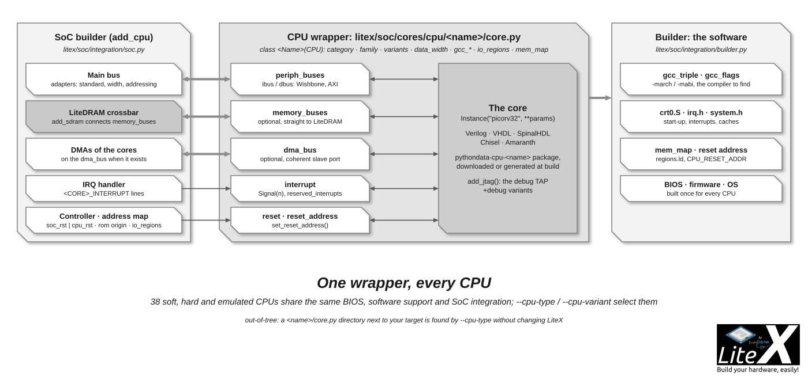

A CPU is a wrapper class in `litex/soc/cores/cpu/<name>/`: it instantiates the core (Verilog,
VHDL, SystemVerilog, SpinalHDL, Chisel or Amaranth sources), exposes its buses as LiteX
interfaces, and tells the SoC builder and the software build what they need to know (memory
map, interrupts, reset address, compiler flags, start-up code). `--cpu-type=<name>` then finds
it and the BIOS boots on it. The thirty-two existing wrappers all look like this: copy
`picorv32/core.py` (150 lines) for a Wishbone core, `cva6/core.py` for an AXI core,
`vexriscv_smp/core.py` for a core generated at build time with options.



## 1. The directory

```
litex/soc/cores/cpu/<name>/      # or <name>/ in the directory where you run the target (out-of-tree)
    __init__.py                  # from .core import <Name>
    core.py                      # the wrapper class
    crt0.S                       # start-up code: stack, .data/.bss init, interrupt vector, call main()
    irq.h  system.h              # the CPU-specific pieces of the software support (interrupt mask/enable, cache flush), csr-defs.h when the CPU has custom CSRs
    boot-helper.S                # the jump to the loaded application (BIOS boot)
```

`collect_cpus()` (`litex/soc/cores/cpu/__init__.py`) registers every directory with a
`core.py` whose class name matches the directory (`picorv32` -> `PicoRV32`), in LiteX and in
the current working directory: an out-of-tree CPU is a directory next to your target, no
change in LiteX needed, `--cpu-type=<name>` finds it. The RISC-V CPUs share `crt0.S`/`irq.h`
patterns with each other (copy from a similar core: same ISA, same interrupt scheme).

## 2. The wrapper (`core.py`)

```python
from litex.soc.cores.cpu import CPU, CPU_GCC_TRIPLE_RISCV32

CPU_VARIANTS = ["minimal", "standard"]
GCC_FLAGS = {"minimal": "-march=rv32i2p0 -mabi=ilp32 ", "standard": "-march=rv32i2p0_m -mabi=ilp32 "}

class PicoRV32(CPU):
    category             = "softcore"              # softcore, hardcore or emulator
    family               = "riscv"                 # riscv, or1k, lm32, ppc64, mips, arm, ...
    name                 = "picorv32"              # the --cpu-type value
    human_name           = "PicoRV32"
    variants             = CPU_VARIANTS
    data_width           = 32
    endianness           = "little"
    gcc_triple           = CPU_GCC_TRIPLE_RISCV32  # the compilers LiteX looks for
    linker_output_format = "elf32-littleriscv"
    nop                  = "nop"
    io_regions           = {0x8000_0000: 0x8000_0000}   # where uncached peripherals may live

    @property
    def gcc_flags(self):
        return "-mno-save-restore " + GCC_FLAGS[self.variant] + "-D__picorv32__ "

    def __init__(self, platform, variant="standard"):
        self.platform     = platform
        self.variant      = variant
        self.reset        = Signal()
        self.interrupt    = Signal(32)
        self.idbus        = idbus = wishbone.Interface(data_width=32, address_width=32, addressing="byte")
        self.periph_buses = [idbus]                 # masters of the main bus
        self.memory_buses = []                      # direct LiteDRAM ports (none here)

        # # #

        mem_valid, mem_ready, mem_addr = Signal(), Signal(), Signal(32)
        self.cpu_params = dict(                     # the Instance parameters and ports
            p_ENABLE_MUL = 1, ...,
            i_clk        = ClockSignal("sys"),
            i_resetn     = ~(ResetSignal("sys") | self.reset),
            o_mem_valid  = mem_valid, i_mem_ready = mem_ready, o_mem_addr = mem_addr, ...
            i_irq        = self.interrupt,
        )
        self.comb += [idbus.adr.eq(mem_addr), idbus.cyc.eq(mem_valid), idbus.stb.eq(mem_valid), ...,
                      mem_ready.eq(idbus.ack)]      # the core's memory interface, adapted to Wishbone
        self.add_sources(platform)

    def set_reset_address(self, reset_address):     # called by the SoC with the ROM origin
        self.reset_address = reset_address
        self.cpu_params.update(p_PROGADDR_RESET=reset_address, p_PROGADDR_IRQ=reset_address + 0x10)

    @staticmethod
    def add_sources(platform):
        vdir = get_data_mod("cpu", "picorv32").data_location
        platform.add_source(os.path.join(vdir, "picorv32.v"))

    def do_finalize(self):
        self.specials += Instance("picorv32", **self.cpu_params)
```

The attributes the SoC builder reads (`CPU` base class in `litex/soc/cores/cpu/__init__.py`):

| Attribute | Meaning |
| --- | --- |
| `periph_buses` | The buses to the main bus: instruction and data, or one shared; any width and standard. |
| `memory_buses` | Optional direct ports to LiteDRAM, for cached CPUs that want the full DRAM bandwidth. |
| `dma_bus` | Optional slave port for coherent DMAs (Linux). |
| `interrupt`, `reserved_interrupts` | The interrupt lines (a `Signal(n)`) and the ones the CPU keeps for itself. |
| `io_regions`, `mem_map` | Where uncached peripherals may live; forced origins when the core imposes them. |
| `reset`, `set_reset_address()` | The SoC resets the CPU; the reset address is the ROM origin by default. |
| `gcc_triple`, `gcc_flags`, `linker_output_format`, `nop` | The software build, with `endianness` and `data_width`. |
| `add_sources()`, `do_finalize()` | The sources (a `pythondata-cpu-*` package, downloaded or generated) and the `Instance`. |
| `args_fill()`, `args_read()` | Optional class methods for CPU-specific options (`--cpu-count`, `--with-fpu`...). |

The optional hooks: `add_jtag()` and `connect_jtag()` for a debug TAP, `add_debug()` for the
debug variants, `add_cfu()` for a custom function unit, `add_soc_components(soc)` for extra
SoC components (a PLIC, a CLINT), `add_software_packages(builder)` and
`prepare_software(builder)` for extra software (a BSP, generated linker scripts). The buses
are `wishbone.Interface`, `AXILiteInterface` or `AXIInterface`, and `add_memory_buses()` is
called by `add_sdram`.

A hard CPU (`category = "hardcore"`) instantiates the vendor processing system instead and
exposes its fabric bridges as `periph_buses` ([Hard core CPUs](Hard-core-CPUs.md)).

## 3. The sources

- **A `pythondata-cpu-<name>` package** (the usual way): the core's sources packaged as a
  Python module in [LiteX-Hub](https://github.com/litex-hub), generated by
  [pythondata-auto](https://github.com/litex-hub/pythondata-auto) from the upstream repository;
  `get_data_mod("cpu", "<name>").data_location` is its path. Add it to
  [litex_repos.py](https://github.com/enjoy-digital/litex/blob/master/litex_repos.py) so
  `litex_setup.py` installs it.
- **Downloaded or cloned at build time** (FemtoRV, NEORV32, uRV, KianV): fine for a first
  integration; pin a commit.
- **Generated at build time** (VexRiscv-SMP, NaxRiscv, VexiiRiscv with sbt; Minerva, Sentinel
  and Coreblocks with Amaranth): the wrapper runs the generator with the variant's parameters
  and caches the netlist; VHDL goes through `VHD2VConverter` (Microwatt, NEORV32).

## 4. The software side

`crt0.S` sets up the stack (`_fstack` from the linker script), copies `.data`, clears `.bss`,
installs the trap/interrupt vector and calls `main()`; `irq.h` implements
`irq_getmask`/`irq_setmask`/`irq_getie`/`irq_setie`/`irq_pending` with the CPU's mechanism
(RISC-V `mie`/`mip` CSRs, a custom CSR, a PLIC...); `system.h` the cache flushes;
`csr-defs.h` the CSR numbers. The `-D__<name>__` define in `gcc_flags` lets the common code
select CPU specifics (`litex/soc/software/include/base/`). The BIOS and the demo build without
change once these exist; `litex/soc/software/bios/boot-helper*.S` may need a variant when the
jump to the application has CPU constraints.

## 5. Test it

```sh
litex_sim --cpu-type=<name> --cpu-variant=standard                      # the BIOS must boot and show its prompt
litex_sim --cpu-type=<name> --with-sdram                                 # memtest, DRAM init
python3 -m litex_boards.targets.<board> --cpu-type=<name> --build --load # a real board: timing, bugs the simulator hides
```

Add the CPU to `TESTED_CPUS` in `test/soc/test_integration.py` (CI boots the BIOS on every
listed CPU with Verilator), and a unit test when the wrapper has logic of its own
(`test/soc/test_cpu_*.py`). Then the pull requests: the `pythondata-cpu-<name>` repository in
LiteX-Hub, the wrapper in LiteX with the `litex_repos.py` entry, and a line in the
[CPUs](CPUs.md) page. Past integrations show the shape of the discussion:
[CV32E40P](https://github.com/enjoy-digital/litex/pull/535),
[FemtoRV](https://github.com/enjoy-digital/litex/commit/b1d8fe61f8613babeb486877a094bff759e31fd0),
[Coreblocks](https://github.com/enjoy-digital/litex/pull/2339).

## Next

- [Choosing a CPU](Choosing-A-CPU.md): what `add_cpu` does with the attributes above.
- [CPUs](CPUs.md): the thirty-two wrappers to compare yours with.
- [Reuse an existing core](Reuse-An-Existing-Core.md): the `Instance` and the sources, in general.
- [SoC simulator](SoC-Simulator.md): boot it there before touching a board.
