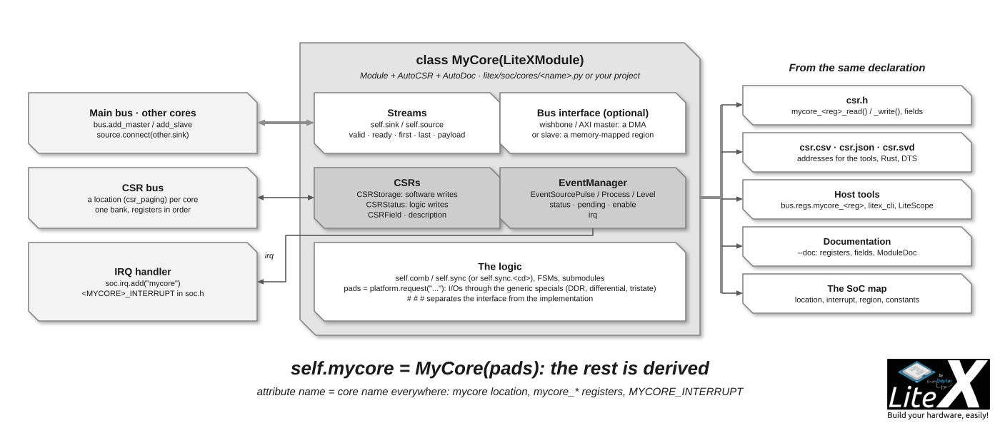

You will write a core of your own, a PWM, with its registers and its interrupt, simulate it
with a Python generator, add it to a SoC in one line and drive it from the firmware and from
the host. A LiteX core is a `LiteXModule`: the logic in Migen, the registers as `CSRStorage`
and `CSRStatus` attributes, the interrupt from an `EventManager`, the data through
[streams](Streams.md) or a [bus](Wishbone-Bus.md) interface; the [SoC builder](SoC-builder.md)
does the rest, the `csr.h` accessors included. Thirty minutes; [Cores](Cores.md) lists the
existing ones to copy from.



## 1. The core

A PWM, simplified from `litex/soc/cores/pwm.py` (the real one adds clock domain crossing, a
configurable counter width and a multi-channel version):

```python
from migen import *
from litex.gen import *
from litex.soc.interconnect.csr import *
from litex.soc.interconnect.csr_eventmanager import *

class PWM(LiteXModule):
    """Pulse Width Modulation.

    Software configures the period and the width (duty cycle) in sys_clk cycles and enables
    the output; an interrupt is raised at the end of each period.
    """
    def __init__(self, pad, counter_width=32):
        self.pad = pad
        # CSRs: the name of the attribute is the name of the register (pwm_enable, pwm_width, ...).
        self.enable = CSRStorage(description="Enable the PWM output.")
        self.width  = CSRStorage(counter_width, description="High time, in ``sys_clk`` cycles.")
        self.period = CSRStorage(counter_width, description="Period, in ``sys_clk`` cycles.")
        self.count  = CSRStatus(counter_width,  description="Current value of the counter.")

        # Interrupt: one event source, raised when the counter wraps.
        self.ev = EventManager()
        self.ev.wrap = EventSourcePulse(description="End of period.")
        self.ev.finalize()

        # # #

        counter = Signal(counter_width)
        self.comb += self.count.status.eq(counter)
        self.sync += [
            self.ev.wrap.trigger.eq(0),
            If(self.enable.storage,
                If(counter < (self.period.storage - 1),
                    counter.eq(counter + 1)
                ).Else(
                    counter.eq(0),
                    self.ev.wrap.trigger.eq(1)
                )
            ).Else(
                counter.eq(0)
            ),
            pad.eq(self.enable.storage & (counter < self.width.storage)),
        ]
```

What matters in it:

- **`LiteXModule`** (`from litex.gen import *`) is `Module` + `AutoCSR` + `AutoDoc`:
  `self.x = Module()` adds a submodule, the CSRs are collected by attribute name, the
  docstrings and `description=` end up in the documentation.
- **CSRs**: `CSRStorage` is written by software and read by the logic (`.storage`, `.wr_stb`
  pulses on a write), `CSRStatus` is written by the logic (`.status`) and read by software
  (`.rd_stb` pulses on a read);
  `fields=[CSRField(...)]` for bit fields, `reset=` for the reset value, `size` up to 64 bits
  (wider registers are split in sub-registers automatically). Keep the names short and
  lowercase: the software sees `<core>_<register>`.
- **`EventManager`**: `EventSourcePulse` (latched until software clears it),
  `EventSourceProcess` (an edge), `EventSourceLevel` (follows a level); `finalize()` after the
  sources are declared; the manager provides the `status`/`pending`/`enable` CSRs and the
  `irq` output.
- The `# # #` line separates the interface (what a SoC sees of the core) from the
  implementation: the [coding style](https://github.com/enjoy-digital/litex/blob/master/doc/coding_style.md)
  describes the layout, the naming and the section banners of a LiteX file.
- Logic in another clock domain: `self.sync.<cd> += ...` and `MultiReg`/`PulseSynchronizer`
  from `litex.gen.genlib.cdc` for the CSRs crossing into it (the real `pwm.py` shows it).

A core that moves data exposes `self.sink`/`self.source` stream endpoints; one that needs
memory access has a `wishbone.Interface`/`AXIInterface` master (a DMA, see
`litex/soc/cores/dma.py`) or slave (a memory-mapped region, see `litex/soc/interconnect/wishbone.py` `SRAM`).

## 2. Simulate it

The Migen simulator runs the module with a Python generator; CSRs have `write()`/`read()`
helpers for simulation:

```python
# test/cores/test_pwm.py
import unittest
from migen import *
from litex.soc.cores.pwm import PWM

class TestPWM(unittest.TestCase):
    def test_duty_cycle(self):
        pad = Signal()
        dut = PWM(pad, counter_width=8)
        highs = []
        def generator():
            yield from dut.period.write(10)
            yield from dut.width.write(3)
            yield from dut.enable.write(1)
            for _ in range(40):
                highs.append((yield pad))
                yield
        run_simulation(dut, generator())
        self.assertEqual(sum(highs[-10:]), 3)         # 3 cycles high per period of 10
```

`python3 -m pytest test/test_pwm.py` (the repositories use `pytest`; `run_simulation(dut,
generator(), vcd_name="sim.vcd")` dumps the waves). A core in a SoC can also be exercised in
[litex_sim](SoC-Simulator.md) with the real BIOS, and on hardware with [LiteScope](Use-LiteScope-To-Debug-A-SoC.md).

## 3. Use it in a SoC

```python
class BaseSoC(SoCCore):
    def __init__(self, ...):
        ...
        self.pwm = PWM(pad=platform.request("user_led", 0))
        self.irq.add("pwm")                 # only for cores with an EventManager
```

The attribute name is the core's name everywhere: `pwm` location on the CSR bus, `pwm_*`
registers, `PWM_INTERRUPT` in `soc.h`. `--doc` documents it, `litex_cli --regs --filter pwm`
shows it. For a core used by many targets, a `soc.add_pwm(name, pads)` helper in the target
(or in `LiteXSoC` upstream) keeps the targets short.

## 4. Use it from software

`csr.h` has the accessors, generated from the same declaration:

```c
#include <generated/csr.h>
#include <irq.h>

pwm_period_write(1000);
pwm_width_write(250);               // 25% duty cycle
pwm_enable_write(1);
printf("count=%d\n", pwm_count_read());

// Interrupt: enable the event and the line, handle it in the ISR.
pwm_ev_enable_write(1);
irq_setmask(irq_getmask() | (1 << PWM_INTERRUPT));
// in isr(): if (irqs & (1 << PWM_INTERRUPT)) { ...; pwm_ev_pending_write(1 << 0); }
```

And from the host through a [bridge](Host-Bridges.md): `bus.regs.pwm_period.write(1000)`.
[Create and load software](Write-Firmware-For-Your-SoC.md) covers the firmware build.

## 5. Where to put it

- In your project: any module in your `PYTHONPATH`; LiteX does not need to know about it.
- In LiteX: `litex/soc/cores/<name>.py` for a generic core, a subpackage for a family
  (`spi/`, `usb2_phy/`), and a helper in `litex/soc/integration/soc.py` when most targets will
  use it; vendor primitives only through the generic specials or in a `<vendor>` adapter
  ([architectural style](https://github.com/enjoy-digital/litex/blob/master/doc/architectural_style.md)).
  Add a test in `test/`, run `pytest`, build one target, and open the pull request with what
  was tested ([Feedback, contribution, support](Feedback-Contribution-Support.md)). The pull
  requests that added [hwmon](https://github.com/enjoy-digital/litex/pulls?q=hwmon),
  the [USB2 soft PHY](https://github.com/enjoy-digital/litex/pull/2641) or the
  [I2C core of LiteEth](https://github.com/enjoy-digital/liteeth/issues/66) are examples of
  the discussion a new core goes through.
- Bigger protocol cores get their own repository, structured like the
  [ecosystem cores](Cores-Ecosystem.md) (`phy/`, `core/`, `frontend/`, `software/`, `gen.py`,
  `test/`).

## Next

- [CSR bus](CSR-Bus.md): what the registers of step 1 become on the bus and in `csr.h`.
- [Use LiteScope](Use-LiteScope-To-Debug-A-SoC.md): the core on hardware, signal by signal.
- [Reuse an existing core](Reuse-An-Existing-Core.md): when the core already exists in Verilog or VHDL.
- [Add a new CPU](Add-A-New-CPU.md): the biggest core of all, wrapped the same way.
