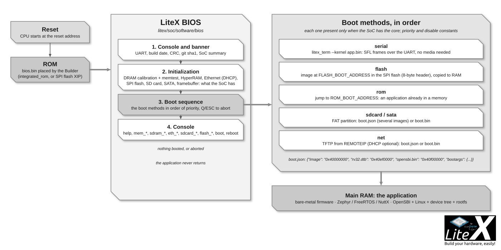
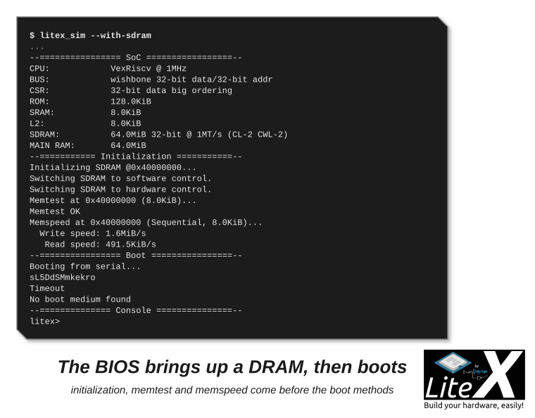

The BIOS is the first program that runs on your SoC, and the one you talk to on a new board:
the Builder compiles it for every SoC with a CPU (`litex/soc/software/bios/`, C on picolibc),
it initializes the SoC (DRAM calibration, Ethernet, storage), gives you a console on the UART
to inspect the hardware, and loads your application through one of the boot methods. It is
the reference user of the generated headers: your firmware is built the same way against the
same `csr.h`, `soc.h` and `mem.h` ([Write firmware for it](Write-Firmware-For-Your-SoC.md)).



*Initialize, try the boot methods in order, drop to the console when none boots.*

```sh
litex_sim --with-sdram          # the BIOS on a SoC with a DRAM model: calibration, memtest, boot, console
```



*The SoC summary, the DRAM brought up and tested, the boot sequence, the prompt.*

## What it does at start-up

1. Enables the interrupts and the UART (the console), the I2C controllers.
2. Prints the banner: build date, BIOS CRC, LiteX git sha1, the SoC summary (CPU, bus, CSR,
   memories, DRAM configuration).
3. Initializes the memories and peripherals the SoC has: HyperRAM, SFP, Ethernet (with DHCP
   when enabled), SPI RAM, then the DRAM (LiteDRAM calibration, memtest and memspeed; a plain
   memtest when the main RAM is a block RAM), the SPI flash, the video framebuffer.
4. Runs the boot sequence (below). If nothing boots, or after `Q`/ESC, it drops to the console.

## The console

Commands have help (`help`, `help <command>`), history and completion. The common ones:

| Group | Commands |
| --- | --- |
| System | `help`, `ident`, `uptime`, `crc`, `leds`, `buttons`, `reboot`, `flush_cpu_dcache`, `flush_l2_cache` |
| Memory | `mem_list`, `mem_read`, `mem_write`, `mem_copy`, `mem_test`, `mem_speed` |
| Boot | `boot <addr>`, `serialboot`, `netboot`, `flashboot`, `romboot`, `sdcardboot`, `sataboot` |
| DRAM (LiteDRAM) | `sdram_init`, `sdram_cal`, `sdram_test`, `sdram_bist`, `sdram_hw_test`, `sdram_spd`, `sdram_debug` |
| Ethernet (LiteEth) | `eth_local_ip`, `eth_remote_ip`, `eth_mac_addr`, `eth_dhcp`, `ping`, `mdio_read`, `mdio_write` |
| Storage | `sdcard_init`, `sdcard_read`, `sdcard_write`; `sata_init`, `sata_read`, `sata_write` |
| Flash (LiteSPI) | `flash_write`, `flash_erase_range`, `flash_from_sdcard` |
| I2C | `i2c_dev`, `i2c_scan`, `i2c_read`, `i2c_write`, `i2c_reset` |

`help <command>` gives the arguments (`mem_write <addr> <value> [count] [size]`, `netboot
[manifest]`...); the DRAM group also has the `sdram_force_*` and `sdram_rst_*` delay and
bitslip controls and `sdram_mr_write`, the Ethernet group `mdio_dump` and the `sfp_mdio_*`
commands and `sfp`, the storage group `sdcard_detect`, `sdcard_freq`, `sata_sec2mem`, `sata_mem2sec` and `sata_rwtest`.
Only the commands of the cores present in the SoC are compiled in.

## Boot methods

The BIOS tries the methods available in the SoC in this order (each has a priority that a
constant can change, and can be disabled):

| Priority | Method | Present when | What it does |
| --- | --- | --- | --- |
| 0 | **serial** | a UART | Prints the magic string and waits for `litex_term --kernel` to upload an image; times out otherwise. |
| 10 | **flash** | `FLASH_BOOT_ADDRESS` | Reads an image (length and CRC header) at that offset, copies it to RAM or runs it in place. |
| 20 | **rom** | `ROM_BOOT_ADDRESS` | Jumps to code already in a memory (an application linked in the ROM with the BIOS). |
| 30 | **sdcard** | LiteSDCard or SPI SD card | Mounts the FAT partition, loads `boot.json` or `boot.bin` (below). |
| 40 | **sata** | LiteSATA | The same with the SATA disk. |
| 50 | **net** | LiteEth MAC | TFTP from `REMOTEIP` (DHCP first when enabled): loads `boot.json` or `boot.bin`. |

`boot.bin` is loaded at the main RAM origin and executed. `boot.json` describes several images
and where to put them (Linux: OpenSBI, the kernel, the device tree, the rootfs):

```json
{
    "Image":     "0x40000000",
    "rv32.dtb":  "0x40ef0000",
    "rootfs.cpio": "0x41000000",
    "opensbi.bin": "0x40f00000",
    "bootargs": {"addr": "0x40f00000", "r1": "0x40ef0000"}
}
```

Without `bootargs`, the BIOS jumps to the last image. The complete description of the manifest,
the flash image bounds and the SRAM boot buffers is in
[doc/bios_config.md](https://github.com/enjoy-digital/litex/blob/master/doc/bios_config.md);
the practical page is [Load application code to the CPU](Write-Firmware-For-Your-SoC.md).

## Configuring the BIOS

The BIOS reads the generated `soc.h`: a core present in the SoC enables its commands and its
boot method, and a target tunes the BIOS with `soc.add_constant()`/`soc.add_config()`:

| Constant or config | Effect |
| --- | --- |
| `ROM_BOOT_ADDRESS`, `FLASH_BOOT_ADDRESS` | Enable the ROM and flash boots (`add_spi_flash` targets set the flash one). |
| `FLASH_BOOT_MAX_SIZE`, `FLASH_BOOT_REGION_BASE`, `FLASH_BOOT_REGION_SIZE` | The bounds of the flash image. |
| `<METHOD>_BOOT_PRIORITY`, `<METHOD>_BOOT_DISABLE` | Reorder or disable a boot method (`SERIAL`, `FLASH`, `ROM`, `SDCARD`, `SATA`, `NET`). |
| `LOCALIP1..4`, `REMOTEIP1..4`, `MACADDR1..6`, `TFTP_SERVER_PORT` | The network boot parameters (`add_ethernet(local_ip=..., remote_ip=...)` sets them). |
| `ETH_DYNAMIC_IP`, `ETH_WITH_DHCP`, `ETH_NETBOOT_SKIP_JSON` | Change the addresses from the console, use DHCP, skip `boot.json`. |
| `CONFIG_BIOS_NO_PROMPT`, `CONFIG_BIOS_NO_DELAYS`, `CONFIG_BIOS_NO_BOOT` | Trim the BIOS: no banner, no delays (simulation), no boot sequence. |
| `CONFIG_BIOS_NO_BUILD_TIME`, `CONFIG_BIOS_NO_CRC` | Reproducible builds, no CRC check. |
| `CONFIG_MAIN_RAM_INIT` (set by `--integrated-main-ram-init`) | Skip the memtest of a preloaded main RAM. |
| `UART_POLLING` | Set automatically when the CPU has no interrupts. |

The Builder options shape the binary: `--bios-console {full,no-history,no-autocomplete,lite,disable}`
and `--bios-no-ansi` for the console, `--bios-format {integer,float,double}` for `printf`,
`--bios-lto` and `--libc-mode {minimal,full}` for the size, `--bios-stack-margin` to fail the
build when the stack room is too small, and the `BIOS_ROM_BUDGET`/`BIOS_SRAM_BUDGET`
environment variables to enforce a footprint. The ROM is resized to the BIOS automatically
(`--no-integrated-rom-auto-size` keeps the requested size); `Memtest`, `Memspeed` and the
console take most of the space: a `lite` console and `minimal` libc fit small FPGAs.

## Where the code is

- `litex/soc/software/bios/main.c`: the start-up and the console; `boot.c`: the boot methods;
  `cmds/cmd_*.c`: the commands, one file per core.
- `litex/soc/software/libbase/`, `liblitedram/`, `libliteeth/`, `liblitesdcard/`,
  `liblitesata/`, `liblitespi/`: the libraries the BIOS and your firmware share (console,
  memtest, DRAM calibration, UDP/TFTP, FAT access, flash).
- `litex/soc/software/include/generated/`: the headers generated per SoC.
- `litex/soc/software/demo/`: the bare-metal application template
  (`litex_bare_metal_demo --build-path=build/<board>`).

## Next

- [Write firmware for it](Write-Firmware-For-Your-SoC.md): what the BIOS boots, and how to load it.
- [Create a complex SoC](Create-A-Complex-SoC.md): the DRAM, Ethernet and storage the BIOS initializes.
- [SoC builder reference](SoC-Builder-Reference.md): the `--bios-*` options.
- [Run Linux on your SoC](Run-Linux-On-Your-SoC.md): the four images a `boot.json` loads.
