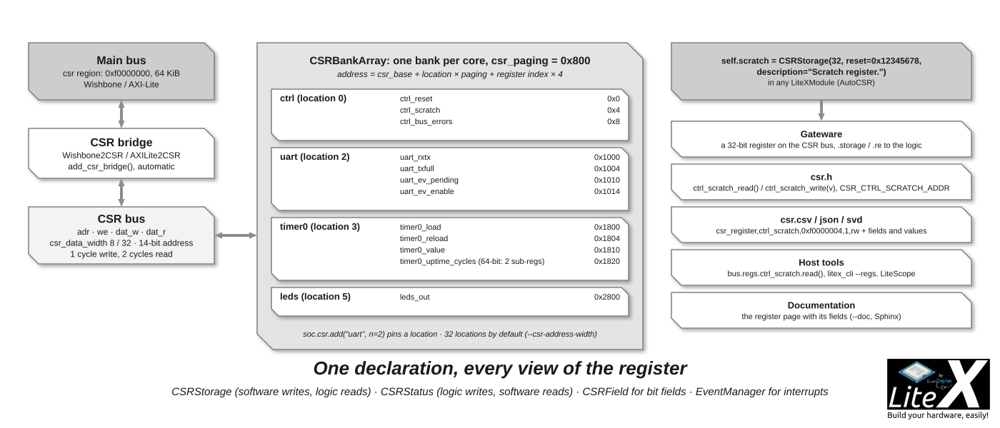
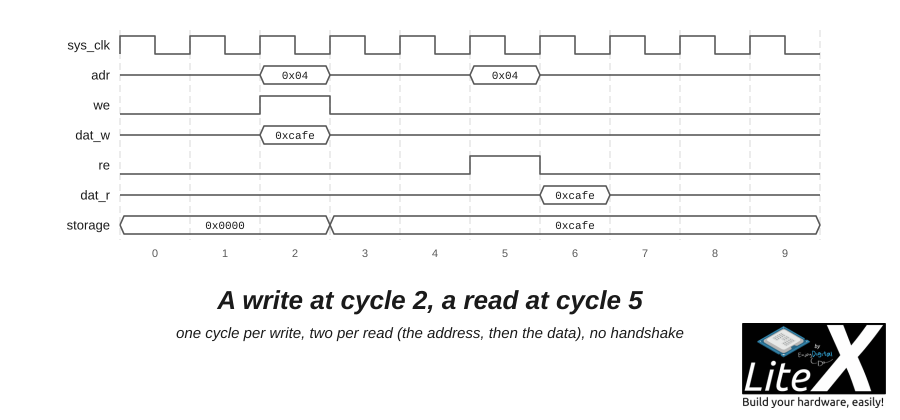

Reading a status bit should not need an AXI master. LiteX controls its cores through
[CSRs](https://github.com/enjoy-digital/litex/blob/master/litex/soc/interconnect/csr.py),
control and status registers on a bus of five signals that writes in one cycle and reads in
two, bridged to the main bus of the SoC: you declare a register as an attribute of your
module, and the build maps it, bridges it and writes its address and accessors for the
software.



```sh
litex_cli --regs            # every register of the running SoC, through a bridge
```

## The CSR bus

| Signal | Width | Driven by | Role |
| --- | --- | --- | --- |
| `adr` | `csr_address_width` (14 by default) | the bridge | The address of a register slot, in 32-bit words. |
| `re` | 1 | the bridge | Read strobe, high for one cycle: the slot at `adr` is being read. |
| `we` | 1 | the bridge | Write strobe, high for one cycle: `dat_w` goes into the slot at `adr`. |
| `dat_w` | `csr_data_width` (32 by default, 8 possible) | the bridge | The data written. |
| `dat_r` | `csr_data_width` | the banks | The data read, valid the cycle after the address; an unselected bank drives 0, the outputs are ORed. |

No handshake and no wait state: a write takes one cycle, a read two (the address, then the data),
everything in the `sys` clock domain. The bus has a single master, the **CSR bridge**
(`Wishbone2CSR` or `AXILite2CSR`, added by `SoC.add_csr_bridge()` for you): it turns
the accesses to the `csr` region of the main bus into CSR cycles and holds the main bus while the
data comes back. The slaves are the **banks**: at build time, `CSRBankArray` scans the SoC for the
modules that declare registers and gives each of them a `CSRBank`, selected by the upper bits of
`adr`.



*A write at cycle 2, a read at cycle 5.*

The CSR bus is small on purpose. Software touches the registers of a core a few times per second,
far from the throughput of the main bus, so a fixed-latency bus with no handshake costs almost no
logic, routes easily, and lets every register of every core be declared, generated and accessed the
same way. Memory and DMAs stay on the main bus ([Wishbone](Wishbone-Bus.md), [AXI](AXI-Bus.md)).

> [!NOTE]
> LiteX CSRs have nothing to do with the CSRs of the RISC-V ISA (`mstatus`, `mie`...): those are
> registers inside the CPU, reached with `csrr` and `csrw`; LiteX CSRs are memory-mapped
> registers of the SoC, reached with loads and stores.

## Declaring registers

A register is an attribute of a module: `LiteXModule` includes `AutoCSR`, which collects the `CSR*`
attributes of the module and of its submodules. Software sees them as `<module>_<attribute>`. A
small PWM core with the usual kinds of registers:

```python
from migen import *
from litex.gen import *
from litex.soc.interconnect.csr import *

class PWM(LiteXModule):
    def __init__(self, width=16):
        self.control = CSRStorage(fields=[
            CSRField("enable", size=1, offset=0,  description="Enable the output."),
            CSRField("period", size=width, offset=16, reset=1000, description="Period, in sys_clk cycles."),
        ])
        self.duty   = CSRStorage(width, reset=500, description="High time, in sys_clk cycles.")
        self.status = CSRStatus(fields=[CSRField("level", size=1, description="Current output level.")])
        self.out    = Signal()

        # # #

        counter = Signal(width)
        self.sync += [
            If(~self.control.fields.enable | self.control.wr_stb,   # Restart on a write to control.
                counter.eq(0)
            ).Elif(counter == self.control.fields.period - 1,
                counter.eq(0)
            ).Else(
                counter.eq(counter + 1)
            ),
            self.out.eq(self.control.fields.enable & (counter < self.duty.storage)),
        ]
        self.comb += self.status.fields.level.eq(self.out)
```

In a SoC, `self.pwm = PWM()` is all it takes: the registers are mapped, the bank and the bridge are
generated, the software headers and the map files are written ([Add a new core](Add-A-New-Core.md)
for the whole flow, interrupts included).

What each kind of register gives to the logic:

| Register | Software | Logic |
| --- | --- | --- |
| `CSRStorage` | reads and writes | `.storage` holds the value, `.wr_stb` is high one cycle after each write. |
| `CSRStatus` | reads | `.status` is driven by the logic, `.rd_stb` is high one cycle after each read. |
| `CSR` | reads and writes | The raw register: `.wr_data` and `.wr_stb` in, `.rd_data` and `.rd_stb` out, nothing stored. |
| `CSRConstant` | a constant | Nothing in the gateware: the value goes to `csr.h` and `csr.csv` (a version, a parameter). |
| `CSRGap` | reserved slots | Nothing: keeps addresses free in a bank whose layout must not move. |

```python
CSRStorage(size=1, reset=0, fields=[], reset_less=False, atomic_write=False, write_from_dev=False)
CSRStatus(size=1, reset=0, fields=[], read_only=True, reset_less=False)
CSR(size=1); CSRConstant(value); CSRGap(count=1)
```

`CSRStorage(write_from_dev=True)` lets the logic update the value too, through `.dat_w` and
`.we`; `CSRStatus(read_only=False)` accepts writes, available as `.wr_data` and `.wr_stb`;
`.rd_stb` is how a flag is cleared on read or a FIFO popped. A `CSR` carries up to
`csr_data_width` bits.

The strobes and the data are named from the software side: `wr_*` for what software writes, `rd_*`
for what it reads. The historical names still work as aliases, but beware when you meet them in
older cores: `re` was the *write* strobe and `we` the *read* strobe (with `r`/`w` for the data),
named from the inside of the register. New code uses `wr_stb`/`rd_stb`.

**Fields.** `fields=[CSRField(...)]` splits a register in named bit fields: `self.control.fields.enable`
in the logic, `CSR_PWM_CONTROL_ENABLE_OFFSET`/`_SIZE` in C, a row in the documentation.
`CSRField(name, size=1, offset=None, reset=0, description=None, pulse=False, access=None, values=None)`:
`offset` places the field (the next free bits otherwise), `pulse=True` makes a 1-bit field high for a
single cycle after the write (a "start" bit), `access=CSRAccess.ReadOnly/ReadWrite/WriteOnly`
documents and checks the direction, `values=[("0b0", "off"), ("0b1", "on")]` documents the encodings.

**Wide registers.** A register wider than `csr_data_width` takes several consecutive slots, most
significant word first (`csr_ordering=big`; `little` reverses it). Software accesses them word by
word, so the value is not read or written atomically: `CSRStorage(atomic_write=True)` buffers the
words and commits them together on the last one, and a wide `CSRStatus` that changes continuously
is latched first (the timer does this: write `update_value`, then read `value`).

**Reset.** `reset=` sets the value after reset; `reset_less=True` removes the reset logic for
registers whose value is always written before being used.

## Addresses

- The `csr` region of the main bus (`mem_map["csr"]`, `0xf0000000` for most CPUs) is
  `2^(csr_address_width + 2)` bytes: 64 KiB by default.
- Every module with registers gets a **location** of `csr_paging` bytes (0x800: 2 KiB, 512 slots of
  4 bytes), allocated in the alphabetical order of the modules unless pinned
  (`self.csr.add("uart", n=2)` before the SoC is finalized, or `reserved_csrs` for a fixed map).
- Inside the location, the registers follow their declaration order, one 4-byte slot each (a slot
  carries `csr_data_width` bits: 32 by default, 8 for the historical width).

So `address = CSR_BASE + location × csr_paging + slot × 4`. In the example above, `pwm` is the
third module of its SoC: location 2, `0xf0001000`; `control` is at `0xf0001000`, `duty` at
`0xf0001004`, `status` at `0xf0001008`. With 14 address bits and 2 KiB pages, 32 locations are
available; `--csr-address-width=15` doubles them, `--csr-paging` changes the page size (0x400 to
0x4000).

The map is printed at the end of the build and written for every tool: `csr.csv` and `csr.json`
(always; `--soc-csv`/`--soc-json` choose the path), `csr.svd` (`--soc-svd`), and `csr.h` for the
BIOS and the firmware:

```
csr_base,ctrl,0xf0000000,,
csr_base,identifier_mem,0xf0000800,,
csr_base,pwm,0xf0001000,,
csr_base,timer0,0xf0001800,,
csr_base,uart,0xf0002000,,
...
csr_register,pwm_control,0xf0001000,1,rw
csr_register,pwm_duty,0xf0001004,1,rw
csr_register,pwm_status,0xf0001008,1,ro
```

## From software

`software/include/generated/csr.h` has the addresses, the fields and an accessor per register:

```c
/* PWM Registers */
#define CSR_PWM_BASE (CSR_BASE + 0x1000L)
#define CSR_PWM_CONTROL_ADDR (CSR_BASE + 0x1000L)
#define CSR_PWM_CONTROL_SIZE 1
#define CSR_PWM_DUTY_ADDR (CSR_BASE + 0x1004L)
#define CSR_PWM_DUTY_SIZE 1
#define CSR_PWM_STATUS_ADDR (CSR_BASE + 0x1008L)
#define CSR_PWM_STATUS_SIZE 1

/* PWM Fields */
#define CSR_PWM_CONTROL_ENABLE_OFFSET 0
#define CSR_PWM_CONTROL_ENABLE_SIZE 1
#define CSR_PWM_CONTROL_PERIOD_OFFSET 16
#define CSR_PWM_CONTROL_PERIOD_SIZE 16
#define CSR_PWM_STATUS_LEVEL_OFFSET 0
#define CSR_PWM_STATUS_LEVEL_SIZE 1

/* PWM Access Functions */
static inline uint32_t pwm_control_read(void) {
	return csr_read_simple((CSR_BASE + 0x1000L));
}
static inline void pwm_control_write(uint32_t v) {
	csr_write_simple(v, (CSR_BASE + 0x1000L));
}
...
```

```c
pwm_duty_write(300);
pwm_control_write((1000 << CSR_PWM_CONTROL_PERIOD_OFFSET) | (1 << CSR_PWM_CONTROL_ENABLE_OFFSET));
printf("level: %d\n", pwm_status_read() & 1);
```

`csr_read_simple()`/`csr_write_simple()` (`hw/common.h`) are plain 32-bit loads and stores. The
accessors of wide registers gather the words themselves (`csr_rd_uint64()`-style helpers,
`csr_rd_buf_uint32()` beyond 64 bits), so the firmware is the same whatever `csr_data_width`;
`SIZE` is the number of slots of a register. Per-field accessors (`pwm_control_enable_read()`...)
exist too, off by default (`with_fields_access_functions` in `litex/soc/integration/export.py`).

The same map serves every other side: the Linux device tree is generated from `csr.json`
(`litex_json2dts_linux`), the host tools read `csr.csv` (`litex_cli --regs`,
`bus.regs.pwm_duty.write(300)` with `RemoteClient` through a [bridge](Host-Bridges.md)), and
LiteScope and the documentation (`--doc`) are built from it.

## In simulation

The registers have helpers for the Migen simulator, so a core is tested through its software
interface without a SoC:

```python
def generator(dut):
    yield from dut.duty.write(3)                     # 3 cycles high...
    yield from dut.control.write((8 << 16) | 1)      # ...out of 8, enabled.
    for _ in range(16):
        yield
        print((yield dut.out), end="")
    print(" level:", (yield from dut.status.read()))

dut = PWM()
run_simulation(dut, generator(dut))
```

`CSRStorage.write()` sets the value and pulses `wr_stb`, `CSRStatus.read()` returns the value and
pulses `rd_stb`. `test/interconnect/test_csr.py` and `test_csr_bus.py` exercise the registers, the
banks and the bridge the same way; the [SoC Simulator](SoC-Simulator.md) runs the whole SoC with
its software.

## Options

| Option | Default | Effect |
| --- | --- | --- |
| `--csr-data-width` | 32 | Bits carried by a slot (8 or 32). |
| `--csr-address-width` | 14 | Width of `adr`, 14 to 18: the size of the `csr` region (`2^(n+2)` bytes), the number of locations. |
| `--csr-paging` | 0x800 | Bytes per location (0x400 to 0x4000). |
| `--csr-ordering` | big | Order of the words of a wide register (`big` or `little`). |
| `--soc-csv`, `--soc-json`, `--soc-svd` | | Where to write the map (`--csr-csv`... are the old spellings). |

## Next

- [Add a new core](Add-A-New-Core.md): a core with registers and an interrupt, from the Python to the C.
- [SoC builder](SoC-builder.md): the handler behind this (`self.csr`), and the bridge.
- [Wishbone bus](Wishbone-Bus.md): the main bus the CSR bridge hangs on.
- [SoC documentation](SoC-Documentation.md): the register-level documentation generated from these declarations.
