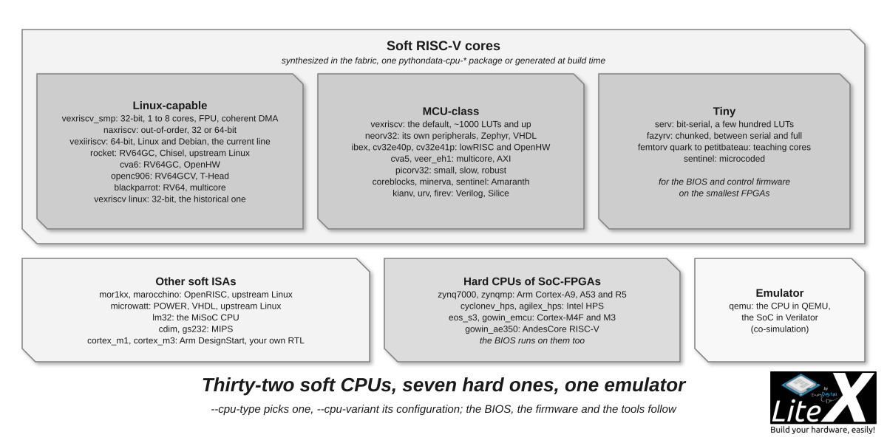

Pick a CPU with `--cpu-type`, its configuration with `--cpu-variant`, rebuild: the BIOS, the
firmware and the tools follow, because the wrapper of each CPU takes care of the memory map,
the compiler flags and the software support. Thirty-two soft CPUs and seven hard ones are
supported today; this page says which one to pick, what the variants mean and what happens
when a CPU is added to the SoC. The [catalog](CPUs.md) lists them all.



*Soft RISC-V cores from a few hundred LUTs to Linux-capable 64-bit, other ISAs, the hard CPUs
of SoC-FPGAs, and QEMU.*

```sh
python3 -m litex_boards.targets.digilent_arty --cpu-type=vexiiriscv --help | grep -A30 "CPU options"   # the options of a CPU
litex_sim --cpu-type=serv --cpu-variant=standard                                                      # try one in a minute
```

## With or without a CPU

Most SoCs embed one to control the system and to split the work between software and
hardware. Some do not need any: a bridge-driven design controlled from the host
(`SoCMini`, `--cpu-type=None`), or a PCIe card whose CPU is the host's. And when the FPGA
carries a hard CPU (Zynq, Cyclone V, Agilex), the SoC runs on it: [Hard core CPUs](Hard-core-CPUs.md).

## By need

- **A controller for your cores, the BIOS, bare-metal firmware or an RTOS**: `vexriscv`
  (`standard`, or `lite` and `minimal` on small FPGAs), `neorv32` for its MCU peripherals and
  Zephyr support, `serv`, `fazyrv` or `femtorv quark` when every LUT counts.
- **Linux**: `vexriscv_smp` (the reference, 32-bit, up to 8 cores), `vexiiriscv` or `naxriscv`
  (64-bit, more performance), `rocket` and `cva6` (64-bit, upstream kernels), `mor1kx` and
  `marocchino` (OpenRISC), `microwatt` (POWER), or a hard CPU.
- **Floating point**: `vexriscv_smp --with-fpu`, `naxriscv --with-fpu`, `vexiiriscv`,
  `rocket full`, `cva6`, `cva5 standard+atomic+float+double`, `cv32e40p standard+fpu`,
  `femtorv petitbateau`.
- **GDB over JTAG**: `vexriscv +debug`, `vexriscv_smp`, `naxriscv`, `vexiiriscv`, `neorv32
  +debug`, `cva6`, `veer_eh1`, `openc906` ([Debug with GDB](Debug-With-GDB.md)).
- **A custom instruction**: `vexriscv full+cfu` with `--cpu-cfu=<verilog>`
  ([CFU Playground](https://github.com/google/CFU-Playground)).

`vexriscv` is the right answer until you need Linux or 64 bits: small, fast, the best
supported, and the one every new feature is tried on first. The SpinalHDL family
(`vexriscv_smp`, `naxriscv`, `vexiiriscv`) is the Linux line, generated at build time with
the options of the target; `rocket` is the Chisel RV64GC with upstream Linux, heavy on the
fabric; `neorv32` is the MCU with its own peripherals and documentation; the tiny ones (`serv`,
`fazyrv`, `femtorv`, `sentinel`) run the BIOS on the smallest FPGAs.

## Variants

`--cpu-variant` selects a configuration among the ones the wrapper lists (its `variants`
list, printed when a name is wrong). The names are CPU specific, with common ones:

| Variant | Meaning |
| --- | --- |
| `minimal` | The smallest working configuration, often without exceptions. |
| `lite` | Bare metal and RTOS on small FPGAs (iCE40, small ECP5 and Artix-7). |
| `standard` | The default: bare metal and RTOS on modern FPGAs. |
| `full` | Every feature of the core. |
| `linux` | MMU, supervisor mode, what Linux needs. |

Extensions are suffixed with `+`: `+debug` (the debug port), `+fpu`, `+smp`, `+cfu`, `+irq`,
`+ghdl`... Each combination is a key of the CPU's list, there is no generic combinator:
`vexriscv` has `standard+debug`, `serv` has no `+debug`. Who has what:

| Variant | CPUs |
| --- | --- |
| `minimal` | cva5, lm32, neorv32, picorv32, vexriscv |
| `lite` | lm32, neorv32, vexriscv |
| `full` | coreblocks, cva6, neorv32, rocket, vexriscv |
| `linux` | coreblocks (`small_linux`), gowin_ae350, marocchino, mor1kx, rocket, vexiiriscv, vexriscv_smp |
| `+debug` | neorv32, vexriscv (`+hwbp` adds hardware breakpoints) |
| `+fpu`, float | cv32e40p, mor1kx, cva5 (`+float+double`); `--with-fpu` on vexriscv_smp and naxriscv |
| `+smp`, several cores | mor1kx, marocchino; `--cpu-count` on vexriscv_smp, naxriscv, cva5, neorv32; rocket `--cpu-num-cores` |

The generated CPUs (`vexriscv_smp`, `naxriscv`, `vexiiriscv`) take their configuration from
command-line options rather than variants (`naxriscv` is always Linux capable, `--xlen 64`
for 64 bits); the pre-generated ones (`vexriscv`, `rocket`) ship one netlist per variant in
their `pythondata-cpu-*` package.

## How a CPU is integrated


*The wrapper exposes buses, regions, interrupts and compiler flags; `add_cpu` wires them.*

`soc.add_cpu(name, variant, reset_address)`, called by `SoCCore`, does the same with every
wrapper:

- Its **peripheral buses** (instruction and data Wishbone, or AXI and AXI-Lite) become masters
  of the main bus, adapted to the standard and width of the SoC.
- Its **memory buses** (VexRiscv-SMP, NaxRiscv, VexiiRiscv, Rocket, AE350) go straight to the
  LiteDRAM crossbar through `add_sdram`, bypassing the main bus.
- Its **DMA bus** (coherent, on VexRiscv-SMP, NaxRiscv and VexiiRiscv) is a slave port for the
  DMAs of the cores, so that Linux sees coherent memory.
- Its **IO regions** (`0x80000000` to `0xffffffff` on most 32-bit cores) say where uncached
  peripherals can live; its `mem_map` overrides the default origins.
- Its **reset address** is the ROM origin, the BIOS; `--cpu-reset-address` moves it to the
  flash or the main RAM, and some CPUs impose theirs (Rocket and CVA6 `0x10000000`,
  BlackParrot `0x70000000`, MIPS `0x1fc00000`).
- Its **interrupts** are wired to the IRQ handler and exported to `soc.h`.
- Its **compiler flags** (`gcc_triple`, `gcc_flags`, `linker_output_format`) drive the BIOS
  and firmware build; `add_software_packages` and `prepare_software` add CPU-specific software
  (the Zynq BSP, the Rocket and NaxRiscv linker scripts).
- The `CPU_TYPE_<name>`, `CPU_VARIANT_<variant>`, `CPU_FAMILY`, `CPU_NAME`, `CPU_NOP` and
  `CPU_RESET_ADDR` constants are generated for the software.

[Add a new CPU](Add-A-New-CPU.md) writes a wrapper; `litex/soc/cores/cpu/picorv32/core.py` is
a good 150-line example, `vexriscv_smp/core.py` a generated one with options.

## Next

- [CPUs](CPUs.md): the catalog, with the variants, the sources and the language of each one.
- [Hard core CPUs](Hard-core-CPUs.md): Zynq, Cyclone V, Agilex, EOS S3, Gowin.
- [Run Linux on your SoC](Run-Linux-On-Your-SoC.md): the Linux line in practice.
- [Debug the CPU with GDB](Debug-With-GDB.md): OpenOCD and GDB on the debug ports above.
