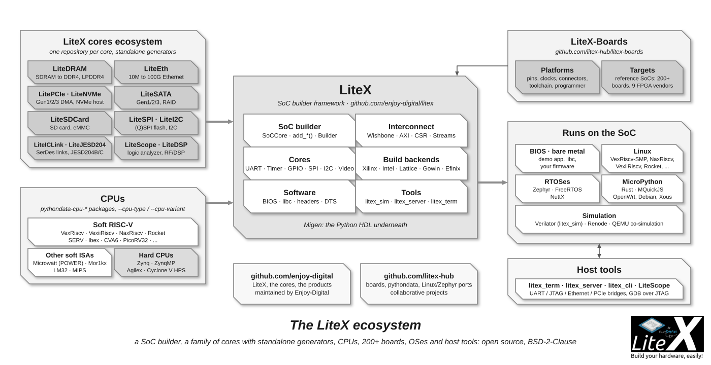

# LiteX Cores Ecosystem

Around the [LiteX](Home.md) framework, a family of cores covers the usual needs of an FPGA
system: DRAM, Ethernet, PCIe, SATA, SD card, SerDes links, JESD204, SPI, I2C, NVMe, DSP and a
logic analyzer. Each core is its own repository, written in Migen/LiteX with the same
conventions (streams, CSRs, [portable layering](LiteX-Approach.md)), tested in CI and used in
real systems ([Projects](Projects.md)). They are installed by `litex_setup.py` with LiteX
([Installation](Installation.md)) and integrated in a SoC with one call
(`add_sdram`, `add_ethernet`, `add_pcie`, `add_sata`, `add_sdcard`, `add_spi_flash`, ...: see
[SoC-builder](SoC-builder.md)). Most of them also ship a **standalone generator** producing a
plain Verilog core for designs that are not LiteX SoCs
([Export](Export-Your-Core-SoC-To-Verilog.md)).

The in-tree cores of LiteX itself (UART, Timer, GPIO, SPI, I2C, PWM, video, USB, HyperRAM,
clocking, ...) are listed on the [Cores](Cores.md) page.

| Core | CI | Description | Standards / features | Hardware | Standalone |
| --- | --- | --- | --- | --- | --- |
| [LiteDRAM](https://github.com/enjoy-digital/litedram) |  | DRAM controller | SDRAM, DDR, LPDDR, DDR2, DDR3, DDR4, LPDDR4/5 (7-Series), RPC DRAM; crossbar with native/AXI/Wishbone ports, DMA, BIST, ECC | Generic SDRAM PHY (Xilinx, Intel, Lattice, Gowin, Efinix...), Xilinx Spartan-6/7-Series/UltraScale(+), Lattice ECP5/Nexus, Gowin GW2A/GW5 | `litedram_gen` |
| [LiteEth](https://github.com/enjoy-digital/liteeth) |  | Ethernet | 10BASE-T (experimental), MII/RMII, GMII/RGMII, SGMII/1000BASE-X, 2500BASE-X, XGMII 10G, 5/10/25GBASE-R, 100G CMAC (UltraScale+); MAC, ARP/ICMP/IGMP/UDP/DHCP, PTP IEEE 1588, Etherbone, UDP streaming | Generic, Xilinx Spartan-6/7-Series/UltraScale(+), Lattice ECP5, Efinix Trion/Titanium, Gowin GW5, Intel Agilex | `liteeth_gen` |
| [LitePCIe](https://github.com/enjoy-digital/litepcie) |  | PCIe | Gen1/2/3, x1 to x16, 64 to 512-bit datapaths; TLP, MSI/MSI-X, crossbar, scatter-gather DMA, MMAP (AXI/Wishbone), PTM; Linux kernel driver, `liblitepcie`, `litepcie_util` | Xilinx 7-Series (Gen2 x8), UltraScale(+) (Gen3 x16), Intel Cyclone V (Gen2 x4) | `litepcie_gen` |
| [LiteNVMe](https://github.com/enjoy-digital/litenvme) |  | NVMe host | On a LitePCIe root port: identify, I/O queues, hardware I/O engine, optional CPU-less init, AXI-Stream block read/write | Validated on Xilinx UltraScale+ (Gen3 x4, ~2.7 GB/s) | `litenvme_gen` |
| [LiteSATA](https://github.com/enjoy-digital/litesata) |  | SATA | Gen1/2/3 (1.5/3/6 Gbps), 48-bit LBA, crossbar, BIST, striping/mirroring | Xilinx Artix-7 GTP, Kintex-7 GTX, UltraScale GTH, UltraScale+ GTH/GTY, Lattice ECP5 (Gen2) | `litesata_gen` |
| [LiteSDCard](https://github.com/enjoy-digital/litesdcard) |  | SD card / eMMC | SD/SDHC/SDXC, eMMC (8-bit, high speed), single/multi-block, DMAs, BIST, ~55 MB/s at 125 MHz | Generic PHY (Xilinx, Intel, Lattice...) | `litesdcard_gen` |
| [LiteICLink](https://github.com/enjoy-digital/liteiclink) |  | Inter-chip links and SerDes | SerWB (Wishbone over 3 LVDS/single-ended pairs, up to 1.25 Gbps); SerDes wrappers with PLL configuration, 8b10b, PRBS | Xilinx 7-Series GTP/GTX/GTH, UltraScale GTH, UltraScale+ GTH/GTY, Lattice ECP5, Efinix Trion/Titanium | |
| [LiteJESD204](https://github.com/enjoy-digital/litejesd204) |  | JESD204B/C | JESD204B (8b10b) and JESD204C (64b66b), shared transport layer, LMFC/LEMC, SYSREF | Xilinx 7-Series GTP/GTX, UltraScale(+) GTH/GTY (through LiteICLink) | |
| [LiteSPI](https://github.com/litex-hub/litespi) |  | SPI / SPI flash | Single/Dual/Quad/Octal SPI, memory-mapped flash reads, dynamic clock, calibration, flash simulation model | Generic | `litespi_gen` |
| [LiteI2C](https://github.com/litex-hub/litei2c) |  | I2C | Standard/Fast/Fast+ modes, crossbar, CSR access; structured like LiteSPI | Generic | |
| [LiteScope](https://github.com/enjoy-digital/litescope) |  | Embedded logic analyzer | Triggers, subsampling, RLE, BRAM storage; over the UART, JTAG, Etherbone or PCIe [bridges](Host-Bridges.md); exports .vcd, .sr (sigrok), .csv | Generic | |
| [LiteDSP](https://github.com/enjoy-digital/litedsp) |  | RF/DSP blocks (work in progress) | Generation, mixing, filters, rate conversion, FFT/PSD, FEC (RS, LDPC, Viterbi), OFDM, motor control, audio, radar, image; pure HDL, no vendor IP | Generic (resource figures for ECP5, Artix-7, Artix UltraScale+) | `litedsp_gen`, `litedsp_flow` |

Older or merged:

- [LiteJESD204B](https://github.com/enjoy-digital/litejesd204b) was renamed LiteJESD204 in
  2026 (the old Python package remains as a compatibility shim).
- [LiteHyperBus](https://github.com/litex-hub/litehyperbus) (2022) is superseded by the
  HyperRAM core in LiteX itself (`litex/soc/cores/hyperbus.py`, `add_hyperram`).
- [LiteVideo](https://github.com/litex-hub/litevideo) is deprecated: video is in LiteX
  (`litex/soc/cores/video.py`: timing generators, framebuffer, terminal, colorbars, HDMI/DVI
  PHYs).
- [ValentyUSB](https://github.com/litex-hub/valentyusb) (USB device for iCE40/ECP5) and
  [LUNA](https://github.com/greatscottgadgets/luna) (used through `litex/soc/cores/luna_cdc_acm.py`
  and the USB2 soft PHY) cover USB 2.0; [USB3-PIPE](https://github.com/enjoy-digital/usb3_pipe)
  provides a USB 3.0 PHY and device core without external chip.

The boards are in [LiteX-Boards](https://github.com/litex-hub/litex-boards)
():
platform and target files for 200+ boards from 9 FPGA vendors, the starting point for your own
([Add a new board](Add-A-New-Board.md)).
