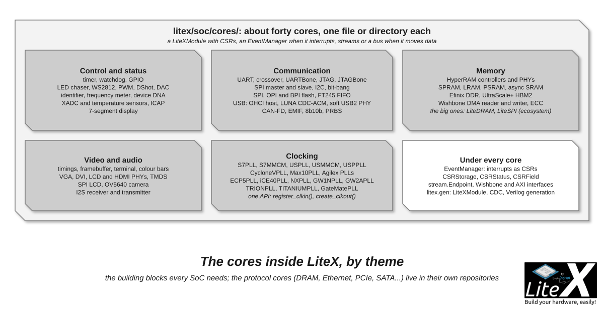

The cores shipped inside LiteX, in `litex/soc/cores/`: the building blocks every SoC needs
(UART, timer, GPIO, SPI, I2C, clocking) and about thirty specialized ones (video, USB, HyperRAM,
CAN-FD, PSRAM, audio...). You add one by assigning it to the SoC, or with its `add_*` helper
when it has one; the big protocol cores (DRAM, Ethernet, PCIe, SATA...) live in their own
repositories, on the [Cores ecosystem](Cores-Ecosystem.md) page.



*Six themes, and under every core the same three things: CSRs, an `EventManager`, streams or
a bus.*

```python
# With the SoC helper when there is one: it instantiates, connects and names the core.
self.add_timer(name="timer1")
self.add_i2c_master(name="i2c0", pads=platform.request("i2c"))
self.add_video_framebuffer(phy=self.videophy, timings="800x600@60Hz", clock_domain="dvi")

# Directly: the module becomes a submodule, its CSRs and IRQs are picked up by name.
self.leds = LedChaser(pads=platform.request_all("user_led"), sys_clk_freq=sys_clk_freq)
self.irq.add("leds")      # only for cores with an EventManager
```

A core is a `LiteXModule` (a Migen `Module` with `AutoCSR` and `AutoDoc`): its registers are
`CSRStorage` and `CSRStatus` attributes collected on the [CSR bus](CSR-Bus.md), its interrupts
come from an `EventManager`, its data flows through [streams](Streams.md) and its memory
traffic through a [Wishbone](Wishbone-Bus.md) or [AXI](AXI-Bus.md) interface. How to write one:
[Add a new core](Add-A-New-Core.md). The tables give the file in `litex/soc/cores/`, what the
core does and how you add it.

## Control and status

| Core | What it does | Add it with |
| --- | --- | --- |
| `timer.py` | A countdown timer with reload and an optional uptime counter; CSRs and an interrupt. | `add_timer`, `--timer-uptime` |
| `watchdog.py` | A watchdog that resets the SoC (or halts it) when it is not fed. | `add_watchdog`, `--with-watchdog` |
| `gpio.py` | `GPIOIn`, `GPIOOut`, `GPIOInOut`, `GPIOTristate`, one interrupt per input pin. | `self.gpio = GPIOTristate(pads)` |
| `led.py` | `LedChaser` (the usual "it is alive"), `WS2812` and `SK2812RGBW` serial LEDs. | `self.leds = LedChaser(pads, sys_clk_freq)` |
| `pwm.py` | `PWM` and `MultiChannelPWM`: enable, width, period. | `self.pwm = PWM(pads)` |
| `identifier.py` | The identification string read by `litex_cli --ident` and the BIOS. | `add_identifier`, `--ident` |
| `freqmeter.py`, `dna.py` | A frequency meter on a clock; the Xilinx device DNA (`S7DNA`, `USDNA`). | as attributes |
| `xadc.py`, `hwmon.py` | Xilinx XADC and SYSMON, Gowin and Intel temperature sensors, one CSR layout. | as attributes |
| `icap.py` | Xilinx ICAP: configuration registers, warm reboot, bitstream loading. | as attributes |
| `seven_seg.py`, `esc.py`, `dac.py` | Multiplexed 7-segment displays, DShot ESC output, a sigma-delta DAC. | as attributes |

## Communication

| Core | What it does | Add it with |
| --- | --- | --- |
| `uart.py` | The console UART with FIFOs and interrupts, the crossover UART, UARTBone (`Stream2Wishbone`). | `add_uart`, `--uart-name`, `add_uartbone` |
| `jtag.py` | The FPGA's JTAG TAP from the design: `XilinxJTAG`, `ECP5JTAG`, `AlteraJTAG`, `GowinJTAG`... | `add_jtagbone`, `add_cpu_jtag_debug` |
| `spi/` | SPI master and slave, a memory-mapped multi-slave engine (`SPIMMAP`), SPI to Wishbone (`SPIBone`). | `add_spi_master` |
| `i2c.py`, `bitbang.py` | An I2C master; bit-banged I2C and SPI for the BIOS and simple drivers. | `add_i2c_master` |
| `spi_flash.py`, `spi_opi.py`, `bpi_flash.py` | The configuration flash clock (STARTUPE2/E3, USRMCLK), octal SPI flash, BPI NOR flash. | `add_spi_flash` uses LiteSPI |
| `usb_fifo.py` | The FTDI FT245 and FT600 FIFO interface, as streams. | `--uart-name=usb_fifo` |
| `usb_ohci.py`, `luna_cdc_acm.py` | A USB 1.1 OHCI host for Linux; the USB 2.0 CDC-ACM console with LUNA. | `--uart-name=usb_acm` |
| `usb2_phy/` | A soft USB 2.0 UTMI PHY in the fabric, high and full speed, no external PHY. | with LUNA |
| `can/ctu_can_fd.py` | A CAN-FD controller (the CTU CAN FD VHDL core, converted with GHDL). | as an attribute |
| `emif.py` | A TI EMIF to Wishbone bridge: a DSP as bus master. | as an attribute |
| `code_8b10b.py`, `prbs.py` | 8b10b coding, PRBS7/15/31 generators and checkers for link tests. | in your core |

## Memory

| Core | What it does | Add it with |
| --- | --- | --- |
| `hyperbus.py`, `hyperram/` | HyperRAM controllers: Wishbone, AXI-Lite or AXI frontend; the newer AXI one with calibration. | `add_hyperram` |
| `ram/` | iCE40 SPRAM, Nexus LRAM, async SRAM, AP and octal PSRAM, vendor HyperRAM, Efinix DDR, HBM2. | `add_ram` with the module's bus |
| `dma.py` | `WishboneDMAReader` and `WishboneDMAWriter`: memory to stream and back. | in your core |
| `ecc.py` | Hamming SECDED encoder and decoder. | in your core |

The main memories come from the helpers: `add_rom` and `add_ram` (block RAM), `add_sdram`
(LiteDRAM), `add_spi_flash` (LiteSPI, memory-mapped), `add_spi_ram`.

## Video and audio

| Core | What it does | Add it with |
| --- | --- | --- |
| `video.py` | Timings, a framebuffer read by DMA from main RAM, a text terminal on the UART stream, colour bars. | `add_video_framebuffer`, `_terminal`, `_colorbars` |
| `video.py` (PHYs) | VGA, LCD, DVI and HDMI outputs: generic, Spartan-6, 7-Series OSERDES or GTP, UltraScale+ GTH, Gowin. | `self.videophy = VideoS7HDMIPHY(pads)` |
| `code_tmds.py`, `spilcd.py` | TMDS encoding; SPI LCD displays (ST7789...). | in your core, as an attribute |
| `ov5640.py` | OV5640 camera control (SCCB) and DVP capture, as a pixel stream. | as an attribute |
| `i2s.py`, `i2saudio.py` | An I2S receiver and transmitter with FIFOs; a simple I2S transmitter fed by a stereo stream. | as attributes |

## Clocking

`litex/soc/cores/clock/` wraps the PLLs and clock managers of every vendor behind one API:
`register_clkin(clk, freq)`, `create_clkout(cd, freq, phase=0, margin=...)`, and the
configuration is computed at build time, with an error when the frequencies cannot be reached.
A target's CRG is ten lines around one of these (`Cyclone10LPPLL` and `StratixVPLL` exist too):

| Vendor | Classes |
| --- | --- |
| Xilinx | `S6PLL`, `S6DCM`, `S7PLL`, `S7MMCM`, `USPLL`, `USMMCM`, `USPPLL`, `USPMMCM`, the `*IDELAYCTRL` |
| Intel | `CycloneIVPLL`, `CycloneVPLL`, `Max10PLL`, `Agilex3PLL`, `Agilex5PLL`, `Agilex7PLL` |
| Lattice | `ECP5PLL`, `ECP5DynamicDelay`, `iCE40PLL`, `NXPLL`, `NXOSCA` |
| Gowin | `GW1NPLL`, `GW1NOSC`, `GW2APLL`, `GW5APLL` |
| Efinix, CologneChip | `TRIONPLL`, `TITANIUMPLL`; `GateMatePLL` |

```python
self.cd_sys = ClockDomain()
self.pll = pll = S7PLL(speedgrade=-1)
pll.register_clkin(platform.request("clk100"), 100e6)
pll.create_clkout(self.cd_sys, sys_clk_freq)
```

## Interrupts: the EventManager

A core raises an interrupt by owning an `EventManager` with one or more event sources:
`EventSourcePulse` (set by a pulse, cleared by the software), `EventSourceProcess` (an edge of a
signal, `edge="rising"`, `"falling"` or `"any"`), `EventSourceLevel` (follows a level). The
manager provides the `status`, `pending` (write 1 to clear) and `enable` CSRs and the `irq`
output; `soc.irq.add("<name>")`, or the helper, assigns the line and exports it to `soc.h`;
`SharedIRQ` ORs several managers on one line when the CPU has few.

```python
self.ev = EventManager()
self.ev.done = EventSourcePulse(description="Transfer done.")
self.ev.finalize()
self.comb += self.ev.done.trigger.eq(transfer_done)
```

## Helpers for core authors

- `LiteXModule` (`litex/gen`): `self.x = Module()` adds a submodule, no `self.submodules +=`
  needed, likewise for specials and clock domains; `add_module()`, `get_module()`, `get_signals()`.
- `litex/gen/genlib/cdc.py`: `MultiReg`, `PulseSynchronizer`, `BusSynchronizer`,
  `AsyncResetSynchronizer`, `ElasticBuffer`; `misc.py`: `WaitTimer`, `BitSlip`, `timeline`.
- `litex/gen/fhdl/`: the Verilog generation, the `Instance` helpers, memory and hierarchy
  utilities (`--hierarchical-verilog`), naming.
- The style to follow: [coding_style.md](https://github.com/enjoy-digital/litex/blob/master/doc/coding_style.md),
  and for portability across vendors
  [architectural_style.md](https://github.com/enjoy-digital/litex/blob/master/doc/architectural_style.md).

## Next

- [Add a new core](Add-A-New-Core.md): a core of your own, with registers, an interrupt and a test.
- [Cores ecosystem](Cores-Ecosystem.md): DRAM, Ethernet, PCIe, SATA and the other repositories.
- [CSR bus](CSR-Bus.md): the registers every core above declares.
- [Streams](Streams.md): the data interface of the video, USB and DMA cores.
