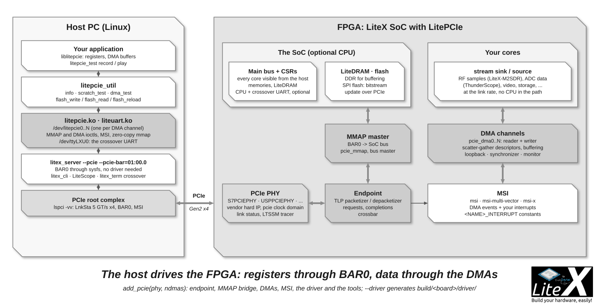

You turn an FPGA board on a PCIe slot (or an M.2 card) into a device the host drives directly:
with [LitePCIe](https://github.com/enjoy-digital/litepcie), the whole SoC bus is mapped in
BAR0, DMAs move data between the host memory and the gateware's streams at the link speed,
MSI interrupts signal the events, and a Linux driver with user tools and a library come with
the core. The CPU of the SoC becomes optional: the host runs the software, the FPGA runs the
hardware. LiteX-M2SDR (a software defined radio), ThunderScope (an oscilloscope), the XTRX,
PCIe Screamer and the Acorn baseboards are built this way. An afternoon, with a board and a
free slot.



## What LitePCIe provides

- **PHYs**: `S7PCIEPHY` (7-Series, Gen1/2, x1 to x8), `USPCIEPHY` (UltraScale, Gen2/3),
  `USPPCIEPHY` and `USPHBMPCIEPHY` (UltraScale+, Gen2/3/4, x1 to x16, 64 to 512-bit),
  `C5PCIEPHY` (Cyclone V), `GW5APCIEPHY` (Gowin GW5A), `LFCPNXPCIEPHY` (Lattice CertusPro-NX),
  `SVPCIEPHY` (Stratix V). They wrap the vendor hard IP, create the `pcie` clock domain (125
  or 250 MHz, set by the datapath width) and cross to `sys`; `pcie_phy._link_status` gives
  the rate, the width and the LTSSM state, `add_ltssm_tracer()` records the link training.
- **Endpoint**: the TLP layer (packetizer and depacketizer, requests and completions with
  reordering) and a crossbar between the MMAP and DMA ports. `LitePCIeRootPort` is the host
  side of the link, used by [LiteNVMe](https://github.com/enjoy-digital/litenvme) to drive an
  NVMe drive from the FPGA.
- **MMAP**: `LitePCIeWishboneMaster` turns BAR0 reads and writes into bus accesses, so the
  host sees the CSRs, the memories and every core ([Host bridges](Host-Bridges.md));
  `LitePCIeWishboneSlave` and `LitePCIeAXISlave` let the SoC or a DMA reach the host memory.
- **DMA**: `LitePCIeDMA`, a reader (host memory to a stream) and a writer (stream to host
  memory) per channel, with scatter-gather descriptor tables, optional buffering, loopback,
  synchronizer, monitor and status; 64-bit host addresses with `address_width=64`.
- **MSI**: `LitePCIeMSI` (one vector), `LitePCIeMSIMultiVector`, `LitePCIeMSIX`: the DMA
  events and your own interrupts, as `<NAME>_INTERRUPT` constants.
- **PTM**: Precision Time Measurement (`with_ptm=True`), the host's time in the FPGA for
  timestamping (7-Series x1 established, wider links and UltraScale+ experimental, `doc/ptm.md`).
- **Software**: the Linux driver (`litepcie.ko`: `/dev/litepcie0..N`, MMAP and DMA ioctls,
  zero-copy mmap of the DMA buffers) and `liteuart.ko` (a `/dev/ttyLXU0` console for the
  crossover UART); `liblitepcie` (registers, DMA buffers, flash), `litepcie_util` (`info`,
  `scratch_test`, `dma_test`, `flash_write`, `flash_read`, `flash_reload`) and `litepcie_test`
  (`record` and `play` through a DMA).

## The target

From `litex_boards/targets/sqrl_acorn.py` (an Artix-7 on a PCIe Gen2 x4 M.2 slot):

```python
from litepcie.phy.s7pciephy import S7PCIEPHY
from litepcie.software import generate_litepcie_software

class BaseSoC(SoCCore):
    def __init__(self, ..., with_pcie=False, pcie_ndmas=1, pcie_address_width=64, **kwargs):
        ...
        # PCIe -------------------------------------------------------------------------------------
        if with_pcie:
            self.comb += platform.request("pcie_clkreq_n").eq(0)
            self.pcie_phy = S7PCIEPHY(platform, platform.request("pcie_x4"),
                data_width = 128,
                bar0_size  = 0x20000)
            self.add_pcie(
                phy           = self.pcie_phy,
                ndmas         = pcie_ndmas,
                address_width = pcie_address_width)

def main():
    ...
    parser.add_target_argument("--with-pcie",  action="store_true", help="Enable PCIe support.")
    parser.add_target_argument("--driver",     action="store_true", help="Generate the PCIe driver.")
    parser.add_target_argument("--pcie-ndmas", default=1, type=int, help="Number of PCIe DMA channels.")
    ...
    if args.driver:
        generate_litepcie_software(soc, os.path.join(builder.output_dir, "driver"))
```

`add_pcie(name="pcie", phy, ndmas, address_width, data_width, with_dma_buffering,
dma_buffering_depth, with_dma_loopback, with_dma_synchronizer, with_dma_monitor,
with_dma_status, with_msi, msi_type="msi"|"msi-multi-vector"|"msi-x", msis, with_ptm, ...)`
creates `pcie_endpoint`, `pcie_mmap` (the bus master, BAR0 based at the `csr` origin),
`pcie_msi` and `pcie_dma0..N-1`, wires the DMA interrupts (`PCIE_DMA0_WRITER_INTERRUPT`,
`PCIE_DMA0_READER_INTERRUPT`...) and exports `PCIE_DMA_CHANNELS`/`PCIE_DMA_ADDR_WIDTH` for
the driver. It needs `csr_data_width=32`. On an UltraScale+ board (`sqrl_xcu1525.py`):
`USPPCIEPHY(platform, platform.request("pcie_x4"), data_width=128, bar0_size=0x20000)` and
`--pcie-lanes 2|4|8|16` picking the data width (64 to 512 bits).

Design notes:

- The PHY's datapath width and lane count set the `pcie` clock (125 MHz for x1/x2 and x4 at
  128-bit, 250 MHz for x4 at 64-bit and x8 at 128-bit on 7-Series); the core runs in `sys` and
  the PHY converts; a wider datapath is the way to keep `sys` slow.
- `bar0_size` must cover the CSR space (and the memories you want visible); `csr` at
  `0xf0000000` is mapped at BAR0 offset 0, the other regions follow the SoC map.
- `--uart-name=crossover` gives the SoC's CPU a console through the bridge: `/dev/ttyLXU0`
  with the driver, or `litex_term crossover` through `litex_server --pcie`.
- Without CPU (`--cpu-type=None`): the host controls everything; `SoCMini` + `add_pcie` is a
  complete PCIe device in a few lines.

## Build, driver, tools

```sh
python3 -m litex_boards.targets.sqrl_acorn --uart-name=crossover --with-pcie --driver --build --load
cd build/sqrl_acorn/driver/kernel && make && sudo ./init.sh     # litepcie.ko + liteuart.ko, /dev/litepcie0, /dev/ttyLXU0
cd ../user && make
./litepcie_util info                                             # identifier, link rate/width, DMA channels
./litepcie_util scratch_test                                     # register access through BAR0
./litepcie_util dma_test                                         # DMA loopback: bandwidth and data check
./litepcie_util flash_write bitstream.bin 0x0 && ./litepcie_util flash_reload   # update the SPI flash over PCIe
```

After a bitstream load the host must rescan the bus (`echo 1 > /sys/bus/pci/rescan` after
removing the device, `software/rescan.py`) or reboot, since the device enumerated at boot has
changed. `lspci -vv` shows the link (`LnkSta: Speed 5GT/s, Width x4`), the BAR and the MSI.

Without the driver, the bridge works through sysfs: `litex_server --pcie --pcie-bar=01:00.0`
then `litex_cli --regs`, LiteScope over PCIe ([Host-Bridges](Host-Bridges.md)).

## Using the DMAs

In the gateware, a DMA channel is two streams in the `sys` domain: `self.pcie_dma0.sink`
(data to the host, the *writer*) and `self.pcie_dma0.source` (data from the host, the
*reader*), `data_width` wide (the PHY's by default): connect your core's streams to them.
`with_dma_loopback` (on by default) lets the host test the channel without gateware,
`with_dma_synchronizer` starts the reader and writer on a trigger (an SDR's TX/RX), the
descriptor table and the buffering hide the host's latency.

On the host, `liblitepcie` (`software/user/liblitepcie/`) wraps the driver:

```c
#include "liblitepcie.h"

int fd = open("/dev/litepcie0", O_RDWR);
litepcie_writel(fd, CSR_LEDS_OUT_ADDR, 0b0101);           // any CSR, from the generated csr.h

struct litepcie_dma_ctrl dma = {.use_reader = 1, .use_writer = 1, .loopback = 0};
litepcie_dma_init(&dma, "/dev/litepcie0", 0 /* zero_copy */);
for (;;) {
    litepcie_dma_process(&dma);
    char *buf;
    while ((buf = litepcie_dma_next_read_buffer(&dma)))  { /* data from the FPGA */ }
    while ((buf = litepcie_dma_next_write_buffer(&dma))) { /* fill data for the FPGA */ }
}
litepcie_dma_cleanup(&dma);
```

The buffers are 8 KiB by default in a ring the driver manages (`DMA_BUFFER_SIZE`, zero-copy
mmap optional); `litepcie_test record file` / `play file` are the reference programs. The
`csr.h`/`soc.h`/`mem.h` of the SoC are copied into `driver/kernel/` by
`generate_litepcie_software`, so your code and the driver share the register map of the
exact build.

## As a standalone core

`litepcie_gen config.yml` exports the same thing as a Verilog core for a Vivado/Quartus
design: the PHY, the endpoint, an AXI-Lite MMAP master and/or slave, the DMA channels as
AXI-Stream ports, `msi_irqs` inputs, with the headers for the driver
([Export your core/SoC to Verilog](Export-To-Verilog.md)); the examples
(`examples/acorn.yml`, `kcu105.yml`) are the starting points.

## Examples

- [LiteX-M2SDR](https://github.com/enjoy-digital/litex_m2sdr): Gen2 x1/x2/x4 on an Artix-7
  M.2 card with PTM, one DMA channel with the synchronizer for the RF samples (2T2R at
  61.44 MSPS, ~14 Gb/s of TX/RX bandwidth on x4), `m2sdr_util`/`m2sdr_rf`/`m2sdr_record`/`m2sdr_play`
  built on `liblitepcie`, a SoapySDR module.
- [ThunderScope](https://github.com/EEVengers/thunderscope_litex), [XTRX](https://github.com/enjoy-digital/litex_xtrx),
  [PCIe Screamer](https://github.com/enjoy-digital/pcie_screamer), the
  [Acorn baseboards](https://github.com/enjoy-digital/litex-acorn-baseboard):
  the same `add_pcie` with their own cores on the DMAs.
- 46 LiteX-Boards targets have `--with-pcie` (Acorn, KC705, KCU105, XCU1525, Alveo U250, Tang
  Mega 138K Pro, CertusPro-NX Versa, XTRX, VU13P...).

## Next

- [Control it from the host](Host-Bridges.md): the same bus access through `litex_server --pcie`, without the driver.
- [Export to Verilog](Export-To-Verilog.md): `litepcie_gen` for a Vivado or Quartus design.
- [LiteX on the Acorn CLE 215+](Use-LiteX-on-the-Acorn-CLE-215.md): a cheap board to try it on.
- [Streams](Streams.md): what the DMA channels connect to.
