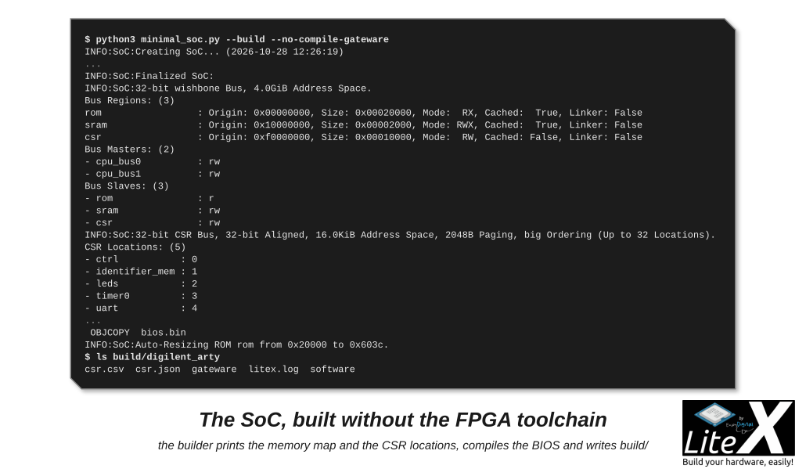

You will have a SoC with a CPU, a BIOS prompt on the serial port and a few lines of your own
logic, first on your computer with Verilator, then on a board, from a target script of forty
lines that you own. Ten minutes once [LiteX is installed](Installation.md). What the pieces are
is explained on [SoC builder](SoC-builder.md); this page is the walk-through.

## 1. In simulation, no board needed

```sh
litex_sim
```

Verilator compiles a SoC with a VexRiscv CPU, a ROM holding the BIOS, an SRAM and a UART, and
the BIOS prompt appears in the terminal:


*The BIOS lists the SoC it runs on, tries the boot methods and waits at its prompt.*

`help`, `mem_list`, `mem_read 0x10000000 32`: the same BIOS as on hardware. `Ctrl-C` ends it.
[SoC simulator](SoC-Simulator.md) has the options: DRAM, Ethernet, tracing, your own firmware.

## 2. A board: the one-line SoC

```sh
python3 -m litex_boards.targets.simple litex_boards.platforms.digilent_arty --build --load
litex_term /dev/ttyUSB1
```

Every board of [LiteX-Boards](https://github.com/litex-hub/litex-boards) has a platform file,
and the `simple` target builds a minimal SoC on any of them with the platform's default clock
and serial port: CPU, ROM, SRAM, UART, timer, a LED chaser, the BIOS prompt. The board's own
target (`python3 -m litex_boards.targets.digilent_arty --build --load`) adds what the board has,
DRAM, Ethernet, flash, with options (`--help`).

## 3. Your own target file

A target is a Python script. This one is the pattern of the LiteX-Boards targets reduced to the
minimum, for the Digilent Arty A7 (replace the platform, the clock and the PLL for yours:
[Add a new board](Add-A-New-Board.md)):

```python
#!/usr/bin/env python3
# minimal_soc.py
from migen import *
from litex.gen import *

from litex_boards.platforms import digilent_arty

from litex.soc.cores.clock import S7PLL
from litex.soc.cores.led import LedChaser
from litex.soc.integration.soc_core import SoCCore
from litex.soc.integration.builder import Builder

# CRG: the clocks and resets of the SoC ------------------------------------------------------------

class _CRG(LiteXModule):
    def __init__(self, platform, sys_clk_freq):
        self.cd_sys = ClockDomain()                      # the "sys" clock domain everything runs in
        self.pll = pll = S7PLL(speedgrade=-1)
        pll.register_clkin(platform.request("clk100"), 100e6)
        pll.create_clkout(self.cd_sys, sys_clk_freq)

# BaseSoC ------------------------------------------------------------------------------------------

class BaseSoC(SoCCore):
    def __init__(self, sys_clk_freq=100e6, **kwargs):
        platform = digilent_arty.Platform()
        self.crg = _CRG(platform, sys_clk_freq)
        SoCCore.__init__(self, platform, sys_clk_freq, ident="My minimal LiteX SoC", **kwargs)
        # Your logic: a core with CSRs is picked up automatically.
        self.leds = LedChaser(pads=platform.request_all("user_led"), sys_clk_freq=sys_clk_freq)

# Build --------------------------------------------------------------------------------------------

def main():
    from litex.build.parser import LiteXArgumentParser
    parser = LiteXArgumentParser(platform=digilent_arty.Platform, description="My minimal LiteX SoC.")
    parser.add_target_argument("--sys-clk-freq", default=100e6, type=float, help="System clock frequency.")
    args = parser.parse_args()

    soc     = BaseSoC(sys_clk_freq=args.sys_clk_freq, **parser.soc_argdict)
    builder = Builder(soc, **parser.builder_argdict)
    if args.build:
        builder.build(**parser.toolchain_argdict)
    if args.load:
        prog = soc.platform.create_programmer()
        prog.load_bitstream(builder.get_bitstream_filename(mode="sram"))

if __name__ == "__main__":
    main()
```

Three parts, and only the first one knows the board:

- The **CRG** (clock and reset generator) makes the `sys` clock domain everything runs in from
  the board's clock pin, with the PLL class of the FPGA family (`S7PLL`, `ECP5PLL`, `GW2APLL`,
  `iCE40PLL`...: [Cores](Cores.md#clocking)).
- `SoCCore(platform, sys_clk_freq, **kwargs)` adds the CPU (VexRiscv by default), the ROM with
  the BIOS, the SRAM, the UART on the platform's `serial` pins, the timer and the controller;
  `**kwargs` carries the command line options (`--cpu-type`, `--integrated-main-ram-size`,
  `--uart-baudrate`...).
- `self.leds = LedChaser(...)` is your logic: a core assigned as an attribute gets its CSRs
  (`leds_out`), its place in `csr.h` and `csr.csv`, nothing else to declare.

`main()` is the same in every target: parse the options, build the SoC, let the `Builder`
generate and compile, load the bitstream.

## 4. Build it without the FPGA toolchain first

```sh
python3 minimal_soc.py --build --no-compile-gateware
```

Everything is generated and the BIOS is compiled, but Vivado does not run: in a few seconds the
log prints the SoC that was built and `build/digilent_arty/` holds the Verilog, the constraints,
the BIOS and the software headers.



*The memory map, the bus masters and slaves and the CSR locations of the SoC, then its BIOS.*

Read the summary as the contract between the hardware and the software: `rom`, `sram` and
`csr` are the regions `mem.h` and the linker script know, the two bus masters are the CPU's
instruction and data buses, and `leds` is at CSR location 2 because the locations are allocated
in alphabetical order. The ROM is resized to the BIOS (24 KiB here). In `build/digilent_arty/`:

```
csr.csv  csr.json  litex.log
gateware/   digilent_arty.v  digilent_arty.xdc  digilent_arty.tcl  build_digilent_arty.sh  *.init
software/   include/generated/{csr.h,soc.h,mem.h,git.h,...}  bios/{bios.elf,bios.bin}  libbase/  libc/ ...
```

`--no-compile-gateware` is how you check a design and get its headers on a machine without the
toolchain, or see the effect of an option (`--cpu-type=serv --integrated-sram-size=0x1000`).

## 5. Build, load, talk to it

```sh
python3 minimal_soc.py --build --load          # Vivado in the PATH (or LITEX_ENV_VIVADO), a few minutes
litex_term /dev/ttyUSB1                        # 115200 8N1
```

The board resets, the LEDs chase and the BIOS prompt is there. Et voilà! `litex_term` is the
LiteX serial terminal (any terminal works); `--kernel demo.bin` boots an application, the next
step of the path. If nothing shows: check the serial device and the baudrate, that the clock pin
and the frequency of the CRG are the board's, and that the bitstream loaded (the programmer's
output).

## 6. Grow it

```sh
python3 minimal_soc.py --build --load --integrated-main-ram-size=0x8000      # 32 KiB of main RAM in block RAM
python3 minimal_soc.py --build --load --cpu-type=serv --cpu-variant=standard # a smaller CPU
python3 minimal_soc.py --build --load --uart-name=crossover+uartbone         # a host bridge on the serial port
```

In the target: `self.add_sdram(...)` for a DRAM, `self.add_ethernet(...)`, a
[core of your own](Add-A-New-Core.md), a [Verilog core](Reuse-An-Existing-Core.md),
[LiteScope](Use-LiteScope-To-Debug-A-SoC.md) to look inside. The LiteX-Boards target of your
board shows how its DRAM, Ethernet and flash are added ([Create a complex SoC](Create-A-Complex-SoC.md)).

## Next

- [Write firmware for it](Write-Firmware-For-Your-SoC.md): the next step of the path, your own program on this SoC.
- [SoC builder](SoC-builder.md): what `SoCCore` and `Builder` do behind the forty lines.
- [Add a new board](Add-A-New-Board.md): the platform file and the CRG of a board of your own.
- [SoC simulator](SoC-Simulator.md): more of `litex_sim`.
