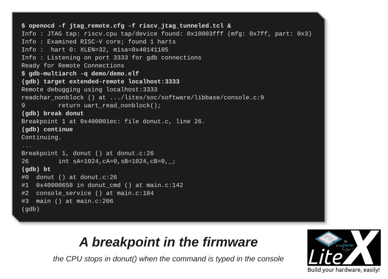

Stop your firmware on a breakpoint, read the backtrace, step through the code: GDB through
OpenOCD and a JTAG TAP, in simulation first, then on a board over a cable, over the FPGA's own
JTAG port (BSCANE2 on Xilinx) or over any [host bridge](Host-Bridges.md). This is for the
RISC-V CPUs with a standard debug module (VexRiscv-SMP, NaxRiscv, VexiiRiscv); the plain
VexRiscv has its own way, at the end of the page. Ten minutes in simulation.

## 1. A CPU with a debug module, and a firmware to debug

```sh
litex_sim --cpu-type=vexriscv_smp --with-sdram --with-rvc --with-privileged-debug --hardware-breakpoints 4 \
          --jtag-tap --with-jtagremote --no-compile-gateware        # the SoC and its headers, no simulator yet
litex_bare_metal_demo --build-path=build/sim/                        # the demo firmware against them
litex_sim --cpu-type=vexriscv_smp --with-sdram --sdram-init demo.bin --with-rvc --with-privileged-debug \
          --hardware-breakpoints 4 --jtag-tap --with-jtagremote     # terminal 1: the SoC boots the demo
```

The options are the ones you will use on a board too:

| Option | What it adds |
| --- | --- |
| `--with-privileged-debug` | The RISC-V debug module in the CPU (halt, registers, memory, single step). |
| `--hardware-breakpoints 4` | Four hardware breakpoints (the code runs from SDRAM, software ones work too). |
| `--jtag-tap` | A JTAG TAP on pins; `--with-jtagremote` connects it to a TCP port in simulation. |
| `--with-rvc` | Compressed instructions: the demo is built with them. |
| `--sdram-init demo.bin` | The firmware in the simulated SDRAM, booted by the BIOS. |

The first SpinalHDL generation of this cluster takes a few minutes (Java and `sbt`); the
netlist is kept. The first `litex_sim` writes the headers the demo needs without compiling the
simulator; the second one compiles it and boots the demo, whose console is in this terminal.

## 2. OpenOCD and GDB

Two files for OpenOCD: the adapter, here the TCP port of `--with-jtagremote`
(`jtag_remote.cfg`; OpenOCD 0.11 spells it `remote_bitbang_host` and `remote_bitbang_port`):

```tcl
adapter speed 10000
adapter driver remote_bitbang
remote_bitbang host localhost
remote_bitbang port 44853
```

and the target (`riscv_jtag_tunneled.tcl`), the same for every setup of this page: one TAP,
one target per hart (`RISCV_COUNT`), the BSCAN tunnel when the TAP is reached through the
FPGA's one (`TAP_NAME`):

```tcl
set _CHIPNAME riscv
set _TARGETNAME $_CHIPNAME.cpu
set cpu_count 1
if [info exists env(RISCV_COUNT)]  {
    set cpu_count $::env(RISCV_COUNT)
}

if { [info exists TAP_NAME] } {
    set _TAP_NAME $TAP_NAME
} else {
    set _TAP_NAME $_TARGETNAME
}

adapter speed 500

# external jtag probe
if {$_TAP_NAME eq $_TARGETNAME} {
    jtag newtap $_CHIPNAME cpu -irlen 6 -expected-id 0x10003FFF
}

for {set i 0} {$i < $cpu_count} {incr i} {
  target create $_TARGETNAME.$i riscv -coreid $i -chain-position $_TAP_NAME
  riscv use_bscan_tunnel 6 1
}

for {set i 0} {$i < $cpu_count} {incr i} {
    targets $_TARGETNAME.$i
    init
    halt
}

echo "Ready for Remote Connections"
```

```sh
openocd -f jtag_remote.cfg -f riscv_jtag_tunneled.tcl    # terminal 2: finds the TAP, halts the CPU, listens on 3333
gdb-multiarch -q demo/demo.elf                            # terminal 3 (or riscv64-unknown-elf-gdb)
(gdb) target extended-remote localhost:3333
(gdb) break donut
(gdb) continue
```

Now type `donut` in the console of the simulation (terminal 1):



GDB stops in `donut()`. From there `bt` shows the call chain from `main()`, `next` and `step`
walk the code, `info locals` and `p` read the variables, `continue` lets the donut spin. The simulated TAP is
bit-banged over TCP, so `set remotetimeout 60` spares you the timeouts of a slow `load` or
`next`. `load` writes `demo.elf` into the SDRAM through the TAP, if you prefer not to boot it.

## 3. On a board, with a JTAG cable

Expose the TAP of the CPU on a connector, here a PMOD of the Digilent Arty, in the target:

```python
from litex.build.generic_platform import Subsignal, Pins, IOStandard
soc.platform.add_extension([
    ("pmod_jtag", 0,
        Subsignal("tms", Pins("pmodd:0")),
        Subsignal("tdi", Pins("pmodd:1")),
        Subsignal("tdo", Pins("pmodd:3")),
        Subsignal("tck", Pins("pmodd:2")),
        IOStandard("LVCMOS33")
    )
])
jtag = soc.platform.request("pmod_jtag")
soc.comb += [
    soc.cpu.jtag_clk.eq(jtag.tck),
    soc.cpu.jtag_tms.eq(jtag.tms),
    soc.cpu.jtag_tdi.eq(jtag.tdi),
    jtag.tdo.eq(soc.cpu.jtag_tdo)
]
soc.platform.add_platform_command("create_clock -name jtag_tck -period 20.0 [get_nets jtag_tck]")
soc.platform.add_false_path_constraints(soc.crg.cd_sys.clk, jtag.tck)
```

```sh
python3 -m litex_boards.targets.digilent_arty --cpu-type=vexriscv_smp --with-rvc --with-privileged-debug \
        --hardware-breakpoints=4 --jtag-tap --build --load
openocd -f digilent-hs2.cfg -f riscv_jtag_tunneled.tcl
gdb-multiarch -q demo/demo.elf -ex "target extended-remote localhost:3333"
```

The adapter file describes the cable, here a Digilent JTAG-HS2 (`digilent-hs2.cfg`):

```tcl
adapter driver ftdi
ftdi vid_pid 0x0403 0x6014
ftdi channel 0
ftdi layout_init 0x00e8 0x60eb
reset_config none
```


## 4. On a board, through the FPGA's JTAG port

No cable to add on Xilinx FPGAs: `--with-cpu-jtag-debug` instantiates the BSCANE2 primitive on
the USER4 chain, connects it to the CPU's JTAG interface and adds the timing constraints
(`soc.add_cpu_jtag_debug(chain=4, clk_freq=10e6)` in a target; `--cpu-jtag-debug-chain` picks
another USER chain, JTAGBone uses USER1 and both coexist; Zynq devices are out, their TAP
belongs to the PS):

```sh
python3 -m litex_boards.targets.digilent_arty --cpu-type=vexriscv_smp --with-rvc --with-privileged-debug \
        --hardware-breakpoints=4 --with-cpu-jtag-debug --build --load
openocd -f digilent_arty.cfg -c "set TAP_NAME xc7.tap" -f riscv_jtag_tunneled.tcl
gdb-multiarch -q demo/demo.elf -ex "target extended-remote localhost:3333"
```

`digilent_arty.cfg` is the onboard FTDI of the Arty plus the Xilinx TAP description:

```tcl
adapter driver ftdi
ftdi vid_pid 0x0403 0x6010
ftdi channel 0
ftdi layout_init 0x00e8 0x60eb
ftdi tdo_sample_edge falling
reset_config none
adapter speed 5000
source [find cpld/xilinx-xc7.cfg]
source [find cpld/jtagspi.cfg]
```

<details>
<summary>The wiring by hand, if you want to see it</summary>

```python
from litex.soc.cores.jtag import XilinxJTAG
soc.jtag = jtag = XilinxJTAG(XilinxJTAG.get_primitive(soc.platform.device), chain=4, platform=soc.platform)
soc.comb += [
    soc.cpu.jtag_reset.eq(jtag.reset),
    soc.cpu.jtag_capture.eq(jtag.capture),
    soc.cpu.jtag_shift.eq(jtag.shift),
    soc.cpu.jtag_update.eq(jtag.update),
    soc.cpu.jtag_clk.eq(jtag.tck),
    soc.cpu.jtag_tdi.eq(jtag.tdi),
    soc.cpu.jtag_enable.eq(jtag.sel),
    jtag.tdo.eq(soc.cpu.jtag_tdo),
]
```

</details>

## 5. Through any host bridge

When no USER chain is free, no cable fits, or the board is a PCIe card in a server, the debug
TAP is driven through CSRs over the [bridge](Host-Bridges.md): `litex_jtag` bit-bangs the
`cpu_jtag_debug` registers through `litex_server` and serves OpenOCD's `remote_bitbang`
protocol on port 3335. Slower than a cable, it works everywhere the bridge does, the
simulation included.

```sh
python3 -m litex_boards.targets.digilent_arty --cpu-type=vexriscv_smp --with-privileged-debug --hardware-breakpoints=4 \
        --with-cpu-jtag-debug --cpu-jtag-debug-transport=csr --with-etherbone --build --load
litex_server --udp                                    # or --uart, --jtag, --pcie: any transport
litex_jtag --csr-csv=build/digilent_arty/csr.csv      # an OpenOCD remote_bitbang server on 127.0.0.1:3335
openocd -c "adapter driver remote_bitbang" -c "remote_bitbang host 127.0.0.1" -c "remote_bitbang port 3335" -f riscv.cfg
gdb-multiarch -q demo/demo.elf -ex "target extended-remote localhost:3333"
```

## 6. The CPUs

- **VexRiscv-SMP**: `--with-privileged-debug`, `--hardware-breakpoints=N`, then `--jtag-tap`
  (pins) or `--with-cpu-jtag-debug` (BSCAN); `--with-swd-debug` gives SWD instead of JTAG
  (`--with-swdremote` in simulation).
- **NaxRiscv** and **VexiiRiscv**: `--with-jtag-tap` (pins) or `--with-jtag-instruction` (the
  tunneled TAP `--with-cpu-jtag-debug` uses); the same OpenOCD files apply.
- The mechanism is described in
  [doc/cpu_jtag_debug.md](https://github.com/enjoy-digital/litex/blob/master/doc/cpu_jtag_debug.md)
  of the repository; the OpenOCD files of the usual cables are in its `prog/` directory
  (`openocd_xc7_ft232.cfg`, `openocd_xc7_ft2232.cfg`, `openocd_xc7_ft4232.cfg`).

## 7. The plain VexRiscv: the `+debug` variant

The single-core `vexriscv` has no RISC-V debug module; its debug plugin is reached through a
LiteX bridge with SpinalHDL's fork of OpenOCD, and `litex_term crossover` and your scripts keep
using the same bridge during the session:

```sh
git clone https://github.com/SpinalHDL/openocd_riscv.git && cd openocd_riscv
wget https://raw.githubusercontent.com/litex-hub/pythondata-cpu-vexriscv/master/pythondata_cpu_vexriscv/verilog/VexRiscv_Debug.yaml -O cpu0.yaml
./bootstrap && ./configure --enable-dummy && make
```

```sh
python3 -m litex_boards.targets.digilent_arty --cpu-type=vexriscv --cpu-variant=standard+debug \
        --uart-name=crossover+uartbone --csr-csv=csr.csv --build --load
litex_server --uart --uart-port=/dev/ttyUSB0
./src/openocd -c 'adapter driver dummy' -c 'adapter speed 1' -c 'jtag newtap lx cpu -irlen 4' \
    -c 'target create lx.cpu0 vexriscv -endian little -chain-position lx.cpu -dbgbase 0xF00F0000' \
    -c 'vexriscv cpuConfigFile cpu0.yaml' -c 'vexriscv networkProtocol etherbone' -c 'init' -c 'reset halt'
riscv64-unknown-elf-gdb build/digilent_arty/software/bios/bios.elf -ex 'target remote localhost:3333'
litex_term crossover
```

OpenOCD complains about the scan chain (`TAP lx.cpu does not have valid IDCODE`, `IR capture
error`: there is no real chain) and ends with `Listening on port 3333 for gdb connections`;
GDB then shows `_start () at .../vexriscv/crt0.S:6`. The variants are `minimal+debug`,
`lite+debug`, `standard+debug`, `full+debug`, `linux+debug`, `secure+debug`, `+hwbp` for
hardware breakpoints, and any bridge works (`--with-jtagbone`, `--with-etherbone`).


## Next

- [Control it from the host](Host-Bridges.md): the bridges `litex_jtag` and the `+debug` variant tunnel through.
- [Write firmware for it](Write-Firmware-For-Your-SoC.md): the demo you just stopped, and how to load yours.
- [Choosing a CPU](Choosing-A-CPU.md): VexRiscv, VexRiscv-SMP, NaxRiscv, VexiiRiscv and the others.
- [SoC simulator](SoC-Simulator.md): more of `litex_sim`, including waveform tracing when GDB is not the right tool.
