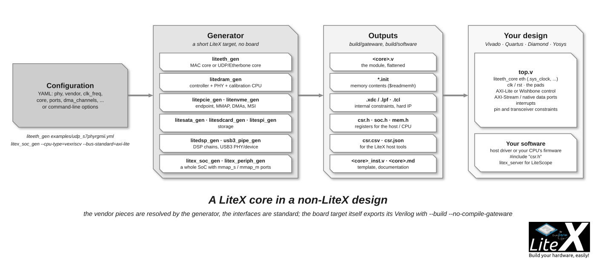

# Export your core/SoC to Verilog

A LiteX design does not have to be the whole chip: the cores and the SoC builder export
plain Verilog modules with standard interfaces (AXI-Lite, AXI-Stream, Wishbone, native
ports) for a Vivado, Quartus, Diamond or Yosys project written in Verilog/VHDL/SystemVerilog.
This is how LiteDRAM, LiteEth, LitePCIe or LiteSATA are used in many non-LiteX designs, and
how a LiteX SoC (CPU, BIOS, peripherals) becomes a subsystem of a bigger FPGA design. The
other direction, a Verilog/VHDL core inside a LiteX SoC, is on the
[Reuse a core](Reuse-a-SystemVerilog-VHDL-Amaranth-Spinal-HDL-Chisel-core.md) page.



## A SoC as a Verilog module: `litex_soc_gen`

```sh
litex_soc_gen --name=my_soc --cpu-type=vexriscv --bus-standard=axi-lite --integrated-main-ram-size=0x10000 --build
```

generates `build/my_soc/gateware/my_soc.v`, a module with:

| Ports | Role |
| --- | --- |
| `clk`, `rst` | The system clock (`--sys-clk-freq`, 50 MHz by default) and an active-high reset. |
| `uart_tx`, `uart_rx` | The console of the BIOS/firmware (`--no-uart` to remove it, `--with-uartbone` for a bridge). |
| `mmap_s_*` | A slave port on the SoC's main bus (Wishbone or AXI-Lite): your logic or another CPU accesses the SoC's memories and CSRs. |
| `mmap_m_*` | A master port: the SoC's CPU accesses your logic through a window (`0xa0000000`, 256 MiB). |
| `debug[7:0]` | Spare signals (an example to extend). |

The CPU, memories and peripherals are those of any `SoCCore` (`--cpu-type`, `--cpu-variant`,
`--integrated-rom-size`, `--integrated-sram-size`, `--integrated-main-ram-size`, `--uart-*`,
`--timer-*`, `--csr-*`...). The BIOS is compiled and placed in the ROM; the software support
(`csr.h`, `soc.h`, `mem.h`, `csr.csv`...) is in `build/my_soc/software/`, so the firmware of
your subsystem is built like any LiteX firmware ([Create and load software](Create-And-Load-Software-To-The-CPU.md));
`--integrated-rom-init=firmware.bin` puts your application in the ROM instead of the BIOS.

`litex_periph_gen` is the same generator without the SoC defaults: with `--cpu-type=None`,
`--integrated-rom-size=0 --integrated-sram-size=0 --no-timer --no-uart --no-ctrl` it exports
a set of LiteX peripherals behind a Wishbone/AXI-Lite slave port (`mmap_s_*`): a register
file with the C accessors, a timer, GPIOs, SPI/I2C masters... for a design that has its own
CPU. Add cores to either generator by editing their short scripts
(`litex/tools/litex_soc_gen.py`, `litex_periph_gen.py`): they are 150-line targets.

Integration: add the `.v` and the `*.init` files of `build/my_soc/gateware/` (the memories
are initialized with `$readmemh`, the files must be found by the tool, usually next to the
Verilog or with an include path) to the project, instantiate the module, constrain `clk`.

```verilog
my_soc soc (
    .clk(clk), .rst(rst),
    .uart_tx(uart_tx), .uart_rx(uart_rx),
    .mmap_s_awvalid(...), ...        // the AXI-Lite slave, from your logic
    .mmap_m_awvalid(...), ...        // the AXI-Lite master, to your logic
    .debug()
);
```

## A core as a Verilog module: the `*_gen` generators

Each ecosystem core has a generator that reads a YAML configuration and writes the core with
its vendor-specific pieces (PHY, hard IP, PLLs) resolved:

| Generator | Produces | Interfaces of the core | Configurations |
| --- | --- | --- | --- |
| `liteeth_gen config.yml` | `liteeth_core.v` + constraints, `csr.csv` | `sys_clock`/`sys_reset`, the PHY pads (MII, RMII, GMII, RGMII, SGMII, 1000BASE-X, 10G BASE-R, XGMII...), `mac_address`/`ip_address` inputs; `core: wishbone`/`axi-lite`: a MAC with slots behind a slave port and an `interrupt` (for a CPU running a software stack); `core: udp`: the hardware ARP/ICMP/UDP stack (DHCP optional) with UDP ports as AXI-Stream (`udp0_sink_*`/`udp0_source_*`, streamer or raw mode) and an Etherbone AXI-Lite master | Xilinx and Lattice PHYs, 8 to 512-bit datapaths, jumbo frames (`liteeth/doc/gen.md`, `examples/*.yml`) |
| `litedram_gen config.yml` | `litedram_core.v` + `.xdc`/`.lpf`, `*.init`, `csr.h`/`sdram_phy.h`, the BIOS | `clk` (the PLL is inside), `user_clk`/`user_rst` outputs, `init_done`/`init_error`, the DRAM pads, user ports `user_port_<n>_*` of type `native`, `wishbone`, `avalon`, `axi` or `fifo`; a UART (`rs232` or `fifo`) for the calibration CPU, or `wb_ctrl_*` with `cpu: None` | SDR on every FPGA, DDR3 on ECP5, DDR2/DDR3 on 7-Series, DDR4 on UltraScale(+) (`examples/arty.yml`, `kcu105.yml`, `versa_ecp5.yml`...) |
| `litepcie_gen config.yml` | `litepcie_core.v` + the hard IP TCL, `csr.h`/`soc.h`/`mem.h` | `clk`/`rst` (outputs from the PCIe clock, or inputs with `clk_external`), `pcie_*`, `mmap_axi_lite_*` master (BAR0 to your logic), `mmap_slave_axi_*` (to the host memory), `ctrl_axi_lite_*`, `dma<n>_writer_axi_t*`/`dma<n>_reader_axi_t*` AXI-Stream, `msi_irqs` | 7-Series, UltraScale(+), Cyclone V, GW5A, CertusPro-NX (`examples/acorn.yml`, `kcu105.yml`) |
| `litesata_gen config.yml` | `litesata_core.v` + `.xdc`, `csr.csv` | `clk`/`rst`, `sata_*`, `enable`/`ready`/`link_up`, `irq`, native user ports (`sector`, `count`, `data` streams) or a `wb_ctrl_*`/`axil_ctrl_*` slave and a `wb_dma_*` master | Xilinx GTP/GTX/GTH/GTY, Gen1 to Gen3 (`doc/gen.md`, `examples/*.yml`) |
| `litesdcard_gen --vendor xilinx --clk-freq 100e6` | `litesdcard_core.v` | `clk`/`rst`, `sdcard_*`, `irq`, `wb_ctrl_*` slave, `wb_dma_*` master | Xilinx, Intel, Lattice |
| `litespi_gen --module S25FL128L --mode x4 --bus-standard axi-lite` | `litespi_core.v` + `.init` | `clk`, `spiflash4x_*`, a `bus_*` slave (memory-mapped flash), `master_*` | any vendor (generic PHY) |
| `litenvme_gen config.yml` | `litenvme_core.v` + `.tcl`/`.xdc`, the firmware ROM `.init`, headers | `pcie_*`, `rst_n`, `clk`/`rst`, `serial_*`, `status_init_*`, `block_ctrl_*` (start/write/sector/count), 256-bit `block_wr_axis_*`/`block_rd_axis_*` | UltraScale+ Gen3 x4 (`doc/STANDALONE_CORE.md`) |
| `litedsp_gen config.yml`, `litedsp_flow netlist.json` | `<name>.v`, `csr.*`, `blocks.json`, a Vivado IP (`--vivado-ip`) | `s_axil_*` control, per-port `<id>_valid/_ready/_last/_payload_i/_q` streams | DSP chains described in YAML/JSON (`doc/flow.md`) |
| `usb3_pipe_gen config.yml` | `<name>.v` + scoped `.xdc`, `*.init`, `<name>_inst.v` template, `<name>.md` | the SerDes pads, `clk`/`refclk`, 32-bit `sink_*`/`source_*` AXI-Stream (the PHY), or `bulk_in_*`/`bulk_out_*` with the USB3 device core | Artix-7 GTP, Kintex-7 GTX, UltraScale+ GTY (`doc/standalone-core.md`) |

A LiteEth UDP core, `examples/udp_s7phyrgmii.yml` shortened:

```yaml
phy         : LiteEthS7PHYRGMII
vendor      : xilinx
toolchain   : vivado
clk_freq    : 125e6
core        : udp
mac_address : 0x10e2d5000000
ip_address  : 192.168.1.50
data_width  : 8
udp_ports : {
  "udp0" : {"udp_port": 2000, "ip_address": "192.168.1.100", "data_width": 32, "tx_fifo_depth": 64, "rx_fifo_depth": 64},
  "udp1" : {"data_width": 32, "tx_fifo_depth": 64, "rx_fifo_depth": 64},
}
```

```sh
liteeth_gen examples/udp_s7phyrgmii.yml --output-dir build        # build/gateware/liteeth_core.v, .xdc, csr.csv
```

## Integration checklist

1. **Files**: the `.v`, every `*.init` next to it (the memories use `$readmemh`), the
   emitted constraints (`.xdc`/`.lpf`: internal clocks and CDC, to be scoped to the instance
   in a bigger project) and, for PCIe/NVMe, the TCL that generates the hard IP.
2. **Clocks and resets**: read the generator's documentation for the core: LiteEth takes
   `sys_clock` at the configured frequency; LiteDRAM takes the board clock and gives
   `user_clk`/`user_rst` back (use them, wait for `init_done`); LitePCIe/LiteNVMe drive
   `clk`/`rst` from the link unless `clk_external`.
3. **Pins**: the transceiver locations, the reference clocks and the I/O standards are
   constrained by the integrator (the core cannot know the board); the `_inst.v` template
   (USB3-PIPE) or the port list of the `.v` gives the names.
4. **Software**: the `csr.h`/`soc.h`/`mem.h` headers describe the registers of the core for
   the host (LitePCIe driver) or the CPU driving it over the control port; `csr.csv` for the
   LiteX host tools.
5. **Simulate first**: `litedram_gen --sim`, `litespi_gen --sim`, or the core's `test/`;
   LiteScope can still be added to a standalone core through its Etherbone/PCIe port.

## Exporting a board target without building it

`python3 target.py --build --no-compile-gateware` writes the Verilog, the constraints and the
build script of any LiteX-Boards target without running the toolchain:
`build/<board>/gateware/<board>.v` is a complete top level for the board that can be built or
edited elsewhere. `--hierarchical-verilog` keeps the module hierarchy (one Verilog module per
`LiteXModule`) instead of the flattened netlist, which makes a large design readable in the
vendor tools and lets you reuse a sub-module.
