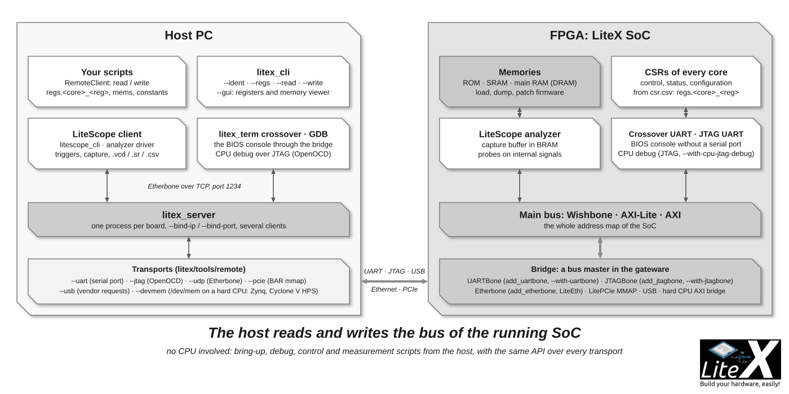
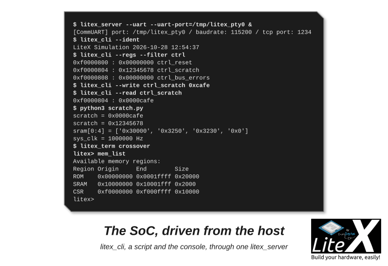

A bridge is a bus master the host drives over the serial port, JTAG, Ethernet or PCIe; the CPU
does not even know it is there. With it you read and write the registers and the memory of
the running SoC from your computer, with `litex_cli` or a Python script of five lines. It is
how we bring up boards, how [LiteScope](Use-LiteScope-To-Debug-A-SoC.md) gets its captures
out, and how plenty of LiteX systems run with no firmware at all. Ten minutes.



## 1. Add a bridge to the SoC

```sh
python3 -m litex_boards.targets.digilent_arty --uart-name=crossover+uartbone --build --load   # a board
litex_sim --uart-name=crossover+uartbone --uart-pty --csr-csv csr.csv                          # or litex_sim
```

`crossover+uartbone` turns the serial port into a UARTBone bridge and moves the CPU console to
a crossover UART, a UART whose other end is a set of registers: the console stays reachable
through the bridge (step 4). On a board the bridge is on the USB-UART you already use; in
simulation it is on the PTY `/tmp/litex_pty0`. The tools find the registers in `csr.csv`,
written in `build/<board>/` (`--csr-csv csr.csv` writes it in the current directory).

## 2. Start litex_server, talk with litex_cli

```sh
litex_server --uart --uart-port=/dev/ttyUSB1   # the board; /tmp/litex_pty0 for litex_sim
litex_cli --ident
litex_cli --regs --filter ctrl
litex_cli --write ctrl_scratch 0xcafe
litex_cli --read ctrl_scratch
```



`0xcafe` came back, so the host owns the bus. `litex_server` holds the transport and serves
every client over TCP (port 1234, several clients at once, the accesses serialized); `litex_cli` is the command line client: `--regs`
dumps every register (`--filter` keeps the ones whose name contains a word), `--read 0x40000000
--length 64` and `--write leds_out 0x5` take an address or a register name, `--gui` opens a
viewer of the registers and the memory. Both read `csr.csv` from the current directory
(`--csr-csv build/<board>/csr.csv` from anywhere else).

## 3. A script of your own

`RemoteClient` is the Python side of the bridge, `csr.csv` gives it the names:

```python
from litex import RemoteClient

bus = RemoteClient()                 # host="localhost", port=1234, csr_csv="csr.csv"
bus.open()
print(f"scratch = 0x{bus.regs.ctrl_scratch.read():08x}")
bus.regs.ctrl_scratch.write(0x12345678)
print(f"sram[0:4] = {[hex(w) for w in bus.read(bus.mems.sram.base, 4)]}")
print(f"sys_clk = {bus.constants.config_clock_frequency} Hz")
bus.close()
```

`regs.<core>_<register>` has `.read()` and `.write()`, `mems.<region>` has `.base`, `.size`
and `.type`, `constants.<name>` holds the values of `soc.add_constant()`; `bus.read(addr, n)`
and `bus.write(addr, [words])` reach any address, several words go as one burst. The register
names are the ones of `csr.csv`: `<module>_<csr>`, the module path flattened. Every bring-up
script we write starts like this.

## 4. The console and the CPU through the bridge

```sh
litex_term crossover                  # the BIOS or firmware console, through litex_server
litex_term jtag --jtag-config=openocd_xc7_ft2232.cfg   # --uart-name=jtag_uart: the console on the JTAG port
```

`litex_term crossover` reads and writes the crossover UART's registers through `litex_server`,
so one cable carries the console and the bridge. The CPU's debug port can go the same way:
`--with-cpu-jtag-debug --cpu-jtag-debug-transport=csr` and `litex_jtag` give OpenOCD and GDB a
JTAG TAP over any bridge ([Debug with GDB](Debug-With-GDB.md)).

## 5. The other bridges

Pick the transport you have; UARTBone is enough for bring-up, Etherbone or PCIe when the speed
matters, JTAGBone when no pin is free:

| Bridge | Add it with | Start the server with |
| --- | --- | --- |
| UARTBone | `--uart-name=crossover+uartbone`, `--with-uartbone` or `soc.add_uartbone()` | `litex_server --uart --uart-port=/dev/ttyUSB1` |
| JTAGBone | `--with-jtagbone` or `soc.add_jtagbone()`: the FPGA's own JTAG port, no pin | `litex_server --jtag --jtag-config=openocd_xc7_ft232.cfg` |
| Etherbone | `--with-etherbone --eth-ip=192.168.1.50` or `soc.add_etherbone(phy=...)` | `litex_server --udp --udp-ip=192.168.1.50` |
| PCIe | `--with-pcie`: the BAR0 of the device, with the DMAs and interrupts | `litex_server --pcie --pcie-bar=02:00.0` |
| USB | a device answering the vendor requests of `comm_usb.py` | `litex_server --usb --usb-vid=... --usb-pid=...` |
| DevMem | the AXI bridge of a hard CPU (Zynq, Cyclone V HPS, Agilex HPS) | `litex_server --devmem --devmem-base=0xff200000` |

- **UARTBone on its own serial port**: add the pins to the platform file (`("serial_debug", 0,
  Subsignal("tx", Pins(...)), Subsignal("rx", Pins(...)), IOStandard(...))`), connect a USB-UART
  dongle, and `self.add_uartbone(uart_name="serial_debug", baudrate=115200)` in the SoC; 1 to
  3 Mbaud when the dongle allows it.
- **JTAGBone** is a `JTAGPHY` on the vendor TAP (Xilinx BSCANE2, Lattice JTAGG, Intel, Gowin,
  Efinix) carrying the UARTBone protocol; the OpenOCD files of the usual cables are in `prog/`
  of LiteX and LiteX-Boards (`openocd_xc7_ft232.cfg`, `openocd_xc7_ft2232.cfg`,
  `openocd_xc7_ft4232.cfg`, `--jtag-chain=1` by default).
- **Etherbone** sends Wishbone records in UDP packets ([the Etherbone
  protocol](https://ohwr.org/project/etherbone-core)): fast and routable, the MAC shared with
  the CPU's Ethernet when both are enabled (`--with-ethernet --with-etherbone`). By hand:

  ```python
  from liteeth.phy import LiteEthPHYRMII      # or LiteEthPHYMII, LiteEthPHYRGMII, ...
  self.ethphy = LiteEthPHYRMII(clock_pads=self.platform.request("eth_clocks"), pads=self.platform.request("eth"))
  self.add_etherbone(phy=self.ethphy, ip_address="192.168.1.50", mac_address=0x10e2d5000001)
  ```

  `litex_server --udp --udp-scan --udp-ip=192.168.1.x` lists the Etherbone devices of the
  network.
- **PCIe**: `litex_server` maps the BAR of the device through sysfs, no kernel driver needed;
  `lspci` gives its address (`02:00.0 Memory controller: Xilinx Corporation Device 7024`).
  [Create a PCIe SoC](Create-A-PCIe-SoC.md) builds one.
- **USB**: 32-bit accesses on the control endpoint, a protocol inherited from the Fomu; LiteX's
  own USB path today is the LUNA CDC-ACM console (`--uart-name=usb_acm`).
- **DevMem**: `/dev/mem` on the Linux of the hard CPU; the Cyclone V lightweight bridge is at
  `0xff200000`, the Zynq GP0 at `0x40000000` ([Hard core CPUs](Hard-core-CPUs.md)).

A design can have several bridges (UARTBone for bring-up, Etherbone for speed): each one is a
bus master arbitrated with the CPU and the DMAs ([SoC builder](SoC-builder.md#the-bus-and-its-handler)).
`--bind-ip` and `--bind-port` make `litex_server` reachable from another machine, `--debug`
prints every access.

## 6. How it works

UARTBone is a byte protocol handled by `Stream2Wishbone` in the gateware
(`litex/soc/cores/uart.py`): a command byte (`0x01` write, `0x02` read, `0x03` and `0x04` the
same at a fixed address), a length (1 to 255 words), the address (4 bytes, 8 with
`--addr-width=64`) and the data words, MSB first; the FSM resets after 100 ms without a
complete command. JTAGBone carries the same bytes over the TAP. Etherbone packets hold read and
write records, over UDP to the FPGA and over TCP between the clients and `litex_server`. PCIe,
USB and DevMem are plain 32-bit memory-mapped accesses. The host side is one class per
transport in `litex/tools/remote/` (`comm_uart.py`, `comm_udp.py`, `comm_pcie.py`,
`comm_usb.py`, `comm_devmem.py`) with `read(addr, length)` and `write(addr, datas)`: a new
transport is one file.

## Next

- [Look inside with LiteScope](Use-LiteScope-To-Debug-A-SoC.md): a logic analyzer in the SoC, read through this bridge.
- [Debug the CPU with GDB](Debug-With-GDB.md): OpenOCD and GDB on the CPU, over JTAG or over the bridge.
- [SoC builder](SoC-builder.md): how the bridge becomes a bus master next to the CPU.
- [Wishbone bus](Wishbone-Bus.md): the bus the bridge speaks.
