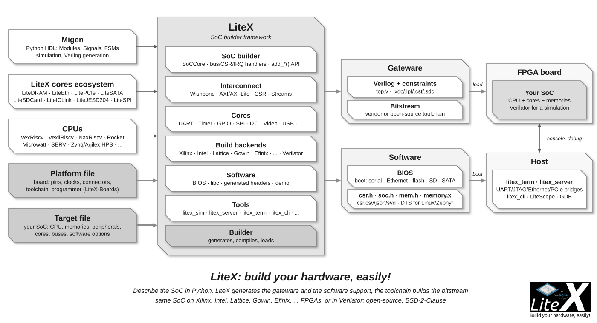

This is how we build with LiteX, and why the code, the cores and these pages fit together:
Python as the glue and Migen as the HDL, cores with stable contracts, layers that keep a
protocol independent of the FPGA, simulation first and instruments on the hardware. LiteX has
been used since 2012 on systems for clients and on open-source projects, and the framework is
what worked on them. Read this once; the rest of the wiki assumes it.

## Python is the glue, Migen the HDL

A LiteX design is a Python program. [Migen](https://github.com/m-labs/migen) describes the
logic (Modules, Signals, finite state machines, clock domains) and generates the Verilog;
Python does everything around it: parameters, address maps, generated software headers,
toolchain scripts, simulation, host scripts talking to the running SoC. This is what makes a
SoC a few lines long: the heavy lifting is in reusable cores and in the integration logic
of the framework, not in each design.

Migen is a small DSL (`sync` vs `comb`, `Signal`, `If/Else`, `FSM`, `Record`) shared by the
whole ecosystem of cores, and LiteX stays on it: it is stable, well understood, and no longer a
barrier for an engineer coming from Verilog/VHDL, all the more since today's AI coding assistants
are fluent in it. The [LiteX for Hardware Engineers](LiteX-for-Hardware-Engineers.md) page
is written for that reader, and existing Verilog/VHDL/Amaranth/SpinalHDL/Chisel cores are
[reused as they are](Reuse-An-Existing-Core.md), converted
to Verilog at build time when needed.

## A SoC is a composition of cores with stable contracts

Cores talk to each other and to the CPU through a small number of interfaces, and the whole
framework is built on them:

- [Streams](Streams.md) (`valid`/`ready`/`first`/`last`/`payload`/`param`) for data paths:
  converters, FIFOs, packetizers and clock domain crossings are generic and reused by every
  core.
- [Wishbone](Wishbone-Bus.md) and [AXI/AXI-Lite](AXI-Bus.md) for memory-mapped traffic, with
  an interconnect (shared bus or crossbar), width/burst converters and bridges between them.
- [CSRs](CSR-Bus.md) (control/status registers, generated by `AutoCSR`) for control: the same
  Python declaration gives the hardware register, its address, the C/Rust header, the
  `csr.csv/json/svd` description and the documentation.
- `EventManager` for interrupts.

Because the contracts are stable, a core written for one project (a video pipeline, a PCIe DMA,
a SerDes link) drops into another, and the [SoC builder](SoC-builder.md) can wire the common
parts (`add_sdram`, `add_ethernet`, `add_pcie`, `add_sdcard`, ...) in one call each.

## Layered for portability

A protocol does not depend on the FPGA it runs on. The
[architectural style](https://github.com/enjoy-digital/litex/blob/master/doc/architectural_style.md)
document is the reference; in short, each decision lives in its owning layer:

| Layer | Owns |
| --- | --- |
| Protocol core (LiteEth MAC, LitePCIe endpoint, LiteDRAM controller...) | framing, state machines, stream behavior |
| Device adapter (`litex/build/<vendor>`, the PHYs) | primitives, PLLs, SerDes, I/O, clock domains, reset sequences |
| Integration wrapper | the stable stream/control/CSR interface between the two |
| Platform and target | pins, clocks, constraints, which cores are instantiated |

This is why the same SoC builds for Xilinx, Intel, Lattice, Gowin, Efinix, CologneChip, Anlogic
or Microsemi parts, with vendor toolchains or the open-source ones (Yosys/nextpnr, Project
Trellis/IceStorm/Oxide/Apicula/Peppercorn, F4PGA), and in [Verilator](SoC-Simulator.md).
Adding a device means writing an adapter, not a copy of the protocol.

## Simulation first, hardware with instruments

- Cores are developed with Migen's Python simulator and `pytest` (`test/` in each
  repository: unit tests with Python models, CI on every push).
- A full SoC runs in Verilator with its real BIOS and firmware (`litex_sim`), with models for
  the serial port, Ethernet (TAP), SDRAM, SPI flash, SD card...; [QEMU co-simulation](SoC-Simulator.md)
  runs the CPU in QEMU against the simulated gateware.
- On hardware, the SoC is never a black box: a [host bridge](Host-Bridges.md) (UART, JTAG,
  Ethernet, PCIe) exposes the whole address space to the host (`litex_server`, `litex_cli`,
  Python scripts), [LiteScope](Use-LiteScope-To-Debug-A-SoC.md) captures internal signals
  through the same bridge, and the CPU is debugged with [GDB over JTAG](Debug-With-GDB.md).
  A board bring-up starts with the bridge and the BIOS, before any application.

## Experiment, get it working, understand, refine, strip down

The method behind most LiteX features: experiment to get a first working version, understand
why it works, refine it, then strip it down to the solid foundation that the next project
builds on. Features land when they have been used on real hardware; the
[Projects](Projects.md) page shows where they come from, and the recent ones
([USB3-PIPE](https://github.com/enjoy-digital/usb3_pipe), [TriXium](https://github.com/enjoy-digital/trixium),
[LiteX-M2SDR](https://github.com/enjoy-digital/litex_m2sdr)) are documented with the same
approach: simulation, measurements on the board, then upstream contributions to LiteX and the
cores.

## Practical rules

- **No vendor IP in the protocol cores.** Vendor primitives stay in the device adapters, so
  that a design can move between vendors and to the open-source toolchains.
- **Keep the public names.** Class names, constructor arguments, CSR layouts, command-line
  options and clock domain names are used by many targets; a refactor provides compatibility
  aliases or a migration path.
- **Generated outputs are the interface with software.** `csr.h`, `soc.h`, `mem.h`,
  `memory.x`, `csr.csv/json/svd` and the device trees are generated from the SoC, never
  written by hand.
- **Standalone cores for other flows.** The cores ship a generator (`litedram_gen`,
  `liteeth_gen`, `litepcie_gen`, `litex_soc_gen`, ...) producing a Verilog core with a
  plain interface for designs that are not LiteX SoCs ([Export](Export-To-Verilog.md)).
- **Validate with elaboration, simulation and one real build.** A Python import proves
  nothing: elaborate every supported variant, run the tests, build a representative target
  when the toolchain is available, and say in the pull request what was not tested on
  hardware.
- **Code and commits in the house style.** The
  [coding style](https://github.com/enjoy-digital/litex/blob/master/doc/coding_style.md)
  (file layout, section banners, HDL conventions, comments, guidance for AI agents) and the
  commit message form `module: Description of the change.`

## Releases and compatibility

LiteX and the cores are released together three times a year, tagged `YYYY.04`, `YYYY.08`
and `YYYY.12` (the tag is the version on PyPI, `litex_setup.py --tag=2026.08` checks out a
release of every repository); `master` is where the development happens and is used by most
projects. [CHANGES.md](https://github.com/enjoy-digital/litex/blob/master/CHANGES.md) lists
what changed in each release, the
[release process](https://github.com/enjoy-digital/litex/blob/master/doc/release_process.md)
how a release is made. CI builds and runs the test suite of each repository on every push
(simulations of every CPU, buses, cores); an
[hardware CI](https://github.com/enjoy-digital/litex_hw_ci) runs the designs on real boards.

## Where it comes from

LiteX was started by [Enjoy-Digital](https://enjoy-digital.fr) to build custom FPGA systems
for clients, and is still used for that: most of the cores and features come from these
projects, were made open source with the clients' agreement and have been improved by the
community since. Enjoy-Digital leads the development; the collaborative projects live in
[LiteX-Hub](https://github.com/litex-hub). The framework is permissively licensed
(BSD-2-Clause), and we ask in return for feedback, contributions and the respect of the
work involved ([Feedback, contribution, support](Feedback-Contribution-Support.md)).

## Next

- [SoC builder](SoC-builder.md): the integration logic this page describes, class by class.
- [Streams](Streams.md), [Wishbone bus](Wishbone-Bus.md), [CSR bus](CSR-Bus.md): the contracts the cores share.
- [Cores](Cores.md): what is in the repository, and the [ecosystem](Cores-Ecosystem.md) around it.
- [Projects](Projects.md): the systems the features come from.
