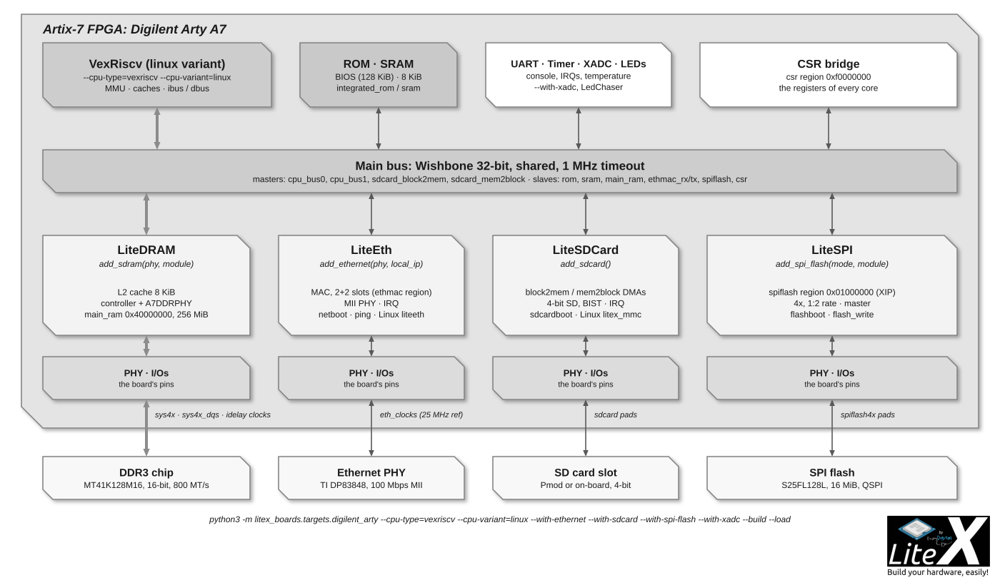

# Run Linux on your SoC

A LiteX SoC runs Linux when its CPU has an MMU (a `linux` variant or a 64-bit core, see
[CPUs](CPUs.md)) and it has a DRAM (`add_sdram`), a console and some way to load the images
(serial, Ethernet, SD card, SATA, flash). The SoC description does the rest: the device tree
is generated from `csr.json`, the kernel has the drivers of the LiteX cores, and the BIOS loads
the images.



## Linux-on-LiteX-VexRiscv: the reference

[Linux-on-LiteX-VexRiscv](https://github.com/litex-hub/linux-on-litex-vexriscv) builds a
Linux SoC around the VexRiscv-SMP CPU (1 to 8 cores, FPU and RVC optional, coherent DMA) for
the boards of LiteX-Boards, with LiteDRAM, LiteEth, LiteSDCard, LiteSATA, PCIe, USB OHCI, the
framebuffer and the usual peripherals, and provides the images (OpenSBI, the kernel, the device
tree, a Buildroot root filesystem):

```sh
git clone https://github.com/litex-hub/linux-on-litex-vexriscv && cd linux-on-litex-vexriscv
./make.py --board=arty --build --load                     # the SoC (./make.py --help lists the boards and options)
# the images: pre-built in https://github.com/litex-hub/linux-on-litex-vexriscv/issues/164,
# or built with Buildroot (make BR2_EXTERNAL=../linux-on-litex-vexriscv/buildroot/ litex_vexriscv_defconfig)
litex_term /dev/ttyUSB1 --images=images/boot.json       # serial boot of the four images
# or: copy them to a TFTP root / an SD card with --with-ethernet / --with-sdcard, the BIOS netboots or sdcardboots
```

The boot takes a few seconds from an SD card; `--with-ethernet`, `--with-sdcard`,
`--with-sata`, `--with-video-framebuffer`, `--with-spi-flash`, `--cpu-count`, `--with-fpu`...
are the `make.py` options. Xilinx, Intel, Lattice, Microsemi, Efinix and Gowin boards are
supported, and on Lattice ECP5 the whole stack (CPU, cores, toolchain) is open source.


## The other CPUs

| CPU | How |
| --- | --- |
| `naxriscv`, `vexiiriscv` (64-bit, out-of-order / the current SpinalHDL generation) | The LiteX-Boards targets with `--cpu-type=naxriscv --xlen 64` or `--cpu-type=vexiiriscv --cpu-variant=linux` (or `debian`), the images from the CPUs' documentation (the SpinalHDL repositories describe the Linux/Debian builds), the BIOS boot as above. |
| `rocket` (64-bit, Chisel) | [Linux-on-LiteX-Rocket](https://github.com/litex-hub/linux-on-litex-rocket): the `linux`/`full` variants, an upstream kernel in a BBL payload with a BusyBox initramfs, on ECP5 (Versa, TrellisBoard, ECPIX-5), Nexys Video and others; maintained by Gabriel Somlo, who also [self-hosts Fedora](https://www.contrib.andrew.cmu.edu/~somlo/BTCP/) on it. |
| `cva6`, `openc906`, `blackparrot` (64-bit) | Their upstream Linux support; BlackParrot was demonstrated in [Linux-On-LiteX-BlackParrot](https://github.com/scanakci/linux-on-litex-blackparrot). |
| `mor1kx`, `marocchino` (OpenRISC) | The `linux`, `linux+smp`, `linux+fpu` variants and the upstream OpenRISC kernel (`arch/openrisc/boot/dts/or1klitex.dts`); mor1kx was the first CPU to boot Linux on LiteX. |
| `microwatt` (POWER) | Upstream Linux has the Microwatt platform; within LiteX the integration is used with the BIOS and bare metal, the Linux flow of the [Microwatt project](https://github.com/antonblanchard/microwatt) uses LiteDRAM through its standalone generator. |
| Hard CPUs: `zynq7000`, `zynqmp`, `cyclonev_hps`, `agilex_hps` | The vendor Linux (PetaLinux, Yocto, the SoC-FPGA distributions) runs on the hard cores; the LiteX gateware is reached through the AXI bridges, and the host tools through `litex_server --devmem` ([Hard core CPUs](Hard-core-CPUs.md)). |

## The device tree and the drivers

```sh
litex_json2dts_linux build/<board>/csr.json > soc.dts          # --initrd, --initrd-start/size, --root-device, --polling
dtc -O dtb -o soc.dtb soc.dts
```

`litex_json2dts_linux` writes the nodes of the CPU(s), the interrupt controller, the memory,
the LiteUART, LiteEth, LiteSDCard, LiteSPI flash, the I2C controllers, the GPIOs, the
framebuffer and the SoC controller from the build's `csr.json`. The drivers are upstream in
the kernel (`drivers/tty/serial/liteuart.c`, `drivers/net/ethernet/litex/`,
`drivers/mmc/host/litex_mmc.c`, `drivers/soc/litex/litex_soc_ctrl.c`); the others (SPI
flash, GPIO, I2C, framebuffer) use generic drivers (`spi-bitbang`, `gpio-mmio`,
`simple-framebuffer`) or the Linux-on-LiteX-VexRiscv patches. [barebox](https://www.barebox.org/)
has a LiteX board and drivers, U-Boot the LiteEth driver.

[OpenSBI](https://github.com/litex-hub/opensbi) (the `*-linux-on-litex-vexriscv` branches
carry the LiteX platform) is the firmware between the BIOS and the kernel on RISC-V: the
BIOS loads `opensbi.bin`, the kernel, the device tree and the rootfs from `boot.json` and
jumps to OpenSBI ([Load application code](Load-Application-Code-To-CPU.md)).

## Without a board

- [litex_sim](SoC-Simulator.md) runs the same SoC in Verilator (slow for a Linux boot, but
  cycle accurate), and the QEMU co-simulation (`--cpu-type=qemu --qemu-kernel=...`) boots
  Linux in seconds against the simulated peripherals.
- [Renode](Generate-Renode-simulation.md) simulates the SoC from `csr.json` with the Linux
  images, fast, with network.

## Beyond Linux-on-LiteX

[OpenWrt](https://github.com/enjoy-digital/litex_openwrt_test), [Debian](https://github.com/roryt12/RISCV64-Debian-Linux-on-FPGA-with-Litex)
(archived) and [Fedora](https://www.contrib.andrew.cmu.edu/~somlo/BTCP/) have been run on
LiteX SoCs; [Xous](https://github.com/betrusted-io/xous-core) (the Precursor microkernel) is
the largest non-Linux system on one. The LiteX-Boards targets with `--cpu-type=vexriscv_smp`
and the [complex SoC](Create-A-complex-SoC-With-Cores-From-The-Ecosystem.md) page show what
the Linux SoC is made of.
