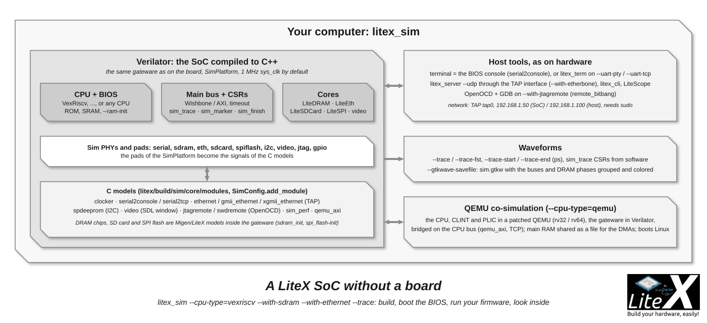

`litex_sim` builds a complete LiteX SoC for [Verilator](https://www.veripool.org/verilator/) and
runs it on your computer: the same CPU, BIOS, buses and cores as on a board, with C++ models
for the outside world (serial console, DRAM chips, Ethernet through a TAP interface, SD card,
SPI flash, a video window...). It is the way to try LiteX without a board, to develop and debug
firmware, to run the test suite in CI, and to look at the waveforms of a whole SoC.



## Getting started

```sh
sudo apt install libevent-dev libjson-c-dev verilator      # Debian/Ubuntu (brew on macOS)
litex_sim                                                   # VexRiscv, ROM with the BIOS, SRAM, UART
```

The build takes a minute (Verilator compiles the SoC to C++), then the BIOS banner and prompt
appear in the terminal: the console is the terminal itself (`serial2console`). `Ctrl-C` stops
it. The build lands in `build/sim/`, and `--help` lists every option (the SoC and Builder
options of the targets, plus the ones below).


*What `litex_sim` prints* (generated by `doc/diagrams/litex-sim-boot.py` from a real run)

To run a firmware, build the SoC once without compiling (the headers are enough), compile the
application, then start the simulation with the RAM preloaded:

```sh
litex_sim --integrated-main-ram-size=0x10000 --no-compile-gateware
litex_bare_metal_demo --build-path=build/sim
litex_sim --integrated-main-ram-size=0x10000 --ram-init=demo.bin
```

A `--rom-init=firmware.bin` replaces the BIOS by your own code; `--sdram-init` preloads a DRAM.

## What can be simulated

| Option | Model |
| --- | --- |
| `--cpu-type`, `--cpu-variant`, `--integrated-*` | Any CPU that Verilator accepts (the CI boots the BIOS on more than 20 of them), the memories |
| `--with-sdram --sdram-module=MT48LC16M16 --sdram-data-width=32`, `--with-sdram-bist`, `--sdram-from-spd-dump` | LiteDRAM with a DRAM model (SDRAM/DDR modules of the LiteDRAM catalog, or from an SPD dump), the L2 cache options (`--l2-size`, `--l2-bursting`) |
| `--with-ethernet`, `--with-etherbone`, `--ethernet-phy-model {sim,gmii,xgmii}`, `--local-ip`, `--remote-ip` | LiteEth on a TAP interface (`tap0`, needs `sudo`): the BIOS netboot, Linux networking, or an Etherbone bridge to `litex_server --udp` |
| `--with-sdcard`, `--with-spi-flash --spi_flash-init=flash.bin`, `--with-i2c` | LiteSDCard, LiteSPI flash and an I2C SPD EEPROM model |
| `--with-video-framebuffer`, `--with-video-terminal`, `--with-video-colorbars`, `--video-vsync` | The video cores displayed in an SDL window |
| `--with-gpio`, `--with-analyzer` | GPIOs, a LiteScope analyzer (captured through Etherbone) |
| `--with-jtagremote`, `--with-swdremote` | OpenOCD `remote_bitbang` servers on the CPU's JTAG/SWD (GDB on the simulated CPU) |
| `--uart-tcp --uart-tcp-port=1234`, `--uart-pty --uart-pty-path=/tmp/litex_pty0` | The console on a TCP port or a pseudo-terminal (`litex_term /tmp/litex_pty0`) instead of stdin/stdout |

The models are C modules in `litex/build/sim/core/modules/` (clocker, serial2console,
serial2tcp, ethernet, gmii_ethernet, xgmii_ethernet, spdeeprom, jtagremote, swdremote, video,
sim_perf, qemu_axi); a `SimConfig` in the target picks them (`sim_config.add_module("serial2console", "serial")`)
and `SimPlatform` declares the pads. Your own target can be simulated the same way: give it a
`SimPlatform`, the `sim` PHYs (`LiteEthPHYModel`, `SDRAMPHYModel`, the `sim` UART) and build it
with `builder.build(sim_config=sim_config)`; `litex/tools/litex_sim.py` is the reference.

## Looking inside

```sh
litex_sim --trace --trace-fst --trace-start=10000000 --trace-end=20000000 --gtkwave-savefile
gtkwave build/sim/gateware/sim.fst build/sim/gateware/sim.gtkw
```

`--trace` dumps a VCD (`--trace-fst` the smaller FST) between `--trace-start` and `--trace-end`
(in picoseconds, `sys_clk` is 1 MHz in the default sim); the SoC's `sim_trace` CSRs start and
stop the dump from software, `sim_marker` puts markers, `sim_finish` ends the simulation.
`--gtkwave-savefile` writes a `.gtkw` with the buses and DRAM phases grouped and colored.
`--sim-debug` prints the SoC's debug output, `--sim-speed` the simulated clock rate, `--threads`
and `--jobs` use several cores, `--opt-level` sets the Verilator optimization, `--save-start`/`--load-start`
save and restore the simulation state to skip a long boot, `--verilator-extra-source` adds your
own C++ to the simulator. `--non-interactive` is for CI.

Inside the simulation, a [bridge](Host-Bridges.md) works as on hardware:

```sh
litex_sim --with-etherbone --csr-csv=csr.csv          # sudo for the TAP interface
litex_server --udp --udp-ip=192.168.1.50                # in another terminal
litex_cli --regs
```

## QEMU co-simulation

`--cpu-type=qemu` runs the CPU in a patched [QEMU](https://www.qemu.org/) (variants `rv32` and
`rv64`, QEMU owns the CLINT and PLIC) while the interconnect and the peripherals run in
Verilator: fast software execution (Linux boots in seconds) with the real LiteX gateware for the
I/Os, bridged through a TCP protocol on the CPU's AXI bus. Build the patched QEMU once with
`python3 litex/build/sim/qemu/build_qemu_litex.py`, then:

```sh
litex_sim --cpu-type=qemu --cpu-variant=rv32 --integrated-main-ram-size=0x1000000
litex_sim --cpu-type=qemu --cpu-variant=rv64 --qemu-firmware=fw_jump.bin --qemu-kernel=Image --qemu-dtb=soc.dtb
```

`--qemu-firmware`, `--qemu-kernel`, `--qemu-dtb`, `--qemu-initrd`, `--qemu-append` boot Linux;
with `--integrated-main-ram-size` the main RAM is a file shared between QEMU and Verilator so
the peripherals' DMAs see the same memory. `litex/build/sim/qemu/README.md` has the protocol
and the details.

## Other simulators

- The Migen simulator (`run_simulation`) and `pytest` for the unit tests of a core, with Python
  models of the other side (`test/` in every repository).
- [Renode](Generate-Renode-simulation.md): a model of the SoC built from `csr.json`, to run
  Linux/Zephyr images fast, without the gateware.
- The vendor simulators and cocotb can be used on the generated Verilog
  (`--no-compile-gateware` to generate only); `litex-hub/cocotb_verilator_sim_example` is an
  example.
