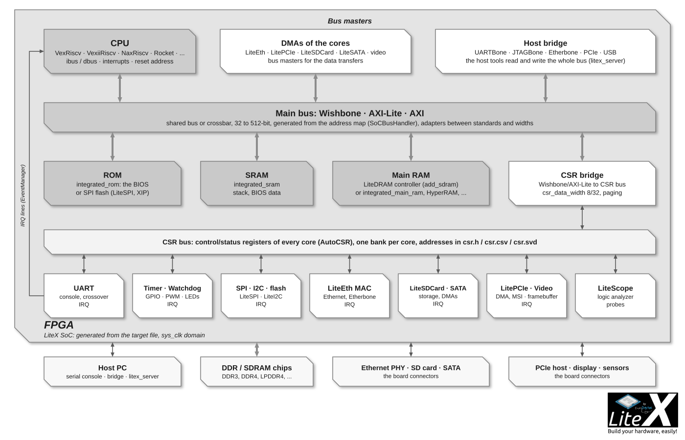
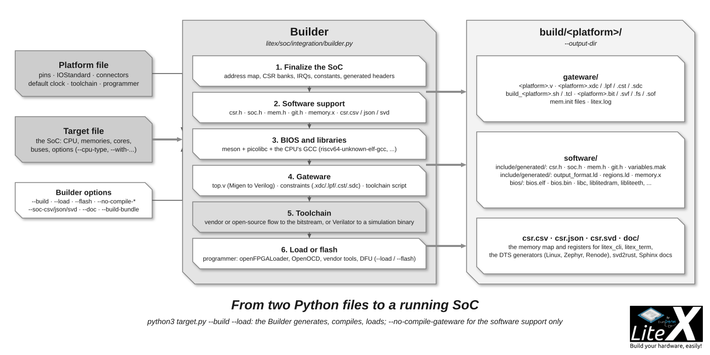

The SoC builder is the part of LiteX that turns a Python description into a complete SoC: it
allocates the address map, connects the bus masters and slaves through the interconnect,
collects the control/status registers of every core, assigns the interrupts, generates the
constants the software needs and hands the result to the Builder, which generates the gateware
and the software support. It lives in `litex/soc/integration/soc.py` (the `SoC`, `LiteXSoC`,
`SoCCore` and `SoCMini` classes) and `builder.py` (the `Builder`).



## A target in 40 lines

A target instantiates a platform, a clock/reset generator and a `SoCCore`, then adds what it
needs with the `add_*` helpers or by instantiating cores. This is the pattern of every target in
[LiteX-Boards](https://github.com/litex-hub/litex-boards):

```python
#!/usr/bin/env python3
from migen import *
from litex.gen import *

from litex_boards.platforms import digilent_arty

from litex.soc.cores.clock import S7PLL
from litex.soc.cores.led import LedChaser
from litex.soc.integration.soc_core import SoCCore
from litex.soc.integration.builder import Builder

# CRG ----------------------------------------------------------------------------------------------

class _CRG(LiteXModule):
    def __init__(self, platform, sys_clk_freq):
        self.cd_sys = ClockDomain()
        self.pll = pll = S7PLL(speedgrade=-1)
        pll.register_clkin(platform.request("clk100"), 100e6)
        pll.create_clkout(self.cd_sys, sys_clk_freq)

# BaseSoC ------------------------------------------------------------------------------------------

class BaseSoC(SoCCore):
    def __init__(self, sys_clk_freq=100e6, with_led_chaser=True, **kwargs):
        platform = digilent_arty.Platform()
        self.crg = _CRG(platform, sys_clk_freq)
        SoCCore.__init__(self, platform, sys_clk_freq, ident="LiteX SoC on Arty A7", **kwargs)
        if with_led_chaser:
            self.leds = LedChaser(pads=platform.request_all("user_led"), sys_clk_freq=sys_clk_freq)

# Build --------------------------------------------------------------------------------------------

def main():
    from litex.build.parser import LiteXArgumentParser
    parser = LiteXArgumentParser(platform=digilent_arty.Platform, description="LiteX SoC on Arty A7.")
    parser.add_target_argument("--sys-clk-freq", default=100e6, type=float, help="System clock frequency.")
    args = parser.parse_args()

    soc = BaseSoC(sys_clk_freq=args.sys_clk_freq, **parser.soc_argdict)
    builder = Builder(soc, **parser.builder_argdict)
    if args.build:
        builder.build(**parser.toolchain_argdict)
    if args.load:
        prog = soc.platform.create_programmer()
        prog.load_bitstream(builder.get_bitstream_filename(mode="sram"))

if __name__ == "__main__":
    main()
```

`python3 target.py --build --load` builds and loads it; `--help` lists the options the parser
adds for the SoC, the Builder, the toolchain and the CPU. The `**kwargs`/`soc_argdict` pair is
how `--cpu-type`, `--integrated-main-ram-size`, `--uart-name`, ... reach `SoCCore`.
[Create a minimal SoC](Create-A-minimal-SoC.md) walks through it step by step.

## The classes

| Class | Role |
| --- | --- |
| `SoC` | The base: the bus handler (`self.bus`), the CSR handler (`self.csr`), the IRQ handler (`self.irq`), the constants and the regions; `add_ram`/`add_rom`, `add_csr_bridge`, `add_cpu`, `add_timer`, `add_watchdog`, `add_constant`/`add_config`; the finalization that builds the interconnect and exports everything. |
| `LiteXSoC(SoC)` | Adds the helpers for the LiteX cores and the ecosystem: `add_uart`, `add_uartbone`, `add_jtagbone`, `add_etherbone`, `add_ethernet`, `add_sdram`, `add_hyperram`, `add_spi_flash`, `add_spi_ram`, `add_spi_master`, `add_i2c_master`, `add_spi_sdcard`, `add_sdcard`, `add_sata`, `add_pcie`, `add_video_*`, `add_cpu_jtag_debug`. |
| `SoCCore(LiteXSoC)` | The usual base class of a target: from its constructor arguments it adds, in this order, the controller (`ctrl`), the CPU, the ROM (with the BIOS), the SRAM, the main RAM, the identifier, the UARTBone, the UART, the JTAGBone, the CPU JTAG debug, the timer and the watchdog. Its `mem_map` gives the default origins. |
| `SoCMini(SoCCore)` | The same with no CPU, no UART, no timer and no SRAM by default: for designs controlled from the host through a bridge, or cores exported to another flow. |

The arguments of `SoCCore` and their `--options` are listed in the
[SoC builder reference](SoC-Builder-Reference.md#soccore-arguments).

## The address map

Every memory and peripheral is a *region* with an origin, a size and attributes:
`SoCRegion(origin, size, mode="rw", cached=True, linker=False, decode=True)`; `SoCIORegion` is
the uncached variant for peripherals. The default origins come from `mem_map`, and the CPU
overrides them with its own map when it has constraints (`cpu.mem_map`):

```python
SoCCore.mem_map = {"rom": 0x00000000, "sram": 0x01000000, "main_ram": 0x40000000}
# VexRiscv (litex/soc/cores/cpu/vexriscv/core.py):
mem_map = {"rom": 0x00000000, "sram": 0x10000000, "main_ram": 0x40000000, "csr": 0xf0000000}
```

A target can override an origin before calling `SoCCore.__init__` (`self.mem_map["csr"] = ...`)
or let the handler allocate (`self.bus.alloc_region(name, size)`); the CPU's IO regions (for
example `0x80000000-0xffffffff` on most 32-bit soft CPUs) are where uncached peripherals must
live, which the handler checks. The final map is exported as `mem.h` and `regions.ld` for the
software, `csr.csv`/`csr.json`/`csr.svd` for the tools, and printed in the build log:

```
Bus Regions:
rom      : Origin: 0x00000000, Size: 0x00020000, Mode: RX,  Cached: True,  Linker: False
sram     : Origin: 0x10000000, Size: 0x00002000, Mode: RWX, Cached: True,  Linker: False
main_ram : Origin: 0x40000000, Size: 0x10000000, Mode: RWX, Cached: True,  Linker: False
csr      : Origin: 0xf0000000, Size: 0x00010000, Mode: RW,  Cached: False, Linker: False
```

## The bus and its handler

`self.bus` (`SoCBusHandler`) owns the main bus: one standard (`wishbone`, `axi-lite` or `axi`),
one data width (32 to 512 bits), one address width (32 or 64), word or byte addressing, and an
interconnect built at finalization: a shared bus (one arbiter, one decoder, the default) or a
crossbar (`--bus-interconnect=crossbar`, every master to every slave). It also provides a
timeout that returns an error instead of hanging the SoC when a slave does not answer
(counted in the controller's `bus_errors` register) and optional bursts (`--bus-bursting`).

```python
self.bus.add_master(name="dma", master=my_dma.bus)                          # a new bus master
self.bus.add_slave(name="buf", slave=my_sram.bus, region=SoCRegion(size=0x1000, cached=False))
self.bus.add_slave("ext", ext_bus, region=SoCRegion(origin=0x90000000, size=0x100000), clock_domain="eth")
```

A master or a slave of another standard or width is adapted automatically (`add_adapter`):
width converters, word/byte addressing, and the Wishbone/AXI-Lite/AXI bridges in both
directions; a `clock_domain` adds a clock domain crossing. This is why a Wishbone CPU, an AXI
DMA from a vendor IP and a 512-bit LiteDRAM port can share one SoC. The details of each bus are
on the [Wishbone](Wishbone-Bus.md) and [AXI](AXI-Bus.md) pages.

## CSRs and interrupts

`self.csr` (`SoCCSRHandler`) allocates one *location* (a page of `csr_paging` bytes, 0x800 by
default) per core with CSRs, in the `csr` region reached through the CSR bridge
(`add_csr_bridge`, automatic). Cores are found by name: any submodule with `CSRStorage`/`CSRStatus`
attributes gets a location, in declaration order, or at a fixed index with
`self.csr.add("uart", n=2)` (for a stable map across builds). 32 locations at the default width
and paging; `--csr-address-width=15` doubles them. [CSR-Bus](CSR-Bus.md) explains the bus and
the generated accessors.

`self.irq` (`SoCIRQHandler`) assigns the interrupt lines: `self.irq.add("uart")` for a core
with an `EventManager` (the helpers do it), or `self.irq.add("mycore", n=5)` for a fixed line.
The numbers are exported as `<NAME>_INTERRUPT` in `soc.h`; the BIOS and the OS device trees
use them.

## The `add_*` API

One helper per core or feature, listed with what each adds in the
[SoC builder reference](SoC-Builder-Reference.md#the-helpers).

The helpers follow a convention: `name` is the CSR/IRQ name and the prefix of the constants;
the module is available as `self.<name>` afterwards (`self.sdram`, `self.ethphy`,
`self.ethmac`, `self.pcie_phy`...), so a target can refine it.

## The Builder

`Builder(soc, output_dir="build/<platform>", ...)` then `builder.build()`:



1. Finalizes the SoC: regions, CSR locations, interrupts, constants, the interconnect.
2. Generates the software support in `software/include/generated/`: `csr.h` (register
   accessors), `soc.h` (constants), `mem.h` (regions), `git.h`, `variables.mak`, the linker
   scripts `output_format.ld` and `regions.ld`, `sdram_phy.h` with a DRAM, and `csr.csv`,
   `csr.json` (always), `csr.svd` and `memory.x` on request.
3. Builds the software packages with `make` (meson >= 0.59 is required by picolibc): libc,
   `libbase`, `libcompiler_rt`, `libfatfs`, `liblitespi`, `liblitedram`, `libliteeth`,
   `liblitesdcard`, `liblitesata` and the [BIOS](BIOS.md), then loads `bios.bin` into the
   ROM (resized to fit unless `--no-integrated-rom-auto-size`).
4. Generates the gateware (Verilog and constraints) and runs the toolchain
   ([Build-Backends](Build-Backends.md)) when `compile_gateware` is set.
5. With `--doc`, generates the Sphinx documentation ([SoC-Documentation](SoC-Documentation.md)).

Loading and flashing are done by the target after the build (`--load`, `--flash`), with the
programmer of the platform. The options, available on every target, are listed in the
[SoC builder reference](SoC-Builder-Reference.md#builder-options).

`builder.get_bitstream_filename(mode="sram"|"flash")` and `builder.get_bios_filename()` give the
paths of the results. Standalone generation of a SoC without a board (`litex_soc_gen`) and the
export of a SoC as a Verilog core are on [Export your core/SoC to Verilog](Export-To-Verilog.md).
