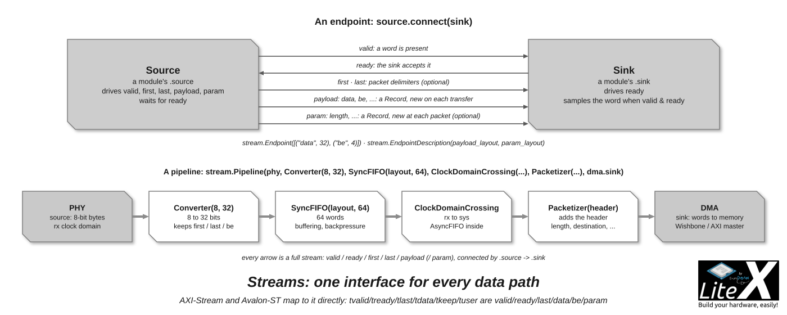
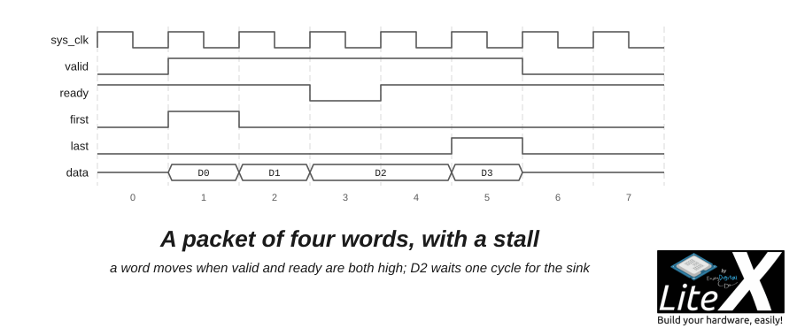

Streams are how data moves between LiteX cores: every core that produces or consumes data
(Ethernet, PCIe DMA, SD card, video, SerDes, converters, FIFOs) has stream endpoints, and you
connect two of them with one line. A stream is a Migen `Record` somewhere between AXI-Stream
and Avalon-ST, deliberately simpler than both, and the generic blocks of
`litex/soc/interconnect/stream.py` (FIFOs, converters, crossings, packetizers) work on any of
them.



| Signal | Direction | Role |
| --- | --- | --- |
| `valid` | source to sink | A word is present (AXI-Stream `tvalid`). |
| `ready` | sink to source | The sink accepts it (`tready`): a transfer happens on each cycle with `valid & ready`. |
| `first` | source to sink | First word of a packet (Avalon-ST `sop`): the start of a packet, without deducing it from `last`. |
| `last` | source to sink | Last word of a packet (`tlast`). |
| `payload` | source to sink | A `Record` with its own layout (`tdata`), new on each transfer: `data`, `be`, `error`... |
| `param` | source to sink | An optional `Record` (`tuser`) changing at each start of packet: `length`, `ip_address`, `port`... |



*Four words, one per cycle while `valid` and `ready` are both high; the source holds `D2`
during the stall; `first` and `last` frame the packet.*

```python
from litex.soc.interconnect import stream

layout = [("data", 32), ("be", 4)]                 # the payload: a 32-bit word with its byte enables
sink   = stream.Endpoint(layout)                   # an Endpoint has valid/ready/first/last + the payload
source = stream.Endpoint(stream.EndpointDescription(payload_layout=layout, param_layout=[("length", 16)]))

self.comb += source.connect(sink)                  # one line: every signal in the right direction
self.comb += source.connect(sink, omit={"be"})     # or only part of it (keep={...} / omit={...})
sink.data                                          # payload and param fields are reached directly
```

A module exposes `self.sink` (what it consumes) and `self.source` (what it produces); the
payload and param fields are reached directly (`ep.data`). `first`, `last`, `payload` and
`param` are `reset_less`. The byte-enable convention (`be`, one bit per data byte, `last`
independent of the mask, header-only packets as a beat with `be=0`) is in
[stream_byte_enables.md](https://github.com/enjoy-digital/litex/blob/master/doc/stream_byte_enables.md).

## The generic blocks

| Block | Purpose |
| --- | --- |
| `SyncFIFO(layout, depth)`, `AsyncFIFO(layout, depth)` | FIFOs, synchronous or between two clock domains. |
| `ClockDomainCrossing(layout, cd_from, cd_to)` | An `AsyncFIFO` between two domains, a passthrough when they are the same. |
| `Buffer(layout)`, `PipeValid`, `PipeReady`, `Delay(layout, n)` | Register stages to break the timing paths: valid and payload, ready, or both. |
| `Converter(nbits_from, nbits_to)`, `StrideConverter(desc_from, desc_to)` | Width conversion by an integer ratio, on a data width or on a full layout. |
| `Gearbox(i_dw, o_dw)` | Width conversion for non-integer ratios (SerDes gearboxes). |
| `Multiplexer(layout, n)`, `Demultiplexer(layout, n)`, `Crossbar(layout, n)` | Select one of `n` sources or sinks with a `sel` signal (`with_csr=True` for a register). |
| `Gate(layout)`, `Shifter(dw)`, `Cast(layout_from, layout_to)` | Enable or disable a stream, shift it, reinterpret its fields. |
| `Pack(layout_from, n)`, `Unpack(n, layout_to)` | Pack `n` words into one record and back. |
| `Monitor(endpoint, ...)` | CSR counters of tokens, overflows, underflows and packets on an endpoint. |
| `Pipeline(*modules)` | Chains modules `source -> sink` in order (bare endpoints accepted); `.add()` appends. |
| `BufferizeEndpoints({name: DIR_SINK})` | A module transformer that buffers the listed endpoints of a module. |

```python
self.pipeline = stream.Pipeline(
    self.phy,                                    # source: 8-bit bytes from the PHY
    stream.Converter(8, 32),                     # 8 to 32 bits
    stream.SyncFIFO([("data", 32)], 64),         # a 64-word FIFO
    stream.ClockDomainCrossing([("data", 32)], cd_from="rx", cd_to="sys"),
    self.dma.sink,                               # sink: the DMA writing to memory
)
```

## Packets

`Packetizer` and `Depacketizer` (`packet.py`) insert and remove a header described by a
`Header({"field": HeaderField(byte, offset, width)}, length)` in front of the payload, with
the byte shifts when the header length is not a multiple of the data width; `PacketFIFO`
stores packets with their parameters. The MAC, ARP, IP, UDP and Etherbone layers of LiteEth,
the TLP layer of LitePCIe and the link layer of LiteSATA are stacks of these.

## AXI-Stream and Avalon-ST

- `AXIStreamInterface(data_width, keep_width, id_width, dest_width, user_width)` is a stream
  `Endpoint` whose payload is `data` and `keep` and whose params are `id`, `dest` and `user`:
  it connects to a LiteX stream directly, and `get_ios()` and `connect_to_pads()` give the `t*`
  ports for a Verilog boundary (the standalone cores export AXI-Stream this way).
- `Native2AvalonST` and `AvalonST2Native` (`litex/soc/interconnect/avalon/avalon_st.py`)
  handle the ready latency of Avalon-ST.

## Simulation

The Migen simulator is enough for most stream modules: drive `valid` and `payload` and sample
`ready` from a generator, or use the Python models of the cores (`test/` in every repository);
`stream.Monitor` gives counters on hardware and [LiteScope](Use-LiteScope-To-Debug-A-SoC.md)
captures an endpoint with its handshake. [alanvgreen](https://github.com/alanvgreen) wrote a
[thorough description of LiteX streams with a diagram](https://github.com/amaranth-lang/amaranth/issues/317#issuecomment-899407394)
when comparing them with Amaranth's.

## Next

- [Add a new core](Add-A-New-Core.md): a core with a stream endpoint, simulated then on hardware.
- [AXI bus](AXI-Bus.md): AXI-Stream, and the memory buses next to it.
- [Cores](Cores.md): the in-tree cores built on streams.
- [Use LiteScope](Use-LiteScope-To-Debug-A-SoC.md): watching a handshake on hardware.
