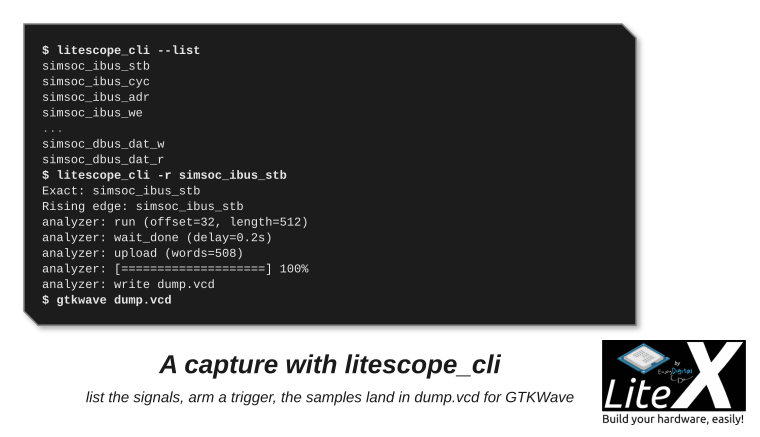
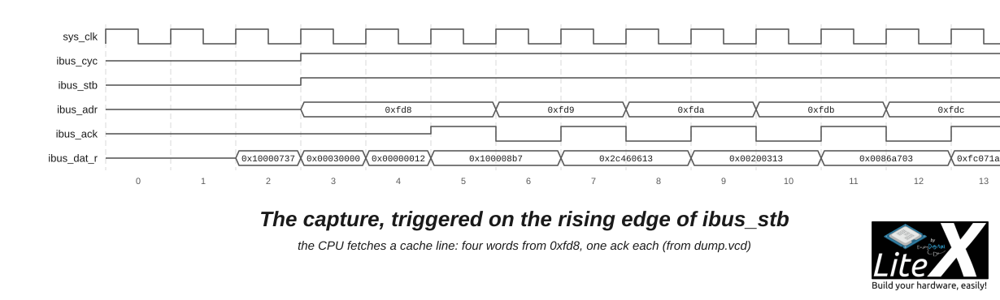

You will capture the internal signals of your running SoC with LiteScope, a logic analyzer in
the gateware: arm it on an event, upload the samples through the host bridge and open them in
GTKWave. It is what simulation gives you, on the real hardware, in real time, for a few block
RAMs. Ten minutes after [the host bridge](Host-Bridges.md), in simulation or on a board.

## 1. Add an analyzer to the SoC

```python
from litescope import LiteScopeAnalyzer

analyzer_signals = [
    self.cpu.ibus.stb, self.cpu.ibus.cyc, self.cpu.ibus.adr, self.cpu.ibus.ack, self.cpu.ibus.dat_r,   # the instruction bus
    self.cpu.dbus.stb, self.cpu.dbus.cyc, self.cpu.dbus.adr, self.cpu.dbus.we,  self.cpu.dbus.dat_w,   # the data bus
]
self.analyzer = LiteScopeAnalyzer(analyzer_signals,
    depth        = 512,
    clock_domain = "sys",
    samplerate   = sys_clk_freq,
    csr_csv      = "analyzer.csv")
```

Any Migen signal goes in the list, and a record too (`[self.cpu.ibus, self.cpu.dbus]` captures
every field). `depth` samples of all the signals are stored in block RAM (depth × width bits),
in the `clock_domain` of the signals; `analyzer.csv`, written at build time, tells the client
the names and the layout. The SoC needs a [bridge](Host-Bridges.md) for the host to reach it.
This analyzer is built into `litex_sim`, so no board is needed to try it:

```sh
litex_sim --with-analyzer --uart-name=crossover+uartbone --uart-pty --csr-csv csr.csv   # terminal 1
litex_server --uart --uart-port=/tmp/litex_pty0                                          # terminal 2
```

On a board: the snippet above in your target, `--uart-name=crossover+uartbone --build --load`,
`litex_server --uart --uart-port=/dev/ttyUSB1`.

## 2. A first capture

```sh
litescope_cli --list                 # the signals of the analyzer, as the design named them
litescope_cli                        # no trigger: an immediate capture into dump.vcd
litescope_cli -r simsoc_ibus_stb     # a rising edge trigger...
litex_term crossover                 # ...then type help in the console: the CPU fetches code
gtkwave dump.vcd
```



*The signals, a rising-edge trigger, the upload: 512 samples in `dump.vcd`.*

The BIOS waits for your keys in a loop that fits in the instruction cache, so `ibus_stb` stays
low until a command runs new code: the capture triggers on the `help` you typed, with 32
samples of history before the edge (`--offset`). Drawn from `dump.vcd`, this is what it holds:



*The CPU refills a cache line: `cyc` and `stb` rise, four words from `0xfd8`, one `ack` each.*

Et voilà! A name is matched exactly, or as a regular expression when it matches one signal
(`-r ibus_stb` is enough here); the names depend on the design and the LiteX version, so
`--list` first. `--csv` and `--csr-csv` point to the files when they are not in the current
directory, `--host` and `--port` to another `litex_server`.

## 3. Triggers

```sh
litescope_cli -v simsoc_dbus_dat_w 0x12345678                                  # a value...
litescope_cli -v simsoc_dbus_dat_w 0x12345678 -v simsoc_dbus_adr 0x04000000   # ...and another (AND)
litescope_cli -v simsoc_dbus_dat_w 0x123456xx                                  # x: don't care nibbles
litescope_cli -f simsoc_dbus_ack --offset 256 --length 512                     # a falling edge, more history
```

To see the first one fire, type `mem_write 0x10000000 0x12345678` in the BIOS console: a write
of another value does nothing, the right one triggers. `--offset` is the number of samples
kept before the trigger, `--length` the number stored (the depth by default),
`--subsampling N` keeps one sample every N cycles, `--rle` enables the run-length encoding
(`with_rle=True` in the analyzer) to span long idle periods, `--group` selects a capture group
when the analyzer was given several lists (`{0: [...], 1: [...]}`), `--gui` opens a live
viewer. `litescope_cli --help` has the rest.

## 4. A script of your own

`litescope_cli` covers most needs; a script is the way to capture inside a test sequence:

```python
#!/usr/bin/env python3
from litex import RemoteClient
from litescope import LiteScopeAnalyzerDriver

bus = RemoteClient()
bus.open()

analyzer = LiteScopeAnalyzerDriver(bus.regs, "analyzer", debug=True)
analyzer.configure_group(0)
analyzer.add_rising_edge_trigger("simsoc_ibus_stb")          # or: analyzer.configure_trigger(cond={"simsoc_ibus_adr": 0x0})
analyzer.run(offset=128, length=512)
# ... do what should fire the trigger: a register write, a command, a packet ...
analyzer.wait_done()
analyzer.upload()
analyzer.save("dump.vcd")

bus.close()
```

Triggering on `ibus_adr == 0x0`, the reset address, and running `reboot` in the console shows
the CPU restarting; triggering on a register of your core while the host writes it shows your
core reacting, cycle by cycle.

## 5. Sizing it

- The block RAM budget is depth × the sum of the signal widths: 512 samples of two 32-bit
  buses with their handshakes fit in a handful of 36 Kb blocks; a wide payload asks for a
  smaller depth or `--rle`.
- Put the analyzer in the clock domain of the signals (`clock_domain="eth_rx"`): the samples
  cross to the `sys` domain inside LiteScope.
- `samplerate` only sets the timescale of the VCD.
- Several analyzers, or groups in one, keep the capture focused; the host reads them one at a
  time.

## Next

- [Debug the CPU with GDB](Debug-With-GDB.md): the next step of the path, breakpoints in the firmware.
- [Control it from the host](Host-Bridges.md): the bridge the samples come through.
- [Add a new core](Add-A-New-Core.md): simulate the core first, capture it on hardware after.
- [SoC simulator](SoC-Simulator.md): when a VCD of the whole simulated SoC (`--trace`) is the better tool.
