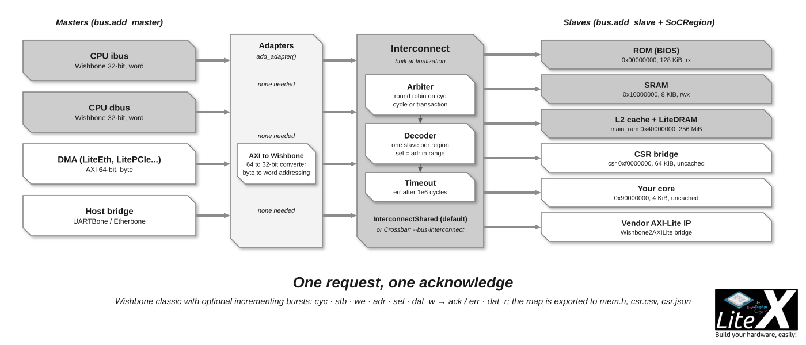
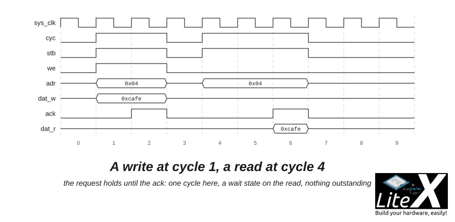

[Wishbone](https://cdn.opencores.org/downloads/wbspec_b4.pdf) is the main bus of a LiteX SoC
unless you ask for AXI: one request, one acknowledge, no channels, what most soft CPUs and
small cores speak. You meet it as `self.bus` in every SoC and as the `wishbone.Interface` of
the cores; the builder bridges it to AXI-Lite and AXI when a master or a slave needs them.
LiteX implements Wishbone classic with optional incrementing bursts, in
`litex/soc/interconnect/wishbone.py`.



*The CPU, the bridges and the DMAs are the masters; the memories, the CSR bridge and your
cores are the slaves; the interconnect in the middle is a shared bus or a crossbar.*

```sh
python3 -m litex_boards.targets.digilent_arty --build --no-compile-gateware 2>&1 | grep -A12 "Bus Masters"   # who is on the bus
```

## The interface

| Signal | Direction | Role |
| --- | --- | --- |
| `adr` | master to slave | The address, in words by default (30 bits on a 32-bit bus), or in bytes. |
| `dat_w`, `dat_r` | master to slave, slave to master | Write and read data: 32 bits by default, 8 to 512. |
| `sel` | master to slave | Byte select, one bit per byte. |
| `cyc`, `stb` | master to slave | Cycle and strobe: a request is `cyc & stb`. |
| `we` | master to slave | Write enable. |
| `ack`, `err` | slave to master | Acknowledge, one per request, or error. |
| `cti`, `bte` | master to slave | Cycle and burst type of an incrementing burst (`bursting=True`). |

```python
from litex.soc.interconnect import wishbone

bus = wishbone.Interface(data_width=32, address_width=32, addressing="word", bursting=False)
# In a simulation generator:
yield from bus.write(0x10, 0xdeadbeef)
value = yield from bus.read(0x10)
```



*The master holds its request until the ack; the slave answers in one cycle or inserts wait
states; nothing is outstanding.*

A transaction is one request (`cyc & stb` with `we`, `adr`, `dat_w` and `sel`) answered by one
`ack` or `err`; with bursting, the words of an incrementing burst are acknowledged one per
cycle. The master waits for the acknowledge, so there is no outstanding request: this is what
keeps Wishbone small, and what limits its throughput for DMAs on wide memories, which is why
LiteDRAM offers native and AXI ports for those.

## The building blocks

Pick the interconnect for a SoC (the builder does, from `--bus-interconnect`), the rest for a
core of your own:

| Block | Purpose |
| --- | --- |
| `InterconnectShared(masters, slaves)` | A shared bus: an `Arbiter` (round robin) and a `Decoder`; the default. |
| `Crossbar(masters, slaves)` | Every master reaches every slave at the same time (`--bus-interconnect=crossbar`). |
| `InterconnectPointToPoint(master, slave)` | A direct connection. |
| `Decoder`, `Arbiter` | The pieces, for a topology of your own. |
| `SRAM(mem_or_size, read_only, init)` | A block RAM on the bus, with burst support. |
| `Converter`, `UpConverter`, `DownConverter` | Data width conversion, word addressing. |
| `Timeout(master, cycles)` | An error after `cycles` without answer: a missing slave does not hang the CPU. |
| `Cache(cachesize, master, slave)` | A write-back cache: the L2 in front of LiteDRAM (`--l2-size`). |
| `ClockDomainCrossing(master, slave, cd_from, cd_to)` | A crossing between two clock domains. |
| `Remapper`, `Offset` | Address remapping for a master with its own view of the memory. |
| `Wishbone2CSR` | The bridge to the [CSR bus](CSR-Bus.md). |
| `Wishbone2AXILite`, `Wishbone2AXI` and back | The bridges to AXI (`litex/soc/interconnect/axi/`). |
| `Wishbone2AvalonMM`, `AvalonMM2Wishbone`, `AHB2Wishbone` | The bridges to Avalon-MM and AHB (`avalon/`, `ahb.py`). |

## In a SoC

The builder owns the main bus: masters (`self.bus.add_master`) and slaves (`self.bus.add_slave`
with a `SoCRegion`) are collected, adapted in width, addressing and standard, and connected at
finalization by the interconnect, with the timeout. A core with a Wishbone interface is one
line away:

```python
from litex.soc.interconnect import wishbone
from litex.soc.integration.soc import SoCRegion

class MyCore(LiteXModule):
    def __init__(self):
        self.bus = wishbone.Interface(data_width=32, address_width=32, addressing="word")
        self.mem = wishbone.SRAM(0x1000, bus=self.bus)      # or your own logic on self.bus

# In the SoC:
self.mycore = MyCore()
self.bus.add_slave("mycore", self.mycore.bus, SoCRegion(origin=0x90000000, size=0x1000, cached=False))
```

The CPU's instruction and data buses are the usual masters, the host [bridges](Host-Bridges.md)
and the DMAs the others. `--bus-data-width=64` or more widens the bus for a 64-bit CPU or a
wide DRAM port, `--bus-bursting` enables the bursts, `--bus-addressing=byte` makes the
addressing match AXI's. `mem.h` and `csr.csv` describe the resulting map.

## Next

- [AXI bus](AXI-Bus.md): the other standard, and how the two mix in one SoC.
- [CSR bus](CSR-Bus.md): the small bus behind `Wishbone2CSR`, where the registers live.
- [SoC builder](SoC-builder.md): the handler that collects the masters and slaves.
- [Add a new core](Add-A-New-Core.md): a core on the bus, with registers and an interrupt.
