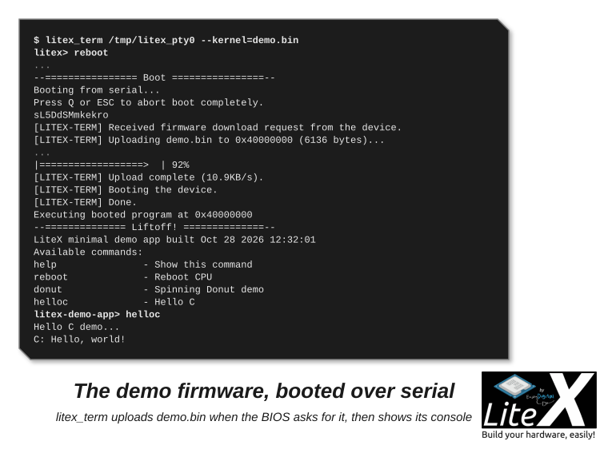

Build the demo against the headers of your SoC, load it over the serial port, talk to it. Then
the other boot methods (TFTP, SD card, flash, ROM) and how interrupts reach your code. The demo
is `litex/soc/software/demo/`: a console with `help`, `reboot`, `helloc` and a spinning donut,
and the template of your own firmware. Ten minutes.

## 1. Build the SoC, then the application, then boot it

```sh
python3 -m litex_boards.targets.digilent_arty --build --load   # the SoC: gateware and BIOS
litex_bare_metal_demo --build-path=build/digilent_arty          # the demo: demo/ and demo.bin
litex_term /dev/ttyUSB1 --kernel=demo.bin                       # boot it over the serial port
```

No board? The same in simulation, with a main RAM for the application and the UART on a PTY:

```sh
litex_sim --integrated-main-ram-size=0x40000 --uart-pty   # terminal 1: the SoC, its UART on /tmp/litex_pty0
litex_bare_metal_demo --build-path=build/sim               # terminal 2, once the SoC is built
litex_term /tmp/litex_pty0 --kernel=demo.bin
```

The BIOS asks for a serial boot at every start; `litex_term` answers with the file and the CPU
jumps to it. If the BIOS is already at its prompt when you connect, type `reboot`:



Type `donut` and it spins. What `litex_bare_metal_demo` did: it copied the template to
`./demo/`, adapted the linker script and ran `make` with the SoC's `build/<board>/` as
`BUILD_DIR`: the generated headers, the
libraries (`libbase`, `libc`, `liblitedram`...) and the compiler flags of the CPU come from
there, so the application always matches the SoC. `--with-cxx` enables C++ (`hellocpp.cpp`),
`--mem` picks the region where the code runs (`main_ram` by default; `rom` or `spiflash` for
execute in place), `--runtime-mem` the region of `.data`, `.bss` and the stack (`sram`;
`main_ram` for a big application).

## 2. What the template contains

Copy the directory to start your own firmware, rename the objects in the Makefile, keep
`BUILD_DIR` pointing at the SoC build, add your sources:

| File | Role |
| --- | --- |
| `Makefile` | Includes `variables.mak` and `common.mak` from the build, links `crt0.o` and the libraries. |
| `linker.ld` | Includes `generated/regions.ld`: code in `main_ram`, `.data`, `.bss` and the stack in `sram`. |
| `main.c` | `uart_init()`, the console loop (`readstr`, `get_token`), the commands, the interrupt setup. |
| `helloc.c`, `hellocpp.cpp`, `donut.c` | The example commands. |
| `demo.fbi` | The flash boot image: `demo.bin` with a length and CRC header for the BIOS `flashboot`. |

`crt0.o` is the start-up code of the CPU (`litex/soc/cores/cpu/<cpu>/crt0.S`), and the regions
of `regions.ld` are the ones the SoC builder printed. The headers you include:

```c
#include <generated/csr.h>     // <core>_<register>_read()/_write(), CSR_<CORE>_<REG>_ADDR, the fields
#include <generated/soc.h>     // CONFIG_CLOCK_FREQUENCY, CONFIG_CPU_*, <CORE>_INTERRUPT, the constants
#include <generated/mem.h>     // <REGION>_BASE / <REGION>_SIZE
#include <irq.h>               // irq_setmask(), irq_setie(), irq_getmask(), irq_pending()
#include <libbase/uart.h>      // uart_init(), uart_isr(), readchar(), readchar_nonblock()
#include <libbase/console.h>   // readstr helpers; printf goes to the UART through picolibc
#include <libbase/i2c.h>, <liblitedram/sdram.h>, <libliteeth/udp.h>, <liblitesdcard/sdcard.h>, ...
```

`printf` and the libc come from picolibc (`--libc-mode full` for the complete `printf`,
`--bios-format float` when you print floats); `timer0` gives `busy_wait()`, `busy_wait_us()`
and the uptime (`--timer-uptime`).

## 3. Interrupts

```c
#include <irq.h>
#include <generated/csr.h>

void isr(void)
{
    unsigned int irqs = irq_pending() & irq_getmask();
#ifdef CSR_UART_BASE
    if (irqs & (1 << UART_INTERRUPT))
        uart_isr();
#endif
    if (irqs & (1 << PWM_INTERRUPT)) {
        pwm_ev_pending_write(pwm_ev_pending_read());   // acknowledge
        ...
    }
}
```

The CPU's `crt0.S` calls `isr()`. The line numbers are the `<CORE>_INTERRUPT` constants of
`soc.h`, and the `ev_enable` and `ev_pending` registers of each core select and acknowledge its
events (`irq.h` of each CPU implements the mask and enable with its CSRs). CPUs without
interrupt support define `UART_POLLING` in `soc.h` and are polled.

## 4. Load it

Serial is the method of step 1 and the right one while you develop; the others are for bigger
binaries, or for boards that run on their own:

| Method | Command or file | When |
| --- | --- | --- |
| Serial | `litex_term /dev/ttyUSB1 --kernel=demo.bin` | Development: a few seconds for a small binary. |
| Network (TFTP) | `boot.bin` or `boot.json` in the TFTP root (`--with-ethernet`) | Big binaries, Linux images. |
| SD card, SATA | `boot.bin` or `boot.json` on a FAT partition | Boards running on their own. |
| SPI flash | `demo.fbi` at `FLASH_BOOT_ADDRESS`, `python3 target.py --flash` | Production, copied to RAM or run in place. |
| ROM | `--integrated-rom-init=demo.bin` (replaces the BIOS, link with `--mem rom`) | Small SoCs without main RAM. |
| Main RAM at reset | `--integrated-main-ram-init=demo.bin`, `litex_sim --ram-init=demo.bin` | Simulation, self-contained test SoCs. |

The BIOS tries them in this order: serial, flash, ROM, SD card, SATA, network; the
`<X>_BOOT_PRIORITY` and `<X>_BOOT_DISABLE` constants change or disable them, and the console
commands `serialboot`, `netboot [file]`, `flashboot`, `romboot`, `sdcardboot [file]` and
`sataboot [file]` run one again ([BIOS](BIOS.md#boot-methods)).

### Serial

```sh
litex_term /dev/ttyUSB1 --kernel=demo.bin [--kernel-adr=0x40000000]   # one binary, main_ram by default
litex_term /dev/ttyUSB1 --images=boot.json                             # several, with their addresses
litex_term /dev/ttyUSB1 --kernel=demo.bin --serial-boot                 # start the upload without waiting for the prompt
```

The speed is the baudrate: `--uart-baudrate=1000000` gives about 80 KB/s, 3 Mbaud about
250 KB/s when the USB-UART follows; `--uart-name=usb_fifo` (FT245), `usb_acm` (the LUNA USB
device, no USB-UART chip) and `jtag_uart` (`litex_term jtag --jtag-config=...`) are the same
protocol on other transports. `--safe` disables the upload optimizations on an unreliable link.
`boot.json` lists the files and their addresses, the last one is where the CPU jumps:

```json
{
    "Image":        "0x40000000",
    "rv32.dtb":     "0x40ef0000",
    "opensbi.bin":  "0x40f00000"
}
```

A `bootargs` block (`r1`, `r2`, `r3`, `addr`) sets the registers and the jump address for the
TFTP, SD card and SATA boots; `litex_term --images` only loads the pairs.

### Network

The BIOS fetches `boot.json`, or `boot.bin` when there is none, from a TFTP server. The SoC is
`192.168.1.50` and the server `192.168.1.100` by default: `--eth-ip`, `--remote-ip` and
`--eth-dhcp` on the targets, or the `REMOTEIP1..4` constants in a SoC:

```python
self.add_constant("REMOTEIP1", 192)
self.add_constant("REMOTEIP2", 168)
self.add_constant("REMOTEIP3", 1)
self.add_constant("REMOTEIP4", 100)
```

```
Booting from network...
Local IP : 192.168.1.50
Remote IP: 192.168.1.100
Booting from boot.json...
Copying Image to 0x40000000... (4545524 bytes)
Copying rv32.dtb to 0x41000000... (2167 bytes)
Copying opensbi.bin to 0x40f00000... (53640 bytes)
Executing booted program at 0x40f00000
--============= Liftoff! ===============--
```

A Linux image loads in a few seconds this way ([Run Linux](Run-Linux-On-Your-SoC.md)), here on
an Arty A7:

<p align="center"></p>

### SPI flash

The bitstream rarely fills the flash; the application goes in the free part, with a header the
BIOS checks:

```sh
python3 -m litex.soc.software.crcfbigen demo.bin -o demo.fbi --fbi --little   # length and CRC header
```

With the flash mapped at `0x30000000` and the image written at offset `0x40000`, the SoC
declares where to look, and the BIOS copies the image to RAM at boot (or runs it in place when
it was linked with `--mem spiflash`):

```python
self.add_constant("FLASH_BOOT_ADDRESS", 0x30040000)
```

The BIOS `flash_write` and `flash_from_sdcard` commands and `python3 target.py --flash` write
the flash ([Load and flash](Load-And-Flash.md)).

### SD card and SATA

The BIOS reads FAT16 and FAT32 partitions: `boot.json` first, `boot.bin` when there is none,
with the same format as the network boot. It is the usual way to run Linux on a board without a
host:

<p align="center"></p>

As on the [OrangeCrab](https://groupgets.com/campaigns/710-orangecrab), whose SD card slot boots
Linux this way:

<p align="center"></p>

[](https://asciinema.org/a/cFQ7JRH96mgJNcuI0Ntey663H)

### ROM

A ROM with the application, at an address the BIOS jumps to when the methods before it found
nothing (`get_mem_data` reads the file with the endianness of the CPU):

```python
self.add_rom("bootrom", 0x20000000, 2**10, contents=get_mem_data("bootrom.bin", endianness="little"))
self.add_constant("ROM_BOOT_ADDRESS", 0x20000000)
```

## 5. Beyond C

- **Rust**: `--memory-x memory.x` and `--soc-svd soc.svd` give the linker regions and the
  peripheral description (`svd2rust`); [rust-litex-hal](https://github.com/pepijndevos/rust-litex-hal)
  implements `embedded-hal` on the LiteX cores.
- **RTOS and OSes**: [Zephyr](Run-Zephyr-On-Your-SoC.md),
  [FreeRTOS](https://github.com/enjoy-digital/freertos-on-litex), NuttX,
  [MicroPython](Run-MicroPython-On-Your-SoC.md) and [Linux](Run-Linux-On-Your-SoC.md) take the
  SoC description through the generated device trees ([OSes ecosystem](OSes-Ecosystem.md)).
- **Debugging**: `printf` over the UART, the BIOS `mem_*` commands, the registers read from the
  host with `litex_cli` while the firmware runs ([Host bridges](Host-Bridges.md)), and
  [GDB](Debug-With-GDB.md) on the CPU.

## Next

- [Control it from the host](Host-Bridges.md): drive the SoC from your computer, firmware or not.
- [BIOS](BIOS.md): what runs before your program, the boot order, the console commands.
- [OSes ecosystem](OSes-Ecosystem.md): when C on bare metal is not enough.
- [Debug the CPU with GDB](Debug-With-GDB.md): breakpoints in this firmware.
